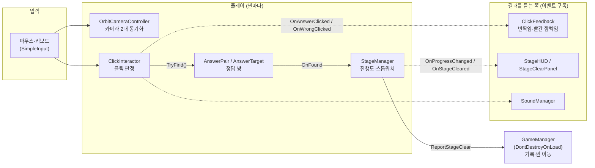
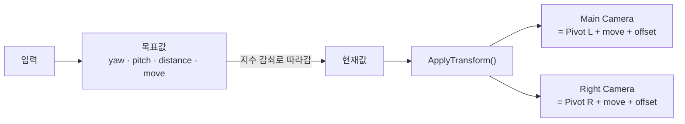
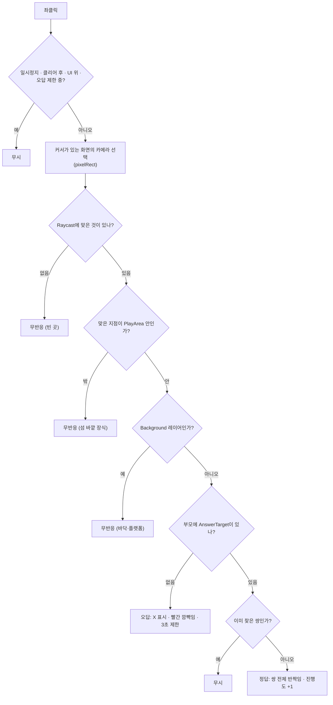

# You're Right 기술 문서

> 두 3D 디오라마를 함께 돌려 보며 **완전히 똑같은 쌍둥이 물체**를 찾는 관찰형 퍼즐 게임
> Unity 6 · URP · C# · 개인 프로젝트

---

## 1. 개요

### 1.1 무엇을 만들었나 (What)

**You're Right**는 '틀린 그림 찾기'를 거꾸로 뒤집은 3D 퍼즐 게임입니다.
화면을 둘로 나눠 서로 다른 두 디오라마를 보여 주고, 플레이어는 카메라를 돌리고 움직이며
**양쪽에 똑같이 놓인 물체(정답 쌍)**를 찾습니다. 스테이지마다 3~5쌍을 모두 찾으면 클리어이고,
스톱워치로 전체 완주 시간을 잽니다.

| 항목 | 내용 |
|---|---|
| 스테이지 | 튜토리얼 1개 + 본 스테이지 5개, 정답 쌍은 모두 26개 |
| 화면 방식 | 월드 1 좌우 분할 · 월드 2 위아래 분할 · 월드 3 물체 하나를 화면 정중앙에서 반반으로 |
| 맵 | 스포츠 공(튜토리얼) · 체스판 · 사막↔설원 · 자동차 전시장 · 기차역 · 공중 SF 섬 도시 |

### 1.2 왜 이 부분이 어려웠나 (Why)

2D 틀린 그림 찾기는 두 그림이 늘 같은 각도로 놓여 있습니다. 3D로 옮기면 이 전제가 깨집니다.

1. **시점 문제**: 두 디오라마를 서로 다른 각도에서 보면 같은 물체도 다르게 보이고, 다른 물체도 같아 보입니다.
   두 화면은 **한 프레임도 어긋나지 않고** 같은 시점이어야 합니다.
2. **판정 문제**: 3D 장면에는 바닥·벽·장식처럼 '물체이지만 문제는 아닌 것'이 많습니다.
   바닥을 헛짚을 때마다 오답이 뜨거나, 클릭이 바닥을 뚫고 뒤쪽 물체에 맞으면 플레이어가 억울해집니다.
3. **공정성 문제**: 이 게임에서 가장 치명적인 버그는 **"정답이 아닌데 양쪽이 똑같은 물체"**입니다.
   플레이어는 맞게 눌렀는데 오답 처리되고 3초 동안 클릭이 막힙니다. 미끼 물체는 일부러 "거의 같게" 만들기 때문에,
   두 섬을 눈으로 비교해서는 0.01 단위 위치 차이나 회전 차이까지 확인할 수 없었습니다.

### 1.3 이 문서에서 다루는 것

이 세 문제를 푼 세 기능을 차례로 설명합니다.

| 문제 | 기능 | 섹션 |
|---|---|---|
| 시점 | 분할 화면 동기화 카메라 (`OrbitCameraController`, `HalfScreenProjection`) | 3 |
| 판정 | 클릭 판정 파이프라인 (`ClickInteractor`, `PlayArea`) | 4 |
| 공정성 | 스테이지 검사 도구 (`StageValidator`) | 5 |

### 1.4 개발 환경

- **Engine**: Unity 6000.3.15f1, URP 17, 새 Input System
- **Language**: C# (네임스페이스 `YoureRight`)
- **기간**: 2026.10.21 ~ 2026.11.05 (기획서 작성부터 Windows 빌드까지, 약 2주 반, 개인 프로젝트)
- **링크**: GitHub https://github.com/KooHoo-Dev/3rd_3D_1-3D-Project-wjsdudgh99

### 1.5 레퍼런스와 핵심 루프

- **레퍼런스**: 분할 화면 '틀린 그림 찾기' 게임. 이 프로젝트는 ① 차이가 아니라 **같은 것**을 찾고,
  ② 그림이 아니라 **직접 돌려 보는 3D 디오라마**이며, ③ 월드마다 **화면을 나누는 방식**이 바뀐다는 점이 다릅니다.
- **핵심 루프**: 둘러보기(회전·이동·줌) → 의심 가는 물체 비교 → 클릭 → 정답이면 황금빛 반짝임 / 오답이면 3초 클릭 제한 → 모두 찾으면 클리어 창 → 다음 스테이지

| 조작 | 결과 |
|---|---|
| 우클릭 드래그 | 두 카메라를 같은 각도로 회전 |
| WASD / Q·E | 바라보는 방향 기준 이동 / 아래·위 이동 (섬 범위 안) |
| 휠 | 두 화면을 함께 확대·축소 |
| Space | 이동 잠금 (회전·줌만 남김) |
| 좌클릭 | 커서가 있는 쪽 화면에서 물체 판정 |
| Esc | 일시정지 |

---

## 2. 시스템 구조

### 2.1 전체 구성



실선은 직접 호출, 점선은 이벤트입니다. **판정하는 쪽(`ClickInteractor`, `StageManager`)은 결과를 누가 쓰는지 모릅니다.**
반짝임, HUD, 효과음은 각자 이벤트를 구독할 뿐이라, 오답 빨간 깜빡임(11/03)이나 진행도 점 UI(11/02)를
나중에 넣을 때도 판정 코드는 한 줄도 고치지 않았습니다.

### 2.2 핵심 클래스 역할

| 클래스 | 책임 | 하지 않는 일 |
|---|---|---|
| `OrbitCameraController` | 카메라 N대를 각자의 Pivot 기준으로 **같은 각도·거리**로 공전 | 클릭 판정 |
| `HalfScreenProjection` | 월드 3에서 화면 전체 기준 투영을 만들고 자기 반쪽만 남김 | 카메라 이동 |
| `ClickInteractor` | 커서가 있는 화면의 카메라로 Raycast, 정답·오답·무반응 판정, 오답 후 3초 제한 | 연출·소리 |
| `PlayArea` | 섬마다 두는 보이지 않는 구역 상자. 점이 안에 있는지만 계산 | 물리 충돌 |
| `AnswerPair` | 쌍둥이 2개를 묶어 한쪽만 눌러도 쌍 전체를 정답 처리, 중복 처리 방지 | 진행도 계산 |
| `StageManager` | 정답 쌍을 자동으로 모아 진행도·클리어 이벤트, 스톱워치 | 씬 이동 |
| `GameManager` | 스테이지 기록을 모으고 다음 씬·결과 화면으로 이동 | 스테이지 내부 로직 |
| `StageValidator` (에디터) | 열린 씬을 **읽기만** 해서 쌍둥이 동일성·실수 검사 | 씬 수정 |

### 2.3 장면 구성 규칙

모든 스테이지 씬은 같은 뼈대를 씁니다. 두 섬은 x -100 / x +100에 멀리 떨어뜨리고,
카메라 Far Clip을 짧게 두어 반대편 섬이 보이지 않게 합니다.

```
Cameras   Main Camera(왼쪽 섬), Right Camera(오른쪽 섬)
Stage     섬 바닥(Background 레이어), CameraPivot Left/Right, PlayArea Left/Right
Props     Left / Right 소품, AnswerPair_01 ~ 05
UI        Canvas(HUD, 클리어 창, 일시정지, 오답 표시)
Managers  StageManager, ClickInteractor, ClickFeedback, SoundManager
```

이 규칙 덕분에 검사 도구가 "Pivot = 섬 중심", "Props = 비교 대상", "Stage = 바닥"이라고 가정하고
모든 스테이지를 같은 코드로 검사할 수 있습니다.

---

## 3. 기능 1: 분할 화면 동기화 카메라

### 3.1 구조

카메라마다 컨트롤러를 붙이지 않고, **컨트롤러 하나가 `(카메라, Pivot)` 쌍 목록을 들고** 같은 값을 모두에게 적용합니다.



- 입력은 **목표값**에 쌓고, 실제 카메라는 `1 - exp(-sharpness × dt)` 비율로 목표값을 따라갑니다. 프레임 속도가 달라도 같은 느낌으로 움직입니다.
- WASD 이동은 Pivot을 옮기지 않고 **모든 Pivot에 같은 이동량(`move`)을 더합니다.** Pivot은 검사 도구가 섬 중심으로 쓰기 때문에 움직이면 안 됩니다.

### 3.2 사용법

씬에서 `Views`에 카메라·Pivot 쌍을 연결하면 끝입니다. **0번 카메라를 씬에 놓아 둔 자리**가 시작 시점이 되도록
`Awake`에서 각도와 거리를 거꾸로 계산하므로, 스테이지마다 시작 화면은 카메라를 끌어다 놓는 것만으로 정합니다.
스테이지마다 다른 설정(이동 끄기, Pitch 범위, 카메라를 막는 레이어)은 Inspector 값으로 바꿉니다.

### 3.3 핵심 동작: 두 화면이 어긋나지 않는 충돌 처리

2-2 기차역에서 카메라가 열차 안으로 들어가 속이 보이는 문제가 있었습니다. 카메라 충돌을 넣되,
**한쪽 화면만 당겨지면 두 시점이 달라져** 비교가 불공정해집니다. 그래서 두 Pivot에서 각각 검사하고
**더 짧은 거리를 두 카메라가 같이 씁니다.**

```csharp
private void ApplyTransform()
{
    Quaternion rotation = Quaternion.Euler(pitch, yaw, 0f);
    Vector3 back = rotation * Vector3.back;

    // (Why) 두 화면 중 더 많이 막힌 쪽 거리를 같이 써서 시점을 맞춘다.
    //       휠로 정한 distance는 건드리지 않으므로, 막힌 곳을 벗어나면 원래 거리로 돌아간다.
    float shownDistance = GetUnblockedDistance(back, distance);
    Vector3 offset = back * shownDistance;

    foreach (OrbitView view in views)
    {
        view.camera.position = view.pivot.position + move + offset;
        view.camera.rotation = rotation;
    }
}

private float GetUnblockedDistance(Vector3 back, float wanted)
{
    if (blockLayers.value == 0) return wanted;   // 충돌을 쓰지 않는 스테이지

    float shortest = wanted;
    foreach (OrbitView view in views)
    {
        Vector3 origin = view.pivot.position + move;
        // (Why) 점(Raycast)이 아니라 공(SphereCast): 카메라 화면 모서리까지 벽 밖에 두기 위해
        if (Physics.SphereCast(origin, collisionRadius, back, out RaycastHit hit,
                               wanted, blockLayers, QueryTriggerInteraction.Ignore))
            shortest = Mathf.Min(shortest, hit.distance);
    }
    return shortest;
}
```

막혔을 때 **부드럽게 따라가지 않고 바로 당기는** 것도 의도입니다. 부드럽게 따라가면 그 몇 프레임 동안 열차 속이 보였습니다.

### 3.4 핵심 동작: 월드 3 반반 투영

월드 3은 물체 하나가 화면 정중앙의 분할선에서 **왼쪽 반은 버전 A, 오른쪽 반은 버전 B**로 이어져 보여야 합니다.
Viewport만 반으로 나누면 물체가 각 반쪽의 가운데에 그려져 월드 1과 똑같아집니다.
그래서 **화면 전체 크기의 시야를 계산한 뒤 자기 반쪽만 잘라 쓰는** off-center 투영을 직접 만듭니다.

```csharp
private void LateUpdate()
{
    Rect pixels = cam.pixelRect;               // 반쪽 화면 (예: 960 × 1080)
    float near = cam.nearClipPlane;
    float top = near * Mathf.Tan(cam.fieldOfView * 0.5f * Mathf.Deg2Rad);

    // (Why) 가로 폭을 반쪽 2개 기준으로 잡아야 화면 전체의 시야가 된다
    float halfWidth = top * (pixels.width * 2f / pixels.height);
    float left  = side == ScreenSide.Left ? -halfWidth : 0f;
    float right = side == ScreenSide.Left ? 0f : halfWidth;

    // 왼쪽 카메라는 시야의 왼쪽 절반만, 오른쪽 카메라는 오른쪽 절반만 그린다
    cam.projectionMatrix = Matrix4x4.Frustum(left, right, -top, top, near, cam.farClipPlane);
}
```

매 프레임 다시 계산해서 창 크기나 FOV가 바뀌어도 맞고, `[ExecuteAlways]`라 에디터에서도 결과를 보며 배치할 수 있습니다.

### 3.5 고민과 선택

**결정 ①: 카메라 두 대를 어떻게 맞출 것인가?**

| | 대안 A: 카메라마다 컨트롤러 + 서로 값 복사 | 대안 B: Cinemachine 카메라 2대 | **대안 C: 컨트롤러 하나가 모든 카메라에 같은 값 적용** |
|---|---|---|---|
| 장점 | 카메라별로 따로 다루기 쉬움 | 충돌·감쇠 기능이 이미 있음 | 같은 값을 쓰므로 **구조적으로 어긋날 수 없음** |
| 단점 | 실행 순서에 따라 한 프레임 어긋날 수 있음 | 두 카메라가 각자 감쇠·충돌을 계산해 시점이 달라질 수 있음 | 충돌·감쇠를 직접 구현해야 함 |

**C를 선택했습니다.** 이 게임에서 두 화면의 시점이 다른 것은 단순한 어색함이 아니라 **게임 규칙이 깨지는 버그**입니다.
Cinemachine 패키지는 프로젝트에 있었지만, 두 카메라가 같은 값을 쓴다는 보장을 얻으려고
충돌·감쇠 구현 비용을 감수했습니다. 그 결과 위 3.3의 "짧은 거리를 같이 쓰기"처럼 **두 화면을 함께 고려하는 규칙**을 넣을 수 있었습니다.

**결정 ②: 카메라가 열차 안으로 들어가는 문제**

- 대안 A: Pivot을 열차 위로 올림 → 간단하지만, 열차 대차(바퀴)처럼 **낮은 곳에 둔 문제를 보기 어려워짐**
- 대안 B: 막는 레이어(`CameraBlock`)를 만들고 충돌 처리 → 구현이 필요하지만 시점 제약이 없음

**B를 선택했습니다.** `CameraBlock` 레이어는 클릭 대상(Clickable Layers)에서 빼서, 카메라는 막되 클릭은 통과하게 했습니다.

---

## 4. 기능 2: 클릭 판정 파이프라인

### 4.1 구조: 클릭 하나가 거치는 순서



판정 결과는 **정답 / 오답 / 무반응** 세 가지입니다. 무반응을 따로 둔 것이 이 기능의 핵심입니다.

### 4.2 핵심 동작

```csharp
private void HandleHit(RaycastHit hit, Vector2 screenPos)
{
    // 1) 섬 바깥(어느 PlayArea에도 없는 지점)이면 빈 곳처럼 무시
    if (IsInsidePlayArea(hit.point) == false) return;

    // 2) 무반응 레이어(바닥·플랫폼·길): 클릭을 '막아 주기만' 하고 반응하지 않음
    if ((silentLayers.value & (1 << hit.collider.gameObject.layer)) != 0) return;

    // 3) 부품마다 Collider가 있는 물체도 있으므로 부모 쪽에서 정답 표시를 찾는다
    AnswerTarget target = hit.collider.GetComponentInParent<AnswerTarget>();
    if (target == null || target.Pair == null)
    {
        HandleWrong(screenPos, hit.collider);   // 오답 + 3초 클릭 제한
        return;
    }

    // 4) 이미 찾은 쌍을 다시 누르면 정답도 오답도 아님
    if (target.Pair.TryFind() == false) return;

    OnAnswerClicked?.Invoke(target);
}
```

- **분할 방식과 무관**: 카메라는 `cam.pixelRect.Contains(커서)`로 고릅니다. 좌우 분할(월드 1·3)과 위아래 분할(월드 2)을 같은 코드로 처리합니다.
- **3초 제한은 `Time.deltaTime`으로 줄입니다.** `unscaledDeltaTime`을 쓰면 일시정지해 둔 채로 제한 시간을 흘려보내는 꼼수가 생깁니다.
- `GetComponentInParent`를 쓰기 때문에 자판기 버튼 하나처럼 **부품 하나**를 정답으로 둘 수도 있고, 차 한 대처럼 **물체 전체**를 정답으로 둘 수도 있습니다.

### 4.3 고민과 선택

**결정: 바닥·플랫폼을 클릭했을 때 오답이 뜨지 않게 하려면?**

| | 대안 A: 바닥을 Raycast 대상에서 뺌 (Clickable Layers에서 제외) | **대안 B: 바닥은 Raycast에 맞되, 맞으면 무반응 (`Background` 레이어)** |
|---|---|---|
| 장점 | 설정 하나로 끝, 코드 변경 없음 | 클릭이 바닥에서 멈춤 |
| 단점 | **클릭이 바닥을 뚫고 지나가** 바닥 아래·뒤쪽 물체에 맞음 | 판정 단계가 하나 늘어남, 바닥 에셋마다 레이어 지정 필요 |

**B를 선택했습니다.** 이 게임은 디오라마를 아래에서 올려다보는 문제도 둘 수 있습니다.
A로 하면 위에서 바닥을 눌렀는데 **바닥 밑의 물체가 오답으로 잡히는** 일이 생깁니다.
플레이어 입장에서는 "아무것도 안 눌렀는데 벌점을 받은" 상황이라 가장 억울한 경우입니다.
레이어 지정 수고는 검사 도구가 "Stage 아래 Collider가 Background가 아님"을 경고하게 해서 줄였습니다(5장).

**PlayArea를 물리 Collider가 아닌 계산 상자로 만든 이유**: Trigger Collider로 만들면 Raycast 설정(`QueryTriggerInteraction`)과
얽히고 다른 물리 검사에 끼어듭니다. 클릭 지점이 상자 안인지만 알면 되므로 Transform 기준의 점-상자 계산으로 충분했습니다.
같은 상자를 카메라 이동 범위로도 다시 씁니다.

---

## 5. 기능 3: 스테이지 검사 도구 (StageValidator)

### 5.1 왜 만들었나

1.2의 공정성 문제는 **사람이 눈으로 막을 수 없었습니다.** 실제로 처음 검사를 돌렸을 때 이런 것들이 나왔습니다.

- 1-1 체스판: 정답으로 둔 흰 룩이 양쪽에서 회전이 달랐는데, 룩 모델이 회전 대칭이 아니라 **실제로는 달라 보였음**
- 2-1 자동차 전시장: 정답이 아닌데 양쪽이 똑같은 물체(**의도하지 않은 쌍둥이**) 7개
- 2-2 기차역: 정답 물체의 Collider가 비어 있거나(Mesh 없는 MeshCollider) 예전 구조의 복사본이 섞여 오류 12개

그래서 **Tools → You're Right → Validate Stage** 한 번으로 열린 씬을 검사하는 에디터 도구를 만들었습니다.
씬을 고치지 않고 읽기만 하며, 결과를 ❌ 오류 / ⚠ 경고 / ℹ 참고로 Console에 남기고 로그를 누르면 해당 물체가 선택됩니다.

### 5.2 검사 항목

| 분류 | 검사 내용 |
|---|---|
| 쌍둥이 동일성 | 섬 중심 기준 위치(오차 0.01), 크기(1%), 메시·머티리얼·자식 구성, 회전(1°, 다르면 **회전 대칭 판정**) |
| 의도하지 않은 쌍둥이 | 정답이 아닌데 양쪽이 똑같아 보이는 물체 → **오류** |
| 함정 후보 | 같은 물체가 0.5 안에서 조금만 다름 → 참고 (의도한 함정인지 확인용) |
| 클릭 가능 여부 | 정답 Collider 없음·꺼짐·Trigger·빈 MeshCollider, Background 레이어, PlayArea 밖 |
| 연결 | 정답 쌍 개수(3~5), 쌍이 같은 섬에 있음, 어느 쌍에도 없는 AnswerTarget |
| 양쪽 환경 | 두 카메라 설정, 섬마다 둔 Point·Spot 조명이 같은 자리·같은 값인지 |
| 빌드 대비 | 정답 머티리얼 Emission 꺼짐 (빌드에서 반짝임 셰이더 변형이 빠질 수 있음) |

비교 기준은 **월드 좌표가 아니라 각 섬의 Pivot 기준 상대 위치**이고, 회전은 월드 회전입니다.
그래서 1-1처럼 오른쪽 소품 그룹 전체를 180° 돌려 둔 섬도 화면에 보이는 그대로 비교합니다.

### 5.3 핵심 동작: "돌려 놓아도 똑같아 보이는가?"

가장 어려운 판정은 **회전만 다른 쌍둥이**입니다. 폰(체스 말)은 어느 방향으로 돌려도 똑같이 보이지만,
8번 당구공은 180° 돌리면 반대편 숫자가 보여서 달라 보입니다. 회전 값만 비교하면 폰도 오류가 되고,
무시하면 당구공을 놓칩니다.

**방법**: 물체 기준점에서 구 위에 고르게 퍼진 **4096개 방향(피보나치 구, 간격 약 3.5°)**으로 광선을 쏴서,
각 방향의 **가장 바깥 면까지의 거리**와 **그 자리의 텍스처 색**을 구합니다. 두 물체의 회전 차이를 Δ라 하면,
모든 방향 d에서 `결과(d)`와 `결과(Δ·d)`가 같을 때만 "똑같아 보인다"고 판단합니다.

```csharp
private static bool IsRotationallySymmetric(Transform a, Transform b, out string note)
{
    note = "";
    List<Triangle> triangles = GetLocalTriangles(a, out float size);  // 루트 기준 삼각형 + 서브메시별 텍스처
    if (triangles == null)
    {
        note = " (메시를 읽지 못해 대칭 여부를 판단할 수 없음)";
        return false;                                  // (Why) 모르면 '같다'가 아니라 '오류'로 알린다
    }

    float distanceTolerance = Mathf.Max(size * SymmetryTolerance, 0.0001f);  // 크기의 1%
    Quaternion delta = Quaternion.Inverse(a.rotation) * b.rotation;          // 두 물체의 회전 차이

    foreach (Vector3 direction in GetRayDirections())  // 피보나치 구 4096방향
    {
        RaySample first  = CastRay(triangles, direction);          // a를 d 방향에서 본 모습
        RaySample second = CastRay(triangles, delta * direction);  // b가 같은 방향에 보여 주는 모습

        if (first.Hit != second.Hit) return false;
        if (first.Hit == false) continue;
        if (Mathf.Abs(first.Distance - second.Distance) > distanceTolerance) return false;  // 모양
        if (SameColor(first.Color, second.Color) == false) return false;                   // 무늬·숫자
    }
    return true;
}
```

`CastRay`는 Möller–Trumbore 광선-삼각형 교차로 **가장 먼 면**(바깥에서 보이는 면)을 찾고,
그 지점의 UV를 보간해 머티리얼 Tiling·Offset을 반영한 텍스처 색을 읽습니다.
Read/Write가 꺼진 FBX 메시는 `Mesh.AcquireReadOnlyMeshData`로, 읽을 수 없는 텍스처는 `Graphics.Blit` 임시 복사본으로 읽고 검사 끝에 지웁니다.

### 5.4 고민과 선택: 대칭을 무엇으로 비교할 것인가

이 판정은 한 번에 정해지지 않았습니다. 합격 기준은 두 실제 사례를 **동시에** 맞히는 것이었습니다.

- **1-1 폰**: 진짜 회전 대칭 → 회전이 달라도 **통과**해야 함
- **튜토리얼 8번 당구공 (180°)**: 반대편 숫자가 보여 숫자 크기가 다름 → **오류**여야 함

| 방법 | 비교하는 것 | 결과 |
|---|---|---|
| 꼭짓점 위치 | 메시 꼭짓점들을 Δ만큼 돌렸을 때 같은 자리에 꼭짓점이 있는가 | 두 사례를 동시에 맞히지 못함 |
| 꼭짓점 UV · 꼭짓점 색 | 위 비교에 꼭짓점의 UV나 색을 더함 | 〃 |
| 면 안쪽 격자 점 | 삼각형 안에 점을 뿌려 위치·색을 비교 | 〃 |
| **방향별 광선** | **같은 방향에서 보이는 바깥 면의 거리와 텍스처 색** | **폰 통과, 당구공 오류. 둘 다 맞힘** |

**최종 선택: 방향별 광선.** 버린 세 방법은 모두 **꼭짓점이나 삼각형을 기준으로 점을 고르기 때문에**,
모델러가 메시를 어떻게 나눴는지(삼각형 배치, UV 이음매)가 결과에 섞입니다. 플레이어가 보는 것은 메시 구조가 아니라 **겉모습**입니다.
광선 방식은 "같은 방향에서 같은 거리·같은 색이 보이는가"만 묻기 때문에 삼각형을 어떻게 나눴는지와 상관이 없습니다.

**대가(Trade-off)**: 가속 구조 없이 `4096방향 × 삼각형 수`를 전부 계산하므로, 삼각형이 1만 개 넘는 물체는 몇 초 걸립니다.
이 도구는 **에디터에서 배치를 마친 뒤 손으로 한 번 돌리는** 용도라 몇 초는 문제가 되지 않는다고 판단했고,
그 대신 구현을 단순하게 유지해 판정 규칙을 고치기 쉽게 했습니다. 저장할 때마다 자동으로 돌리는 옵션은 같은 이유로 넣지 않았습니다.

---

## 6. 결과 및 배운 점

### 6.1 결과

| 목표 (1.2) | 결과 |
|---|---|
| 두 화면이 같은 시점 | 컨트롤러 하나가 모든 카메라에 같은 값 적용. 충돌로 당겨질 때도 짧은 거리를 함께 써서 시점 유지 |
| 억울한 판정 없애기 | 정답 / 오답 / 무반응 3단계 판정. 바닥·섬 바깥·빈 곳 클릭은 벌점 없음 |
| 공정성 | 6개 씬, 정답 26쌍 모두 **Validate Stage 오류 0** 확인 (1-1 룩, 2-1 의도하지 않은 쌍둥이 7개, 2-2 Collider 오류 12개를 출시 전에 찾아 고침) |

- **완성도**: 메뉴 → 튜토리얼 → Stage 1~5 → 결과 화면까지 Windows 빌드(약 280MB)로 전체 흐름을 확인했습니다.
- **확장성**: 2.1의 이벤트 구조 덕분에 오답 빨간 깜빡임, 진행도 점 UI, 효과음을 판정 코드 수정 없이 붙였습니다.
- **제작 속도**: 정답 쌍 등록(`AnswerPairCreator`), 기차역·전시장 소품 조립, 차량 Collider 정리, UI 테마·글꼴 적용, 빌드 등 **반복 작업을 메뉴 도구 16개로 만들어**, 2026.10.24~11.01 사이에 디오라마 6개를 만들었습니다.

### 6.2 문제 해결 경험 (Troubleshooting)

**① 위아래 분할에서만 카메라가 열차 속을 비춤**
- **(문제)** 충돌 반지름 0.3으로 카메라가 열차 상자 밖에 있는데도, 2-2(위아래 분할)에서만 화면 가장자리에 열차 속이 보였습니다.
- **(원인)** 카메라는 점이 아니라 **Near Clip 면(사각형)**을 가집니다. 위아래 분할은 화면 하나가 1920 × 540이라 가로로 매우 넓어서,
  Near Clip 0.3 · FOV 32°에서 이 사각형 모서리가 카메라 중심에서 **약 0.44** 떨어집니다. 반지름 0.3인 공이 상자 밖이어도 모서리는 상자 안이었습니다.
- **(해결)** 2-2의 `Collision Radius`를 **0.4**로 올리고, 기준(가로가 넓은 화면은 0.4 이상)을 문서에 남겼습니다.

**② 에디터 도구를 다시 실행하자 씬의 Collider 24개가 사라짐**
- **(문제)** 기차역 키트 도구(Build Station Kit)를 수정해 다시 실행했더니, 씬에서 스크린도어 24개의 부품에 직접 붙여 둔 MeshCollider가 모두 사라졌습니다.
- **(원인)** `PrefabUtility.SaveAsPrefabAsset`으로 프리팹을 **새로 덮어쓰면** 자식 오브젝트의 내부 ID(fileID)가 일부 바뀝니다.
  씬에 저장된 수정 사항은 이 ID로 대상을 가리키므로, 가리킬 대상을 잃고 사라졌습니다.
- **(해결)** 덮어쓰지 않고 **기존 프리팹을 열어 이름 경로가 같은 오브젝트는 그대로 두고 값만 맞추는** `PrefabSaveUtility.SaveKeepingIds`를 만들었습니다.
  없는 것만 만들고 남는 것만 지우므로 ID가 유지됩니다. 이후 모든 조립 도구가 이 함수로 저장하도록 규칙을 정했습니다.

**③ 정답 반짝임이 빌드에서만 약해질 위험**
- **(문제)** 정답 반짝임은 머티리얼 Emission을 코드로 올리는 방식인데, 코드로 Emission을 켜 둔 머티리얼이 저장 후 다시 꺼져 있었습니다.
- **(원인)** `globalIlluminationFlags`를 `EmissiveIsBlack`으로 두면 URP가 저장할 때 `_EMISSION` 키워드를 꺼 버립니다.
  키워드가 꺼진 머티리얼만 있으면 빌드에서 그 셰이더 변형이 빠져, 실행 중에 Emission을 올려도 빛나지 않을 수 있습니다.
- **(해결)** 정답 머티리얼은 **Emission을 켜고 색을 검정**(`RealtimeEmissive`)으로 두는 규칙을 만들고, 검사 도구가 Emission이 꺼진 정답 머티리얼을 경고하게 했습니다.

**④ 기록에 로딩 시간이 섞임**
- **(문제)** 스테이지에 들어오자마자 스톱워치가 0이 아닌 값에서 출발했습니다.
- **(원인)** 씬 로딩 직후 첫 프레임의 `deltaTime`에 로딩 시간이 들어 있었습니다.
  "시작한 프레임 번호와 같으면 건너뛰기"로 막으려 했지만, 에디터 첫 Play에서는 `Start`와 첫 `Update`가 다른 프레임이라 막지 못했습니다.
- **(해결)** 프레임 번호 대신 **타이머를 켠 뒤 첫 번째 `Update` 호출**을 건너뛰는 플래그(`skipNextTick`)로 바꿨습니다.

### 6.3 아쉬운 점(기술 부채)과 향후 계획

| As-Is (지금) | To-Be (개선 계획) |
|---|---|
| 씬 흐름 테스트를 사람이 직접 Play해서 확인 | 게임 코드에 asmdef를 추가하고 Play Mode 테스트로 "메뉴 → 6스테이지 → 결과 기록 5개·Total 합계"를 자동 검증 |
| 검사 도구는 **프리팹 루트 단위**로 비교해서, 열차 대차처럼 큰 물체 안의 **자식 부품끼리** 생긴 의도하지 않은 쌍둥이는 놓침 (지금은 눈으로 확인) | 부품 단위 비교 옵션 추가 (Collider가 있는 자식을 별도 단위로) |
| 대칭 판정이 `방향 × 삼각형` 전수 계산이라 큰 메시는 몇 초 | 임시 MeshCollider + `Physics.Raycast`나 BVH로 교차 계산을 가속 |
| 한글 Fallback 글꼴 아틀라스(16.9MB)가 빌드에서 가장 큰 에셋 | 실제 쓰는 글자만 담은 Static 아틀라스로 줄이기 |
| 일정이 모자라 월드 3의 두 번째 맵(3-2)을 취소 | 반반 투영 코드는 재사용 가능하므로 맵만 추가하면 됨 |

### 6.4 배운 점

- **공정성은 코드가 지켜야 한다.** 관찰 퍼즐에서 "정답인데 오답"은 한 번만 나와도 게임 전체를 못 믿게 만듭니다.
  사람의 눈으로 보장할 수 없는 규칙은 검사 도구로 만들고, 그 도구가 통과해야 스테이지 완성으로 쳤습니다.
- **"어떻게 만들어졌나"보다 "어떻게 보이나"를 비교하라.** 대칭 판정을 네 번 갈아엎은 끝에, 플레이어 기준(겉모습)으로 질문을 바꾸자 한 번에 풀렸습니다.
- **반복 작업은 두 번째에 도구로 만든다.** 정답 쌍 등록, 소품 조립, Collider 정리를 도구로 만들어 두니,
  같은 실수를 다시 하지 않게 되고 맵 하나를 만드는 시간이 줄었습니다.
