<!--
✍ 작성자 확인 목록 (이 주석은 화면에 보이지 않습니다. 다 확인하면 지워도 됩니다)

이 문서는 Claude가 코드·씬·기획서에서 확인한 사실로 쓴 초안을 바탕으로,
단계마다 본인 확인을 거쳐 고쳐 가는 중입니다(진행 기록: src/_draft/기술문서-수정-진행.md).

2026-11-24 선생님 피드백에 따라 목차를 「개요 → 기획 → AI 활용 → 문제 해결 → 결과」로 다시 짰습니다(Claude 초안).
- 기술 내용(장면 구성 규칙 · 카메라 사용법 · 충돌 처리 · 반반 투영 · 검사 도구)과 코드는 원래 문서 그대로 3장으로 옮겼습니다.
- 개발 환경은 개요 맨 위로, 기능마다 그림을 제목 바로 아래로 올렸습니다.

1. 전체를 읽고 확인 — 특히 Claude가 새로 쓴 이어 주는 문장(1.2 둘째 단락, 2.2 · 3.1 · 4장 첫 단락, 기능마다 그림 아래 첫 단락)
2. 📷 사진 자리 5곳 — 본문에 <!- - 📷 사진 자리 - -> 주석으로 표시해 두었습니다. 사진을 images/에 넣고 주석을 풀면 됩니다.
   ✅ ① 3.2 Hierarchy 창(Stage 2-2) 넣음 ✅ ② 3.3 OrbitCameraController 인스펙터(Stage 2-2, Collision Radius 0.4) 넣음 ✅ ③ 3.3 기차역 카메라 충돌 GIF 넣음(설명 문장은 Claude 추천 중 본인이 고름, 2026-11-24) ✅ ④ 3.3 월드 3 반반 화면(Stage 5) 넣음 ✅ ⑤ 3.5 Validate Stage 결과 넣음 — 처음 검사(10-30의 2-1 씬을 커밋 518d131에서 임시로 꺼내 다시 검사, 2026-11-24) · 로그 눌러 물체 선택 · 고친 뒤(Stage 5 = 씬 3-1)
3. 🖼 3.5 회전 대칭 설명 그림(images/rotation_symmetry.svg) — Claude가 그렸고 본인 확인 뒤 넣음(2026-11-24). 그 아래 설명 문장은 Claude가 씀
   3.2 씬 사진 3장(Template · Stage 1 · Stage 5)과 Hierarchy를 넣었고, 사진 아래 설명 문장은 Claude가 씀. 글상자는 Stage 2-2 Hierarchy에 맞춰 Lights · EventSystem · Stage Left/Right(섬 바닥, 본인 확인) · Right Answer를 더함
4. 3.5 "실제로 처음 검사를 돌렸을 때" — 검사 도구를 직접 돌려서 찾았다면 4장으로 옮길 수 있습니다
5. 2.1 조작 방법 그림(controls.png)의 설명 문장
6. 전자레인지 과제 문장은 미니골프처럼 뺐습니다 — 남기고 싶으면 알려 주세요
7. 발표 후 피드백(VR 9기 3D 프로젝트 설문 응답 PDF, 2026-11-24 반영) — 5.1 평가 한 줄, 5.2 표(계획 1·2줄은 본인 생각, "함정 후보 목록 기준"과 3·4줄 계획은 Claude 제안을 본인이 받아들임), 5.3 첫 항목(교훈 문장은 Claude가 정리, 본인 확인). 응답자 이름은 넣지 않음
-->

# You're Right 기술 문서

> 두 3D 디오라마를 함께 돌려 보며 **완전히 똑같은 쌍둥이 물체**를 찾는 관찰형 퍼즐 게임
> Unity 6 · URP · C# · 개인 프로젝트

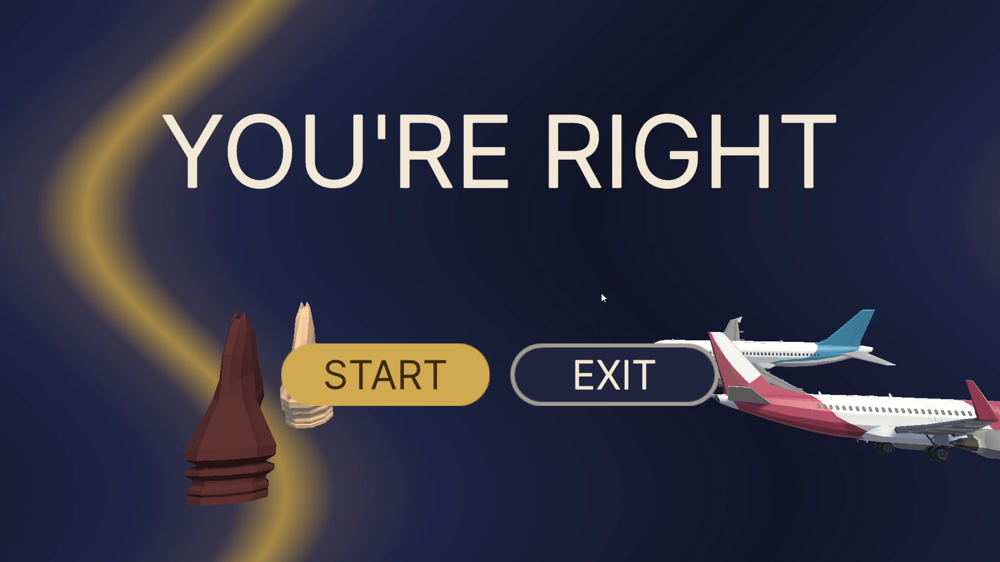

---

## 1. 개요

### 1.1 개발 환경

| 항목 | 내용 |
|---|---|
| 엔진 | Unity 6000.3.15f1, URP 17, 새 Input System |
| 언어 | C# (네임스페이스 `YoureRight`) — 코드와 에디터 도구는 대부분 AI로 생성(3장) |
| 기간 | 2026.10.21 ~ 2026.11.05 (기획서 작성부터 Windows 빌드까지, 약 2주 반) |
| 인원 | 개인 프로젝트 |
| GitHub | https://github.com/KooHoo-Dev/3rd_3D_1-3D-Project-wjsdudgh99 |
| 시연 영상 | https://youtu.be/ekMrtZYxHfs |
| 쇼츠 | https://youtube.com/shorts/WIkPCM9Zzm0 |
| 3D 에셋 · 효과음 | Unity 에셋 스토어 무료 에셋 · Pixabay |
| 음악 | Sakura Girl의 Lemonade · Jazzy Night · City Walk (https://soundcloud.com/sakuragirl_official, CC BY 3.0, chosic.com) |
| 글꼴 | Pretendard (SIL Open Font License 1.1) |

### 1.2 한 줄 소개

**You're Right**는 '틀린 그림 찾기'를 거꾸로 뒤집은 3D 퍼즐 게임입니다.
화면을 둘로 나눠 서로 다른 두 디오라마를 보여 주고, 플레이어는 카메라를 돌리고 움직이며
**양쪽에 똑같이 놓인 물체(정답 쌍)**를 찾습니다.

그런데 3D로 옮기자 **"똑같다"를 보장하는 것**부터 어려웠습니다. 두 화면이 정말 같은 각도인지,
바닥을 헛짚은 것도 오답인지, 정답이 아닌데 똑같은 물체가 숨어 있지는 않은지.
이 문서는 그 문제를 **기획서로 정하고, AI와 함께 만들고, 직접 플레이하며 찾아낸** 과정입니다.

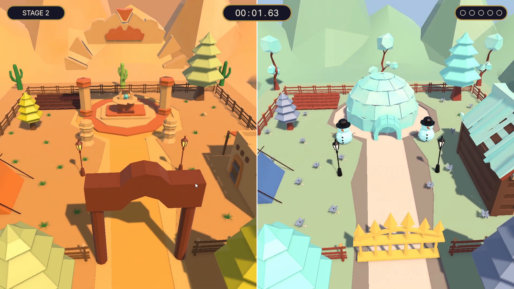

*좌우 분할(월드 1) — 왼쪽은 사막, 오른쪽은 설원 디오라마입니다. 이 둘에서 완전히 똑같은 물체를 찾습니다.*

### 1.3 목표한 경험

기획서에서 정한 목표는 세 가지였습니다.

- 차이가 아니라 **공통점을 찾는 신선함**
- 체력·제한 시간·게임 오버 없이 **느긋하게 디오라마를 감상하는 관찰**
- 스톱워치로 **완주 시간을 줄이는 성취감**

---

## 2. 기획

### 2.1 플레이 소개와 핵심 루프

- **레퍼런스**: 특정 게임이 아니라 분할 화면 '틀린 그림 찾기' 장르를 참고했습니다. 이 프로젝트는 ① 차이가 아니라 **같은 것**을 찾고,
  ② 그림이 아니라 **직접 돌려 보는 3D 디오라마**이며, ③ 월드마다 **화면을 나누는 방식**이 바뀐다는 점이 다릅니다.
- **핵심 루프**: 둘러보기(회전·이동·줌) → 의심 가는 물체 비교 → 클릭 → 정답이면 황금빛 반짝임 / 오답이면 3초 클릭 제한 → 모두 찾으면 클리어 창 → 다음 스테이지

| 항목 | 내용 |
|---|---|
| 스테이지 | 튜토리얼 1개 + 본 스테이지 5개, 정답 쌍은 모두 26개 (스테이지마다 3~5쌍) |
| 화면 방식 | 월드 1 좌우 분할 · 월드 2 위아래 분할 · 월드 3 물체 하나를 화면 정중앙에서 반반으로 |
| 맵 | 스포츠 공(튜토리얼) · 체스판 · 사막↔설원 · 자동차 전시장 · 기차역 · 공중 SF 섬 도시 |
| 기록 | 스톱워치로 스테이지별 시간과 전체 완주 시간을 잼 (튜토리얼은 연습이라 기록에서 뺌) |

| 조작 | 결과 |
|---|---|
| 우클릭 드래그 | 두 카메라를 같은 각도로 회전 |
| WASD / Q·E | 바라보는 방향 기준 이동 / 아래·위 이동 (섬 범위 안) |
| 휠 | 두 화면을 함께 확대·축소 |
| Space | 이동 잠금 (회전·줌만 남김) |
| 좌클릭 | 커서가 있는 쪽 화면에서 물체 판정 |
| Esc | 일시정지 |

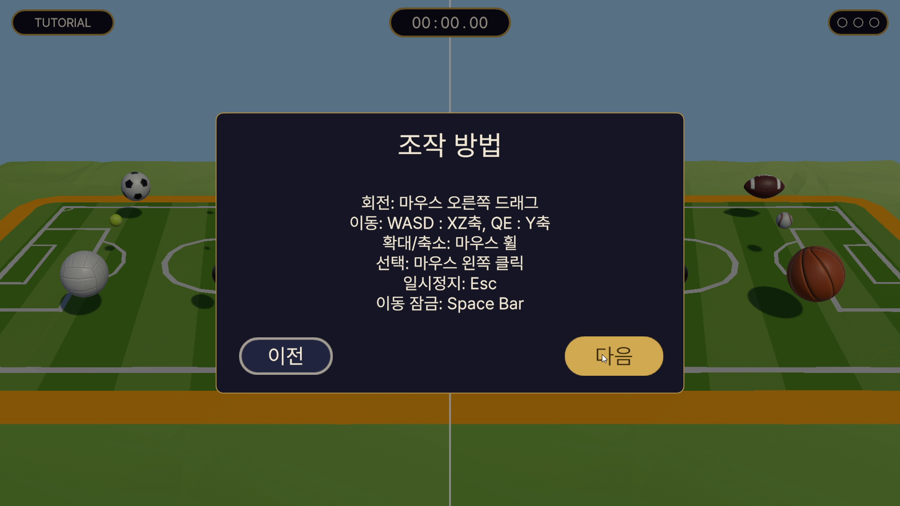

*튜토리얼 시작 안내 패널 — 규칙에 이어 조작 방법을 보여 준 뒤 시작합니다.*

### 2.2 3D로 옮기며 생긴 세 가지 문제

2D 틀린 그림 찾기는 두 그림이 늘 같은 각도로 놓여 있습니다. 3D로 옮기면 이 전제가 깨집니다.
기획서를 쓰고 만드는 내내 이 세 가지가 기준이었습니다.

1. **시점 문제**: 두 디오라마를 서로 다른 각도에서 보면 같은 물체도 다르게 보이고, 다른 물체도 같아 보입니다.
   두 화면은 **한 프레임도 어긋나지 않고** 같은 시점이어야 합니다. → 3.3
2. **판정 문제**: 3D 장면에는 바닥·벽·장식처럼 '물체이지만 문제는 아닌 것'이 많습니다.
   바닥을 헛짚을 때마다 오답이 뜨거나, 클릭이 바닥을 뚫고 뒤쪽 물체에 맞으면 플레이어가 억울해집니다. → 3.4
3. **공정성 문제**: 이 게임에서 가장 치명적인 버그는 **"정답이 아닌데 양쪽이 똑같은 물체"**입니다.
   플레이어는 맞게 눌렀는데 오답 처리되고 3초 동안 클릭이 막힙니다. 미끼 물체는 일부러 "거의 같게" 만들기 때문에,
   두 섬을 눈으로 비교해서는 0.01 단위 위치 차이나 회전 차이까지 확인할 수 없었습니다. → 3.5

### 2.3 기획 변경 이력

만드는 동안 바뀐 결정은 기획서의 「기획 변경 이력」에 날짜·원래 기획·이유와 함께 25건을 남겼습니다.
그중 게임에 영향이 컸던 것입니다.

| 날짜 | 바뀐 내용 | 원래 기획 | 이유 |
|---|---|---|---|
| 10-22 → 10-27 → 11-01 | **스테이지 10개 → 7개 → 6개** | 튜토리얼 + 메인 3개 | 처음에는 월드마다 다른 비교 방식으로 지루함을 줄이려 10개로 늘렸지만, 남은 기간에 디오라마 9개는 빠듯해 줄였습니다. 대신 월드마다 다른 화면 방식은 모두 보여 주기로 했습니다 |
| 10-23 | **플랫폼 위 물체만 클릭에 반응** — 바닥·길·플랫폼 밖은 무반응 | 배경을 클릭 대상에서 제외 | 클릭이 바닥을 뚫고 지나가 아래쪽 물체가 맞는 것을 막고, 바닥을 헛짚을 때마다 X가 뜨는 것도 막음 |
| 10-26 | **오답 후 3초 클릭 제한** — 제한 중 커서가 빨간 원 타이머로 바뀜 | 오답은 타격감만 주고 패널티 없음 | 무작정 여러 곳을 누르는 플레이를 막음 |
| 10-27 | **WASD는 카메라 이동**(섬 범위 안), 회전은 우클릭 드래그만 | WASD·우클릭 드래그 모두 회전 | 사막↔설원처럼 큰 섬에서 보고 싶은 곳으로 다가가 살피기 쉽게 |
| 10-28 | **Q 하강 / E 상승** | WASD 앞뒤좌우만 | 기차역에서 열차 반대편으로 넘어가고, 대차처럼 낮은 곳을 살피기 위해 |

### 2.4 맵과 문제 만들기

디오라마와 문제(정답·미끼)는 직접 만들었습니다.

- **디오라마 맵 꾸미기** — 에셋을 고르고 체스판·사막·설원·기차역 같은 맵을 배치했습니다.
  체스판에는 어두운 배경과 위에서 비추는 조명으로 취조실 같은 긴장감을, 사막↔설원에는 해가 뜨고 지는 조명으로 움직이는 그림자를 넣었습니다.
- **정답·미끼 물체 배치** — 어느 물체를 정답 쌍으로, 어느 것을 미끼로 둘지 정하고 놓았습니다.
  미끼는 일부러 "거의 같게" 만들기 때문에, 이것이 2.2의 공정성 문제로 이어졌습니다.
- **Stage 5는 이동 잠금** — 물체 하나를 화면 정중앙에서 반반으로 보여 주는 월드 3은, **완벽한 반반으로만 보여 주는 것이 이 스테이지의 백미**라고 생각해
  WASD·Q/E 이동을 아예 막았습니다. 회전과 줌만 쓸 수 있습니다(3.3).

---

## 3. AI 활용

### 3.1 AI와 나눈 역할

이 프로젝트는 **AI가 프로젝트 파일을 직접 만들고 고치는 방식**으로 개발했습니다.

| 제가 한 것 | AI가 한 것 |
|---|---|
| 기획서 작성, 바뀐 결정 25건 기록 (2장) | 게임 코드 — 카메라 · 클릭 판정 · 스테이지 진행 |
| 디오라마 꾸미기, 정답·미끼 배치 (2.4) | 에디터 도구 — 맵 조립 도구 · 스테이지 검사 도구 · 메뉴 도구 16개 |
| 플레이 테스트, 이상한 동작 찾기, 조건을 좁혀 알리기 (4장) | 알려 준 문제의 원인 찾기와 고치기 |

아래 세 기능(3.3 ~ 3.5)은 2.2의 세 문제에 하나씩 대응합니다. 기능마다 **어떻게 동작하는지**와 함께,
**「고민과 선택」에서 누가 무엇을 정했는지**를 적었습니다.

### 3.2 장면 구성 규칙

모든 스테이지 씬은 같은 뼈대를 씁니다. 두 섬은 x -100 / x +100에 멀리 떨어뜨리고,
카메라 Far Clip을 짧게 두어 반대편 섬이 보이지 않게 합니다.

| Stage Template | Stage 1 (체스판) | Stage 5 (공중 SF 섬 도시) |
|---|---|---|
| 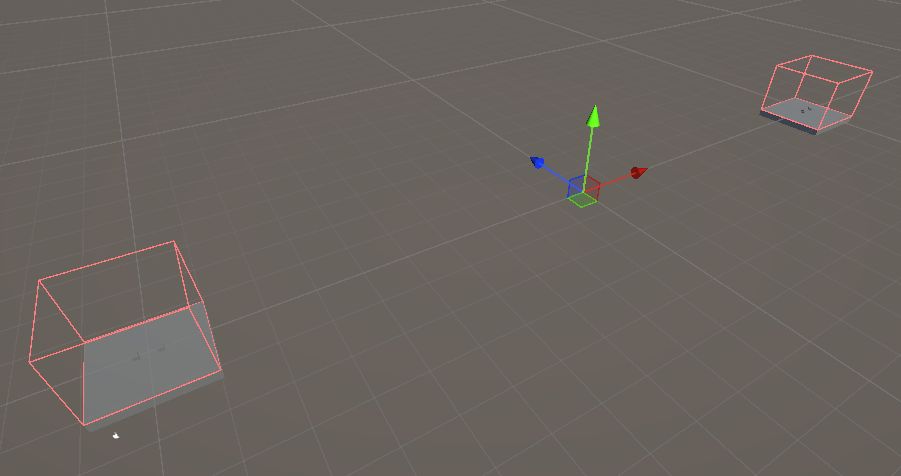 | 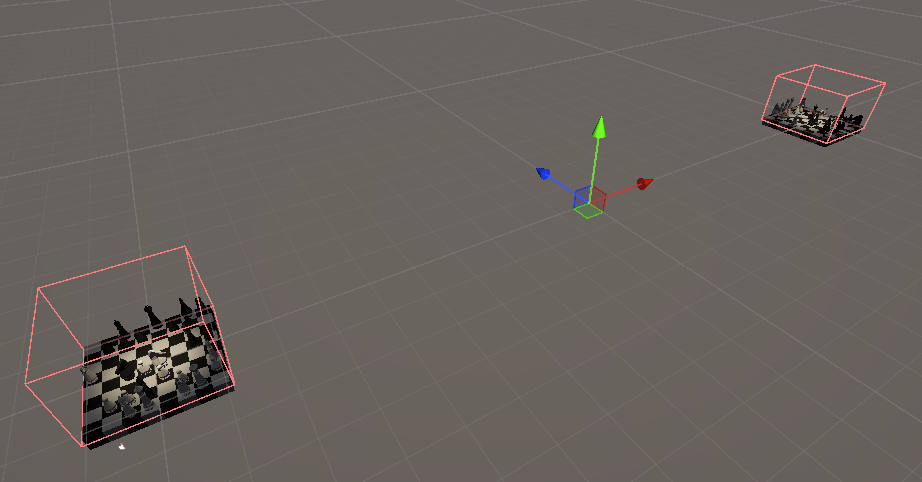 | 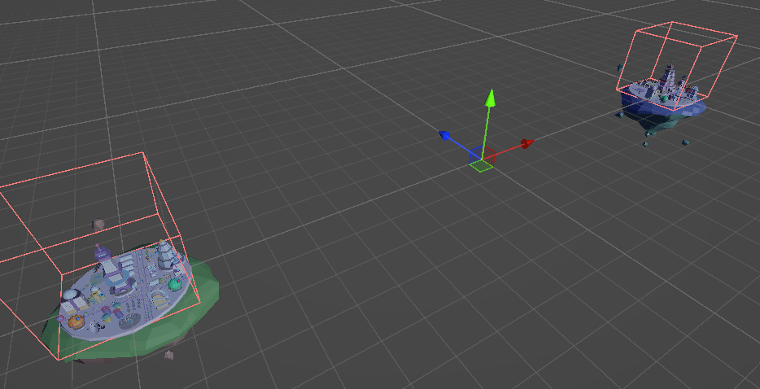 |

*왼쪽은 Stage Template, 가운데·오른쪽은 같은 뼈대로 만든 실제 스테이지입니다. 두 섬은 멀리 떨어져 있고, 빨간 상자가 섬마다 둔 PlayArea입니다.*

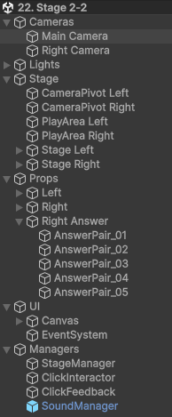

*Stage 2-2(기차역)의 Hierarchy — 아래 글상자의 묶음이 그대로 있고, Right Answer 아래에 정답 쌍 AnswerPair_01 ~ 05가 있습니다.*

```
Cameras   Main Camera(왼쪽 섬), Right Camera(오른쪽 섬)
Lights    조명
Stage     CameraPivot Left/Right, PlayArea Left/Right, Stage Left/Right(섬 바닥, Background 레이어)
Props     Left / Right 소품, Right Answer(정답 쌍 AnswerPair_01 ~ 05)
UI        Canvas(HUD, 클리어 창, 일시정지, 오답 표시), EventSystem
Managers  StageManager, ClickInteractor, ClickFeedback, SoundManager
```

이 규칙 덕분에 검사 도구가 "Pivot = 섬 중심", "Props = 비교 대상", "Stage = 바닥"이라고 가정하고
모든 스테이지를 같은 코드로 검사할 수 있습니다.

### 3.3 분할 화면 동기화 카메라

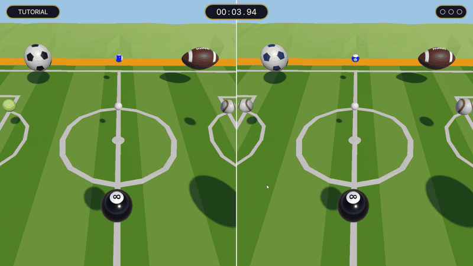

*두 화면의 카메라가 같은 각도·거리로 함께 움직입니다. Space를 누르면 이동 잠금(VIEW LOCKED)이 켜집니다. (튜토리얼)*

입력 하나로 두 화면의 카메라가 **같은 각도·같은 거리**로 함께 움직입니다. 2.2의 시점 문제를 푸는 기능입니다.

#### 구조

카메라마다 컨트롤러를 붙이지 않고, **컨트롤러 하나가 `(카메라, Pivot)` 쌍 목록을 들고** 같은 값을 모두에게 적용합니다.

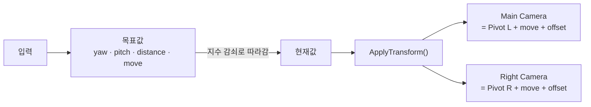

- 입력은 **목표값**에 쌓고, 실제 카메라는 `1 - exp(-sharpness × dt)` 비율로 목표값을 따라갑니다. 프레임 속도가 달라도 같은 느낌으로 움직입니다.
- WASD 이동은 Pivot을 옮기지 않고 **모든 Pivot에 같은 이동량(`move`)을 더합니다.** Pivot은 검사 도구가 섬 중심으로 쓰기 때문에 움직이면 안 됩니다.

#### 사용법

씬에서 `Views`에 카메라·Pivot 쌍을 연결하면 끝입니다. **0번 카메라를 씬에 놓아 둔 자리**가 시작 시점이 되도록
`Awake`에서 각도와 거리를 거꾸로 계산하므로, 스테이지마다 시작 화면은 카메라를 끌어다 놓는 것만으로 정합니다.
스테이지마다 다른 설정(이동 끄기, Pitch 범위, 카메라를 막는 레이어)은 Inspector 값으로 바꿉니다.

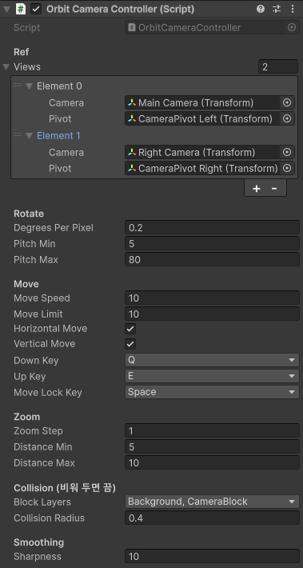

*Stage 2-2(기차역)의 OrbitCameraController — Views에 카메라·Pivot 쌍 2개를 연결했고, 이 스테이지는 Block Layers(Background · CameraBlock)와 Collision Radius 0.4로 카메라가 열차 안으로 들어가지 않게 했습니다(4.1).*

#### 카메라 충돌 처리

2-2 기차역에서 카메라가 열차 안으로 들어가 속이 보이는 문제가 있었습니다. 카메라 충돌을 넣되,
**한쪽 화면만 당겨지면 두 시점이 달라져** 비교가 불공정해집니다. 그래서 두 Pivot에서 각각 검사하고
**더 짧은 거리를 두 카메라가 같이 씁니다.**

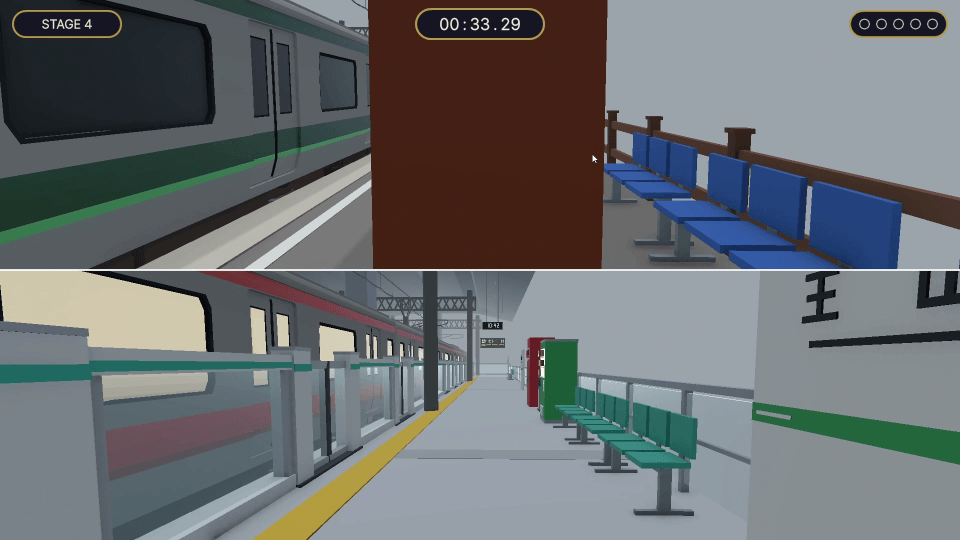

*Stage 2-2(기차역) — 열차에 가까이 가도 두 카메라가 더 짧은 거리를 함께 써서, 한쪽만 당겨지거나 열차 속이 보이지 않습니다.*

```csharp
private void ApplyTransform()
{
    Quaternion rotation = Quaternion.Euler(pitch, yaw, 0f);
    Vector3 back = rotation * Vector3.back;

    // (Why) 두 화면 중 더 많이 막힌 쪽 거리를 같이 써서 시점을 맞춘다.
    //       휠로 정한 distance는 건드리지 않으므로, 막힌 곳을 벗어나면 원래 거리로 돌아간다.
    float shownDistance = GetUnblockedDistance(back, distance);
    Vector3 offset = back * shownDistance;

    foreach (OrbitView view in views)
    {
        view.camera.position = view.pivot.position + move + offset;
        view.camera.rotation = rotation;
    }
}

private float GetUnblockedDistance(Vector3 back, float wanted)
{
    if (blockLayers.value == 0) return wanted;   // 충돌을 쓰지 않는 스테이지

    float shortest = wanted;
    foreach (OrbitView view in views)
    {
        Vector3 origin = view.pivot.position + move;
        // (Why) 점(Raycast)이 아니라 공(SphereCast): 카메라 화면 모서리까지 벽 밖에 두기 위해
        if (Physics.SphereCast(origin, collisionRadius, back, out RaycastHit hit,
                               wanted, blockLayers, QueryTriggerInteraction.Ignore))
            shortest = Mathf.Min(shortest, hit.distance);
    }
    return shortest;
}
```

막혔을 때 **부드럽게 따라가지 않고 바로 당기는** 것도 의도입니다. 부드럽게 따라가면 그 몇 프레임 동안 열차 속이 보였습니다.

#### 월드 3 반반 투영

월드 3은 물체 하나가 화면 정중앙의 분할선에서 **왼쪽 반은 버전 A, 오른쪽 반은 버전 B**로 이어져 보여야 합니다.
Viewport만 반으로 나누면 물체가 각 반쪽의 가운데에 그려져 월드 1과 똑같아집니다.
그래서 **화면 전체 크기의 시야를 계산한 뒤 자기 반쪽만 잘라 쓰는** off-center 투영을 직접 만듭니다.

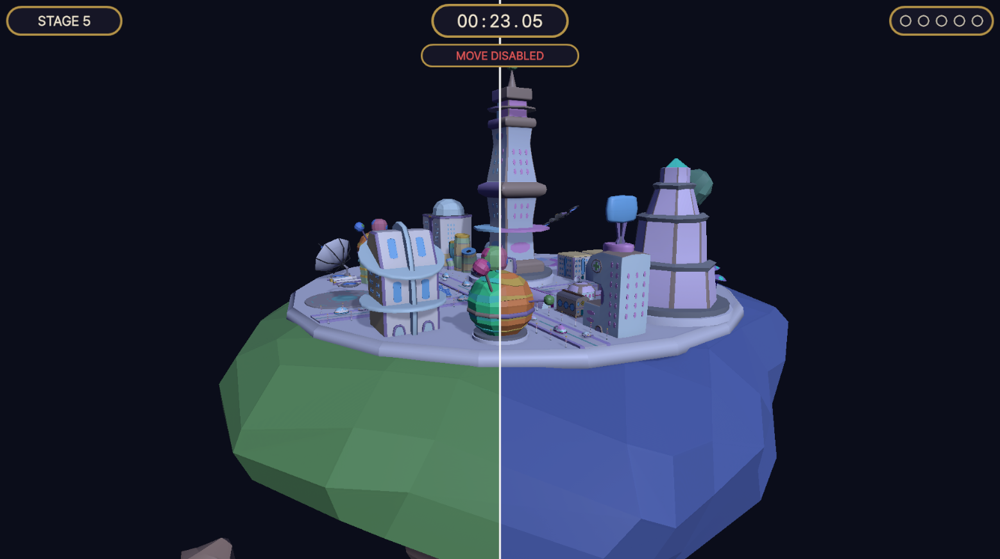

*Stage 5(월드 3) — 섬 하나가 화면 정중앙 분할선에서 이어져 보이지만, 왼쪽 반(초록 바닥)과 오른쪽 반(파란 바닥)은 서로 다른 두 섬을 각 카메라가 자기 반쪽만 그린 것입니다. Stage 5는 WASD·Q/E 이동을 아예 막아 둔 스테이지라 MOVE DISABLED가 표시됩니다(2.4).*

```csharp
private void LateUpdate()
{
    Rect pixels = cam.pixelRect;               // 반쪽 화면 (예: 960 × 1080)
    float near = cam.nearClipPlane;
    float top = near * Mathf.Tan(cam.fieldOfView * 0.5f * Mathf.Deg2Rad);

    // (Why) 가로 폭을 반쪽 2개 기준으로 잡아야 화면 전체의 시야가 된다
    float halfWidth = top * (pixels.width * 2f / pixels.height);
    float left  = side == ScreenSide.Left ? -halfWidth : 0f;
    float right = side == ScreenSide.Left ? 0f : halfWidth;

    // 왼쪽 카메라는 시야의 왼쪽 절반만, 오른쪽 카메라는 오른쪽 절반만 그린다
    cam.projectionMatrix = Matrix4x4.Frustum(left, right, -top, top, near, cam.farClipPlane);
}
```

매 프레임 다시 계산해서 창 크기나 FOV가 바뀌어도 맞고, `[ExecuteAlways]`라 에디터에서도 결과를 보며 배치할 수 있습니다.

#### 고민과 선택

**결정 ①: 카메라 두 대를 어떻게 맞출 것인가?**

**당시의 선택** — "두 화면은 항상 같은 시점이어야 한다"는 규칙은 기획서에서 제가 정했고,
AI에게 Cinemachine 등 다른 방법도 들은 뒤 C를 골랐습니다.

| | 대안 A: 카메라마다 컨트롤러 + 서로 값 복사 | 대안 B: Cinemachine 카메라 2대 | **대안 C: 컨트롤러 하나가 모든 카메라에 같은 값 적용** |
|---|---|---|---|
| 장점 | 카메라별로 따로 다루기 쉬움 | 충돌·감쇠 기능이 이미 있음 | 같은 값을 쓰므로 **구조적으로 어긋날 수 없음** |
| 단점 | 실행 순서에 따라 한 프레임 어긋날 수 있음 | 두 카메라가 각자 감쇠·충돌을 계산해 시점이 달라질 수 있음 | 충돌·감쇠를 직접 구현해야 함 |

**C를 선택했습니다.** 이 게임에서 두 화면의 시점이 다른 것은 단순한 어색함이 아니라 **게임 규칙이 깨지는 버그**입니다.
Cinemachine 패키지는 프로젝트에 있었지만, 두 카메라가 같은 값을 쓴다는 보장을 얻으려고
충돌·감쇠 구현 비용을 감수했습니다. 그 결과 위 「두 화면이 어긋나지 않는 충돌 처리」의 "짧은 거리를 같이 쓰기"처럼 **두 화면을 함께 고려하는 규칙**을 넣을 수 있었습니다.

**결정 ②: 카메라가 열차 안으로 들어가는 문제**

**당시의 선택** — 기차역(2-2)에서 카메라가 객차 안으로 들어가 속이 보이는 것을 제가 발견했고, 해결 방법은 AI가 B로 정했습니다(기획서 10-28).

- 대안 A: Pivot을 열차 위로 올림 → 간단하지만, 열차 대차(바퀴)처럼 **낮은 곳에 둔 문제를 보기 어려워짐**
- 대안 B: 막는 레이어(`CameraBlock`)를 만들고 충돌 처리 → 구현이 필요하지만 시점 제약이 없음

돌아보면 열차 대차처럼 낮은 곳에 둔 문제를 살펴야 했으므로 B가 맞았다고 생각합니다. `CameraBlock` 레이어는 클릭 대상(Clickable Layers)에서 빼서, 카메라는 막되 클릭은 통과하게 했습니다.

### 3.4 클릭 판정

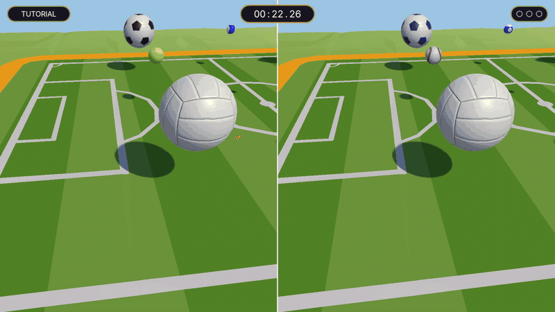

*정답 클릭 — 한쪽만 눌러도 양쪽 배구공이 함께 황금빛으로 반짝이고, 오른쪽 위 진행도 점이 하나 찹니다. (튜토리얼)*

클릭 결과를 **정답 / 오답 / 무반응** 세 가지로 나눕니다. 2.2의 판정 문제를 푸는 기능입니다.

#### 클릭이 거치는 순서

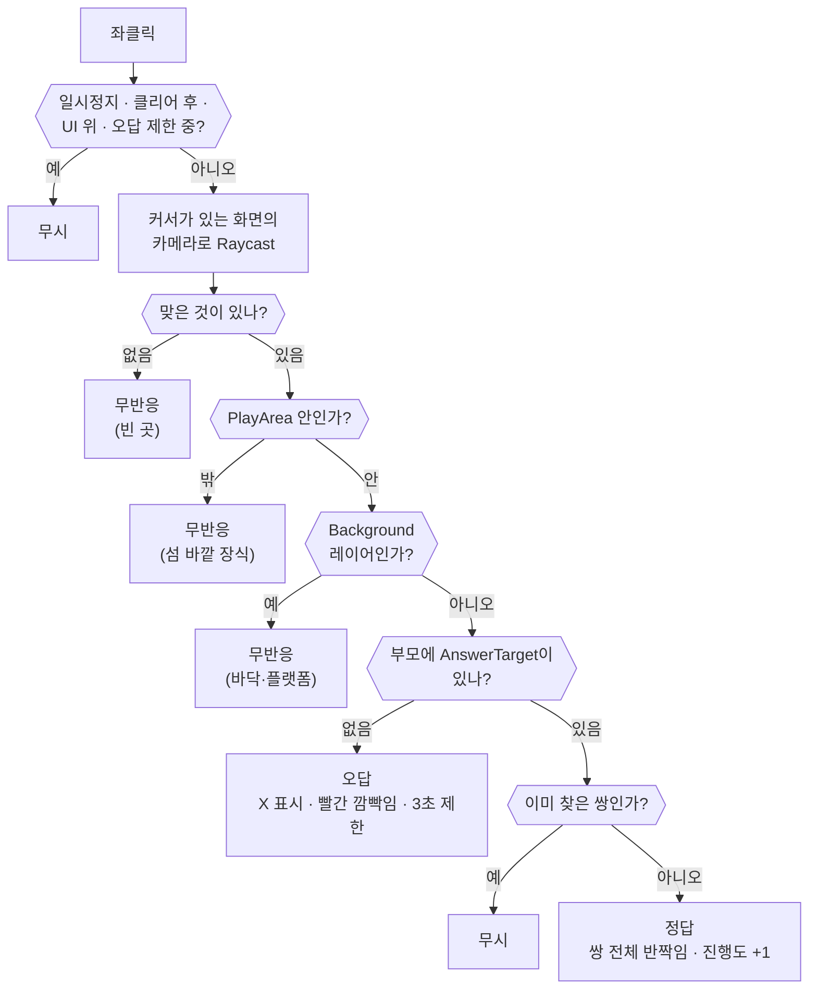

판정 결과는 **정답 / 오답 / 무반응** 세 가지입니다. 무반응을 따로 둔 것이 이 기능의 핵심입니다.

#### 핵심 동작

```csharp
private void HandleHit(RaycastHit hit, Vector2 screenPos)
{
    // 1) 섬 바깥(어느 PlayArea에도 없는 지점)이면 빈 곳처럼 무시
    if (IsInsidePlayArea(hit.point) == false) return;

    // 2) 무반응 레이어(바닥·플랫폼·길): 클릭을 '막아 주기만' 하고 반응하지 않음
    if ((silentLayers.value & (1 << hit.collider.gameObject.layer)) != 0) return;

    // 3) 부품마다 Collider가 있는 물체도 있으므로 부모 쪽에서 정답 표시를 찾는다
    AnswerTarget target = hit.collider.GetComponentInParent<AnswerTarget>();
    if (target == null || target.Pair == null)
    {
        HandleWrong(screenPos, hit.collider);   // 오답 + 3초 클릭 제한
        return;
    }

    // 4) 이미 찾은 쌍을 다시 누르면 정답도 오답도 아님
    if (target.Pair.TryFind() == false) return;

    OnAnswerClicked?.Invoke(target);
}
```

- **분할 방식과 무관**: 카메라는 `cam.pixelRect.Contains(커서)`로 고릅니다. 좌우 분할(월드 1·3)과 위아래 분할(월드 2)을 같은 코드로 처리합니다.
- **3초 제한은 `Time.deltaTime`으로 줄입니다.** `unscaledDeltaTime`을 쓰면 일시정지해 둔 채로 제한 시간을 흘려보내는 꼼수가 생깁니다.
- `GetComponentInParent`를 쓰기 때문에 자판기 버튼 하나처럼 **부품 하나**를 정답으로 둘 수도 있고, 차 한 대처럼 **물체 전체**를 정답으로 둘 수도 있습니다.

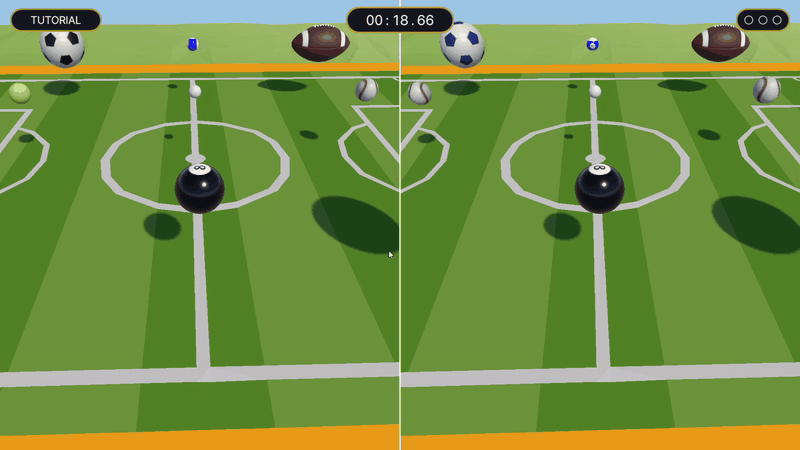

*오답 클릭 — 오답 표시가 뜨고 3초 동안 클릭이 제한됩니다. (튜토리얼)*

#### 고민과 선택

**결정: 바닥·플랫폼을 클릭했을 때 오답이 뜨지 않게 하려면?**

**당시의 선택** — 플레이하다 바닥을 헛짚을 때마다 X가 뜨는 것이 거슬려서 고쳐 달라고 요청했고,
방법(B)은 AI가 정했습니다(기획서 10-23).

**지금 돌아본 비교**

| | 대안 A: 바닥을 Raycast 대상에서 뺌 (Clickable Layers에서 제외) | **대안 B: 바닥은 Raycast에 맞되, 맞으면 무반응 (`Background` 레이어)** |
|---|---|---|
| 장점 | 설정 하나로 끝, 코드 변경 없음 | 클릭이 바닥에서 멈춤 |
| 단점 | **클릭이 바닥을 뚫고 지나가** 바닥 아래·뒤쪽 물체에 맞음 | 판정 단계가 하나 늘어남, 바닥 에셋마다 레이어 지정 필요 |

돌아보면 B가 맞았습니다. 이 게임은 디오라마를 아래에서 올려다보는 문제도 둘 수 있습니다.
A로 하면 위에서 바닥을 눌렀는데 **바닥 밑의 물체가 오답으로 잡히는** 일이 생깁니다.
플레이어 입장에서는 "아무것도 안 눌렀는데 벌점을 받은" 상황이라 가장 억울한 경우입니다.
레이어 지정 수고는 검사 도구가 "Stage 아래 Collider가 Background가 아님"을 경고하게 해서 줄였습니다(3.5).

**PlayArea를 물리 Collider가 아닌 계산 상자로 만든 이유** (AI가 정한 구현입니다): Trigger Collider로 만들면 Raycast 설정(`QueryTriggerInteraction`)과
얽히고 다른 물리 검사에 끼어듭니다. 클릭 지점이 상자 안인지만 알면 되므로 Transform 기준의 점-상자 계산으로 충분했습니다.
같은 상자를 카메라 이동 범위로도 다시 씁니다.

### 3.5 스테이지 검사 도구

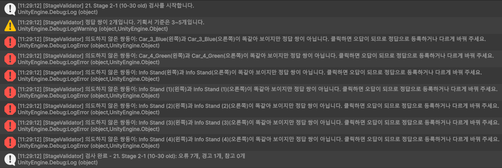

*제작 중이던 10-30의 2-1 자동차 전시장 씬을 다시 꺼내 검사한 결과 — 정답이 아닌데 양쪽이 똑같은 물체 7개가 빨간 오류로, 정답 쌍이 2개뿐이라는 것이 노란 경고로 나옵니다.*

눈으로는 찾을 수 없는 "정답이 아닌 쌍둥이"를 찾아 주는 에디터 도구입니다. 2.2의 공정성 문제를 푸는 기능입니다.

#### 왜 만들었나

2.2의 공정성 문제는 **사람이 눈으로 막을 수 없었습니다.** 실제로 처음 검사를 돌렸을 때 이런 것들이 나왔습니다.

- 1-1 체스판: 정답으로 둔 흰 룩이 양쪽에서 회전이 달랐는데, 룩 모델이 회전 대칭이 아니라 **실제로는 달라 보였음**
- 2-1 자동차 전시장: 정답이 아닌데 양쪽이 똑같은 물체(**의도하지 않은 쌍둥이**) 7개
- 2-2 기차역: 정답 물체의 Collider가 비어 있거나(Mesh 없는 MeshCollider) 예전 구조의 복사본이 섞여 오류 12개

그래서 **Tools → You're Right → Validate Stage** 한 번으로 열린 씬을 검사하는 에디터 도구를 만들었습니다.
씬을 고치지 않고 읽기만 하며, 결과를 ❌ 오류 / ⚠ 경고 / ℹ 참고로 Console에 남기고 로그를 누르면 해당 물체가 선택됩니다.

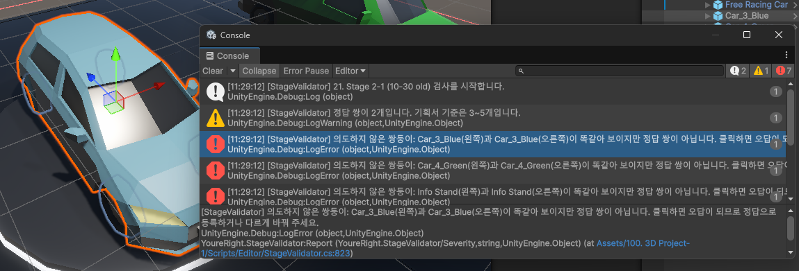

*오류 로그를 누르면 그 물체(Car_3_Blue)가 씬에서 선택되어, 어느 것을 고쳐야 하는지 바로 찾을 수 있습니다.*

고친 뒤에는 오류와 경고가 모두 0이 됩니다. 아래는 마지막 스테이지를 검사한 결과입니다.

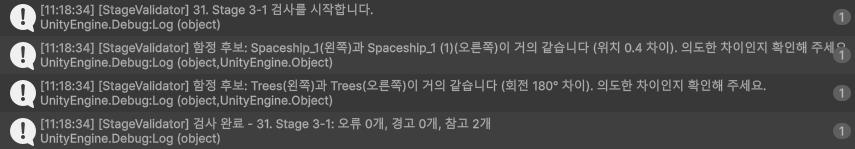

*Stage 5(씬 이름 3-1)를 검사한 Console — 오류 0 · 경고 0입니다. 참고 2개는 거의 같은 물체(우주선 위치 0.4 차이, 나무 180° 회전)를 함정으로 의도한 것인지 확인하라는 안내입니다.*

#### 검사 항목

| 분류 | 검사 내용 |
|---|---|
| 쌍둥이 동일성 | 섬 중심 기준 위치(오차 0.01), 크기(1%), 메시·머티리얼·자식 구성, 회전(1°, 다르면 **회전 대칭 판정**) |
| 의도하지 않은 쌍둥이 | 정답이 아닌데 양쪽이 똑같아 보이는 물체 → **오류** |
| 함정 후보 | 같은 물체가 0.5 안에서 조금만 다름 → 참고 (의도한 함정인지 확인용) |
| 클릭 가능 여부 | 정답 Collider 없음·꺼짐·Trigger·빈 MeshCollider, Background 레이어, PlayArea 밖 |
| 연결 | 정답 쌍 개수(3~5), 쌍이 같은 섬에 있음, 어느 쌍에도 없는 AnswerTarget |
| 양쪽 환경 | 두 카메라 설정, 섬마다 둔 Point·Spot 조명이 같은 자리·같은 값인지 |
| 빌드 대비 | 정답 머티리얼 Emission 꺼짐 (빌드에서 반짝임 셰이더 변형이 빠질 수 있음) |

비교 기준은 **월드 좌표가 아니라 각 섬의 Pivot 기준 상대 위치**이고, 회전은 월드 회전입니다.
그래서 1-1처럼 오른쪽 소품 그룹 전체를 180° 돌려 둔 섬도 화면에 보이는 그대로 비교합니다.

#### 회전한 쌍둥이 판정

가장 어려운 판정은 **회전만 다른 쌍둥이**입니다. 폰(체스 말)은 어느 방향으로 돌려도 똑같이 보이지만,
8번 당구공은 180° 돌리면 반대편 숫자가 보여서 달라 보입니다. 회전 값만 비교하면 폰도 오류가 되고,
무시하면 당구공을 놓칩니다.

**방법**: 물체 기준점에서 구 위에 고르게 퍼진 **4096개 방향(피보나치 구, 간격 약 3.5°)**으로 광선을 쏴서,
각 방향의 **가장 바깥 면까지의 거리**와 **그 자리의 텍스처 색**을 구합니다. 두 물체의 회전 차이를 Δ라 하면,
모든 방향 d에서 `결과(d)`와 `결과(Δ·d)`가 같을 때만 "똑같아 보인다"고 판단합니다.

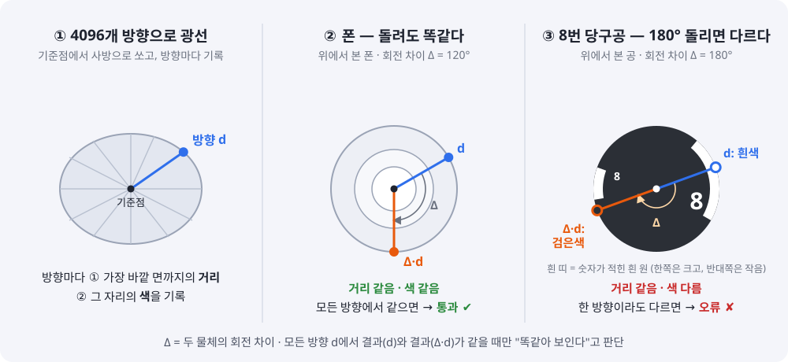

*회전 대칭 판정 — 폰은 어느 방향에서 봐도 거리·색이 같아 통과하고, 8번 당구공은 180° 돌린 방향에서 색이 달라 오류가 됩니다. (원리를 보여 주려고 단순하게 그린 그림)*

```csharp
private static bool IsRotationallySymmetric(Transform a, Transform b, out string note)
{
    note = "";
    List<Triangle> triangles = GetLocalTriangles(a, out float size);  // 루트 기준 삼각형 + 서브메시별 텍스처
    if (triangles == null)
    {
        note = " (메시를 읽지 못해 대칭 여부를 판단할 수 없음)";
        return false;                                  // (Why) 모르면 '같다'가 아니라 '오류'로 알린다
    }

    float distanceTolerance = Mathf.Max(size * SymmetryTolerance, 0.0001f);  // 크기의 1%
    Quaternion delta = Quaternion.Inverse(a.rotation) * b.rotation;          // 두 물체의 회전 차이

    foreach (Vector3 direction in GetRayDirections())  // 피보나치 구 4096방향
    {
        RaySample first  = CastRay(triangles, direction);          // a를 d 방향에서 본 모습
        RaySample second = CastRay(triangles, delta * direction);  // b가 같은 방향에 보여 주는 모습

        if (first.Hit != second.Hit) return false;
        if (first.Hit == false) continue;
        if (Mathf.Abs(first.Distance - second.Distance) > distanceTolerance) return false;  // 모양
        if (SameColor(first.Color, second.Color) == false) return false;                   // 무늬·숫자
    }
    return true;
}
```

`CastRay`는 Möller–Trumbore 광선-삼각형 교차로 **가장 먼 면**(바깥에서 보이는 면)을 찾고,
그 지점의 UV를 보간해 머티리얼 Tiling·Offset을 반영한 텍스처 색을 읽습니다.
Read/Write가 꺼진 FBX 메시는 `Mesh.AcquireReadOnlyMeshData`로, 읽을 수 없는 텍스처는 `Graphics.Blit` 임시 복사본으로 읽고 검사 끝에 지웁니다.

#### 대칭을 비교하는 방법

**당시의 선택** — 스테이지 검사 도구와 대칭 비교 방법은 AI가 제안하고 만들었습니다.
이 절은 제가 고른 방식이 아니라, 어떤 방법들을 시도했고 왜 지금 방식이 남았는지를 기록한 것입니다.

이 판정은 한 번에 정해지지 않았습니다. 합격 기준은 두 실제 사례를 **동시에** 맞히는 것이었습니다.

- **1-1 폰**: 진짜 회전 대칭 → 회전이 달라도 **통과**해야 함
- **튜토리얼 8번 당구공 (180°)**: 반대편 숫자가 보여 숫자 크기가 다름 → **오류**여야 함

| 방법 | 비교하는 것 | 결과 |
|---|---|---|
| 꼭짓점 위치 | 메시 꼭짓점들을 Δ만큼 돌렸을 때 같은 자리에 꼭짓점이 있는가 | 두 사례를 동시에 맞히지 못함 |
| 꼭짓점 UV · 꼭짓점 색 | 위 비교에 꼭짓점의 UV나 색을 더함 | 〃 |
| 면 안쪽 격자 점 | 삼각형 안에 점을 뿌려 위치·색을 비교 | 〃 |
| **방향별 광선** | **같은 방향에서 보이는 바깥 면의 거리와 텍스처 색** | **폰 통과, 당구공 오류. 둘 다 맞힘** |

**남은 방법: 방향별 광선.** 버린 세 방법은 모두 **꼭짓점이나 삼각형을 기준으로 점을 고르기 때문에**,
모델러가 메시를 어떻게 나눴는지(삼각형 배치, UV 이음매)가 결과에 섞입니다. 플레이어가 보는 것은 메시 구조가 아니라 **겉모습**입니다.
광선 방식은 "같은 방향에서 같은 거리·같은 색이 보이는가"만 묻기 때문에 삼각형을 어떻게 나눴는지와 상관이 없습니다.

**대가(Trade-off)**: 가속 구조 없이 `4096방향 × 삼각형 수`를 전부 계산하므로, 삼각형이 1만 개 넘는 물체는 몇 초 걸립니다.
이 도구는 **에디터에서 배치를 마친 뒤 손으로 한 번 돌리는** 용도라 몇 초는 문제가 되지 않아,
그 대신 구현을 단순하게 유지해 판정 규칙을 고치기 쉽게 했습니다. 저장할 때마다 자동으로 돌리는 옵션은 같은 이유로 넣지 않았습니다.

### 3.6 반복 작업은 도구로

정답 쌍 등록(`AnswerPairCreator`), 기차역·전시장 소품 조립, 차량 Collider 정리, UI 테마·글꼴 적용, 빌드 같은
**반복 작업을 메뉴 도구 16개로 만들어**, 2026.10.24~11.01 사이에 디오라마 6개를 만들었습니다.

AI가 작업 중에 스스로 찾아 막은 문제도 있습니다(제가 발견한 것이 아닙니다).

- **조립 도구를 다시 실행하면 씬의 Collider가 사라짐** (10-29, `1d9c4e4a`) — 프리팹을 새로 덮어쓰면 내부 ID가 바뀌어 씬의 수정 사항이 사라집니다.
  이름이 같은 오브젝트는 그대로 두고 값만 맞추는 저장 함수(`PrefabSaveUtility.SaveKeepingIds`)로 막았습니다.
- **정답 반짝임이 빌드에서 약해질 위험** (10-28, `1aa8e72d`) — 실제로 겪은 버그가 아니라, 머티리얼을 만드는 도구에서
  Emission 키워드가 꺼지지 않게 미리 정한 규칙입니다. 검사 도구가 Emission이 꺼진 정답 머티리얼을 경고합니다.

---

## 4. 문제 해결

아래 두 문제는 플레이 중 제가 직접 발견했고, 어떤 상황에서만 생기는지 **조건을 좁혀** AI에게 알렸습니다.
원인을 찾고 고친 것은 AI입니다. 🔍는 이 문서를 쓰며 커밋 기록으로 다시 확인한 내용입니다.

### 4.1 위아래 분할에서 열차 속이 보임

(11-02, 커밋 `6bc23eb7`)

- **(발견)** 2-2 기차역에서 화면 가장자리에 열차 속이 보였습니다. 좌우 분할 맵에서는 없고 위아래 분할에서만 생긴다는 것을 확인해 알렸습니다.
- **(문제)** 충돌 반지름 0.3으로 카메라가 열차 상자 밖에 있는데도, 2-2(위아래 분할)에서만 화면 가장자리에 열차 속이 보였습니다.
- **(원인)** 카메라는 점이 아니라 **Near Clip 면(사각형)**을 가집니다. 위아래 분할은 화면 하나가 1920 × 540이라 가로로 매우 넓어서,
  Near Clip 0.3 · FOV 32°에서 이 사각형 모서리가 카메라 중심에서 **약 0.44** 떨어집니다. 반지름 0.3인 공이 상자 밖이어도 모서리는 상자 안이었습니다.
- **(해결)** 2-2의 `Collision Radius`를 **0.4**로 올리고, 기준(가로가 넓은 화면은 0.4 이상)을 문서에 남겼습니다.
- **(결과)** 2-2에서 카메라가 열차에 가까이 가도 속이 보이지 않습니다.
- 🔍 **(확인)** 커밋 메시지에 "위아래 분할의 넓은 화면에서 Near Clip 모서리가 열차 속으로 들어가던 문제를 Collision Radius 0.4로 해결"이 남아 있습니다.
  처음 카메라 충돌을 넣은 것은 10-28 커밋(`fb7a01b4`, 3.3 고민과 선택 결정 ②)이고, 이 문제는 그 뒤에 남아 있던 것입니다.

### 4.2 기록에 로딩 시간이 섞임

(10-23, 커밋 `c089b148`)

- **(발견)** 스테이지에 들어오자마자 스톱워치가 00:00.01에서 출발했습니다. 들어온 직후에만 그렇다는 것을 알렸습니다.
- **(원인)** 씬 로딩 직후 첫 프레임의 `deltaTime`에 로딩 시간이 들어 있었습니다.
  "시작한 프레임 번호와 같으면 건너뛰기"로 막으려 했지만, 에디터 첫 Play에서는 `Start`와 첫 `Update`가 다른 프레임이라 막지 못했습니다.
- **(해결)** 프레임 번호 대신 **타이머를 켠 뒤 첫 번째 `Update` 호출**을 건너뛰는 플래그(`skipNextTick`)로 바꿨습니다.
- **(결과)** 스톱워치가 00:00.00에서 시작합니다.
- 🔍 **(확인)** 커밋 메시지에 "타이머 시작 후 첫 Update는 건너뜀(로딩 직후 첫 프레임 deltaTime이 기록에 섞여 00:00.01로 시작하던 문제)"이 남아 있습니다.

### 4.3 플레이 테스트로 찾은 문제

맵을 직접 만들다 보니 어디에 무엇이 있는지 이미 알고 있어서, 난이도를 제대로 보지 못했습니다.
발표 전 테스트에서 받은 피드백 4건을 반영했습니다.

| 피드백 | 반영 |
|---|---|
| 꽃이 너무 작아 못 찾겠어요 | 크기를 키움 |
| 밤이 길어서 잘 안 보여요 | 밤을 10초에서 8초로 |
| 계기판 바늘이 잘 안 눌려요 | 정답을 큰 물체로 |
| 차 실내가 양쪽이 같아 헷갈려요 | 한쪽 실내 색을 바꿈 |

---

## 5. 결과와 배운 점

### 5.1 결과

| 목표 (2.2) | 결과 |
|---|---|
| 두 화면이 같은 시점 | 컨트롤러 하나가 모든 카메라에 같은 값 적용. 충돌로 당겨질 때도 짧은 거리를 함께 써서 시점 유지 |
| 억울한 판정 없애기 | 정답 / 오답 / 무반응 3단계 판정. 바닥·섬 바깥·빈 곳 클릭은 벌점 없음 |
| 공정성 | 6개 씬, 정답 26쌍 모두 **Validate Stage 오류 0** 확인 (1-1 룩, 2-1 의도하지 않은 쌍둥이 7개, 2-2 Collider 오류 12개를 출시 전에 찾아 고침) |

- **완성도**: 메뉴 → 튜토리얼 → Stage 1~5 → 결과 화면까지 Windows 빌드(약 280MB)로 전체 흐름을 확인했습니다.
- **확장성**: 부록의 이벤트 구조 덕분에 오답 빨간 깜빡임, 진행도 점 UI, 효과음을 판정 코드 수정 없이 붙였습니다.
- **발표 뒤 평가**: "분할 화면을 회전과 줌으로 서로 다른 시점을 확인하게 만든 점이 기획과 기술을 잘 결합했다"는 평을 받았습니다(3.3).

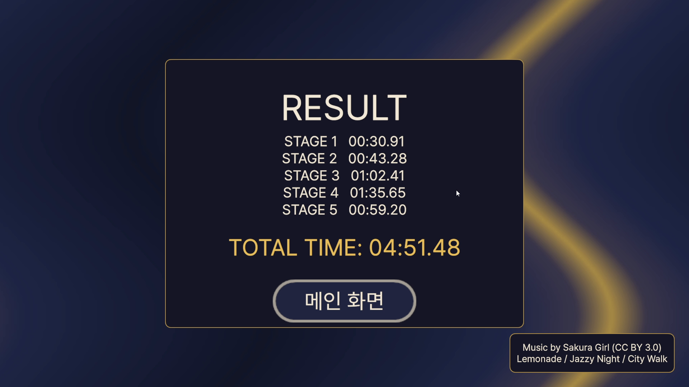

*결과 화면 — Stage 1~5의 기록과 전체 완주 시간(TOTAL TIME)이 나옵니다.*

### 5.2 아쉬운 점과 다음 계획

**만들고 테스트하며 느낀 점**

- **3-2 맵 취소** — 일정이 모자라 월드 3의 두 번째 맵(3-2)을 만들지 못했습니다. 그래서 월드 3은 Stage 5 하나뿐입니다.
- **테스트 전에는 못 찾은 문제** — 맵을 직접 만들다 보니 어디에 무엇이 있는지 이미 알고 있어서, 난이도를 제대로 보지 못했습니다.
  테스트에서 "꽃이 너무 작아 못 찾겠어요", "밤이 길어서 잘 안 보여요" 같은 피드백을 받고서야 알았습니다(4.3).

**발표 후 받은 피드백과 다음 계획**

발표 뒤 설문으로 받은 피드백 중, 아직 고치지 못한 것과 다음 계획입니다.

| 받은 피드백 | 다음 계획 |
|---|---|
| **힌트가 있으면 좋겠다** — 오래 못 찾으면 막힌다는 의견이 가장 많았고, 2스테이지에서 10분 넘게 갇혔다는 응답도 있었습니다 | 일정 시간이 지나도 정답을 찾지 못하면 정답 주변에 반짝이는 효과를 주거나, 새가 그 주변을 날았다 앉았다 하게 해서 자연스럽게 시선을 끌기 |
| **같아 보이는데 정답이 아닌 것이 많다** | 발표 전에 고쳤는데도 같아 보인다는 것이 남아 있어, 꼼꼼히 다시 수정하기. 검사 도구의 함정 후보(ℹ 참고) 목록을 기준으로 사람 눈에도 보일 만큼 차이를 키우기(3.5) |
| **클릭할 수 있는 물체와 배경을 구분하기 어렵다** — 일일이 눌러 봐야 해서 시간이 걸린다 | 커서를 올리면 테두리로 강조하기. 정답만 강조하면 답이 드러나므로 미끼를 포함한 모든 소품에 똑같이 적용하기 |
| **찾는 구역이 눈에 띄지 않는다** — 구역 밖 나무 같은 장식에도 시선이 분산된다 | 구역 밖 장식을 줄이거나 어둡게 해서 찾는 구역을 분명히 하기 |

**코드에서 찾은 개선점** — AI와 함께 코드를 다시 읽으며 정리

| As-Is (지금) | To-Be (고치는 방법, 제안) |
|---|---|
| 씬 흐름 테스트를 사람이 직접 Play해서 확인 | 게임 코드에 asmdef를 추가하고 Play Mode 테스트로 "메뉴 → 6스테이지 → 결과 기록 5개·Total 합계"를 자동 검증 |
| 검사 도구는 **프리팹 루트 단위**로 비교해서, 열차 대차처럼 큰 물체 안의 **자식 부품끼리** 생긴 의도하지 않은 쌍둥이는 놓침 (지금은 눈으로 확인) | 부품 단위 비교 옵션 추가 (Collider가 있는 자식을 별도 단위로) |
| 대칭 판정이 `방향 × 삼각형` 전수 계산이라 큰 메시는 몇 초 | 임시 MeshCollider + `Physics.Raycast`나 BVH로 교차 계산을 가속 |
| 한글 Fallback 글꼴 아틀라스(16.9MB)가 빌드에서 가장 큰 에셋 | 실제 쓰는 글자만 담은 Static 아틀라스로 줄이기 |
| 일정이 모자라 월드 3의 두 번째 맵(3-2)을 취소 | 반반 투영 코드는 재사용 가능하므로 맵만 추가하면 됨 |

### 5.3 배운 점

- **목표한 경험과 실제 반응은 달랐다** — 기획서의 목표는 "느긋하게 디오라마를 감상하는 관찰"이었지만, 발표 뒤에는 "열받게 잘 만들었다", "이건 좀 싶은 게 오히려 재미"라는 반응이 많았습니다.
  정답의 차이를 얼마나 크게 두느냐에 따라 느긋함과 긴장감 사이를 오가게 되어, **난이도 조절이 곧 목표한 경험을 지키는 일**이라는 것을 배웠습니다.
- **기획서를 자세히 쓰고, 바뀐 결정을 기록하기** — 코드는 AI가 만들었지만, 무엇을 만들지는 기획서가 정했습니다.
  만드는 동안 바뀐 결정 25건을 기획서의 변경 이력에 남겨 두어, 왜 그렇게 바뀌었는지 헷갈리지 않았습니다.
- **테스트 피드백으로 맵 다듬기** — 테스트에서 받은 피드백 4건을 반영했습니다(4.3). 만든 사람 눈에는 보이지 않는 문제를 다른 사람이 찾아 준다는 것을 알았습니다.
- **조건을 좁혀서 알리기** — "이상하다"가 아니라 "위아래 분할에서만", "들어온 직후에만"처럼 어느 상황에서 생기는지까지 좁혀 알리면
  원인을 빨리 찾을 수 있었습니다(4장).

---

## 부록. 코드 구조

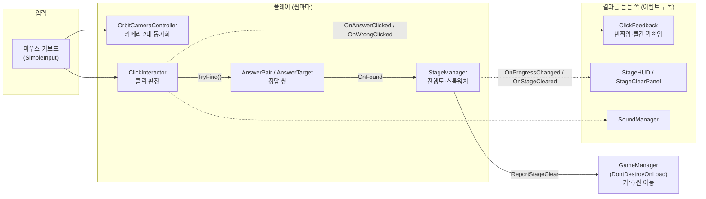

실선은 직접 호출, 점선은 이벤트입니다. **판정하는 쪽(`ClickInteractor`, `StageManager`)은 결과를 누가 쓰는지 모릅니다.**
반짝임, HUD, 효과음은 각자 이벤트를 구독할 뿐이라, 오답 빨간 깜빡임(11/03)이나 진행도 점 UI(11/02)를
나중에 넣을 때도 판정 코드는 한 줄도 고치지 않았습니다.

| 클래스 | 책임 | 하지 않는 일 |
|---|---|---|
| `OrbitCameraController` | 카메라 N대를 각자의 Pivot 기준으로 **같은 각도·거리**로 공전 | 클릭 판정 |
| `HalfScreenProjection` | 월드 3에서 화면 전체 기준 투영을 만들고 자기 반쪽만 남김 | 카메라 이동 |
| `ClickInteractor` | 커서가 있는 화면의 카메라로 Raycast, 정답·오답·무반응 판정, 오답 후 3초 제한 | 연출·소리 |
| `PlayArea` | 섬마다 두는 보이지 않는 구역 상자. 점이 안에 있는지만 계산 | 물리 충돌 |
| `AnswerPair` | 쌍둥이 2개를 묶어 한쪽만 눌러도 쌍 전체를 정답 처리, 중복 처리 방지 | 진행도 계산 |
| `StageManager` | 정답 쌍을 자동으로 모아 진행도·클리어 이벤트, 스톱워치 | 씬 이동 |
| `GameManager` | 스테이지 기록을 모으고 다음 씬·결과 화면으로 이동 | 스테이지 내부 로직 |
| `StageValidator` (에디터) | 열린 씬을 **읽기만** 해서 쌍둥이 동일성·실수 검사 | 씬 수정 |
