<!--
✍ 작성자 확인 목록 (이 주석은 화면에 보이지 않습니다. 다 확인하면 지워도 됩니다)

이 문서는 Claude가 코드(Assets/01_Scripts)·프리팹·커밋 메시지에서 확인한 사실로 쓴 초안을 바탕으로,
단계마다 본인 확인을 거쳐 고쳐 가는 중입니다(진행 기록: src/_draft/기술문서-수정-진행.md).
게임 제목·레퍼런스·보스 체력(500)은 기획서로, 고민과 선택은 당시 실제로 정한 방식으로 확인했습니다.
5.2 회고와 5.3 배운 점은 업데이트 기획서의 회고와 본인이 고른 내용으로 고쳤습니다.
4.5 코드에서 찾은 문제 ①②는 본인이 게임에서 재현해 확인했고, ③은 본인이 의도를 확인했습니다(2026-11-23).

2026-11-24 선생님 피드백에 따라 You're Right와 같은 틀(개요 → 기획 → AI 활용 → 문제 해결 → 결과)로 다시 짰습니다(Claude 초안).
- 쉬운 코드는 뺐습니다: 생존 타이머·보스전 전환·게임 종료(예전 3.3·3.4), 패턴 선택·패턴 코루틴(예전 5.3·5.4). 다이어그램·게임 화면·글로 설명합니다
- 예전 4.2 사용법·4.4 아이템 드랍은 뺐습니다(확정 드랍 이야기는 2.3 표로). 판정 순서 → Enter/Stay가 바로 이어집니다
- 보스 패턴은 GIF + 자세한 표로, 보스 인스펙터는 표로 바꿨습니다

1. ✅ 이어 주는 문장 — Claude가 예전 문서(확인받은 글)와 맞춰 봄: 대부분 예전 1.2·1.3·6.2를 옮긴 것. 3.1 표의 커밋 확인은 "문서를 쓰며"로 밝힘(본인 선택, 2026-11-24)
   - 3.4 코드 2개(판정 순서 · 깜빡임 코루틴)는 선생님 피드백대로 뺌(본인 선택, 2026-11-24). 판정 순서는 다이어그램 · 4.1 As-Is/To-Be 표가 보여 줌
2. ✅ 새로 넣은 그림 3장의 설명 문장(2.1 main_menu.png · enemies.gif, 3.3 countdown.gif) — 그림 프레임 · MainMenuController와 맞춰 봄, enemies · countdown 설명은 Claude 제안을 본인이 골라 보탬(2026-11-24)
3. ✅ 📷 3.5 「사용법」의 Boss 프리팹 인스펙터(images/boss_inspector.png) 넣음 — Hp를 테스트 값 10에서 500으로 바꾸고 찍음, 프리팹 이름 오타(DeahtEffect → DeathEffect)도 고침(2026-11-24). 설명 문장은 Claude 추천 중 본인이 고름. 패턴마다 따로 찍은 GIF는 선택
4. ✅ ✍ 3.5 「패턴 타이밍을 만드는 방법」 끝의 "그래서 지금 고른다면" — Update + 타이머, 직접 짜 본 방식이라 읽고 고칠 수 있어서(본인 답, 문장은 Claude 초안을 본인이 확인, 2026-11-24)
5. ✅ 3.5 패턴 표 — Boss.cs의 WaitForSeconds로 다시 계산해 "쏘는 시간(첫 발 ~ 마지막 발)" 0.4 · 1.1 · 1.1 · 1.5초로 맞춤(기준은 본인 선택, 2026-11-24)
6. ✅ 2.3 표 — 결과 화면이 바뀐 이유는 넣지 않기로 함(본인 선택, 2026-11-24)
-->

# Strikers Lite 기술 문서

> 60초를 버티면 보스가 내려오는 세로 화면 2D 비행 슈팅 게임
> Unity 6 · URP 2D · C# · 개인 프로젝트 (2주)

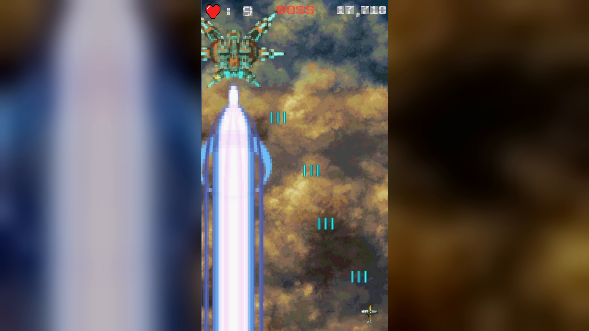

---

## 1. 개요

### 1.1 개발 환경

| 항목 | 내용 |
|---|---|
| 엔진 | Unity 6000.3.15f1 (Unity 6), URP 2D 17.3, Input System 1.19, TextMeshPro |
| 언어 | C# — 스크립트 17개, 1,338줄 (큰 틀은 직접, 세부 코드는 대부분 AI로 생성 — 3장) |
| 화면 | 세로 607×1080 |
| 기간 | 2026.06.24 ~ 2026.07.07 (2주, 커밋 38개) |
| 인원 | 1인 |
| GitHub | https://github.com/KooHoo-Dev/3rd-2D-Project-wjsdudgh99 |
| 시연 영상 | https://youtu.be/tmnxGLaPnx8 |
| 쇼츠 | https://youtube.com/shorts/VyfRGFwk3u8 |
| 그림 | 비행기·보스·배경은 원작 「스트라이커즈 1945」 시리즈의 스프라이트를 내려받아 사용했습니다 (출처: The Spriters Resource — https://www.spriters-resource.com/arcade/strikers1945/ · https://www.spriters-resource.com/arcade/strikers1945ii/) |

### 1.2 한 줄 소개

**Strikers Lite**는 세로 화면(607×1080)에서 비행기를 조종해 적을 격추하는 2D 슈팅 게임입니다.
한 판은 **60초 생존 → 보스전** 두 단계입니다. 보스를 격추하면 VICTORY, 체력이 0이 되면 GAME OVER이고,
결과 화면에서 바로 다시 하거나(Retry) 메인 메뉴로 돌아갈 수 있습니다.

프로그래밍을 배우고 **처음 만든 게임**입니다. 이 문서는 기획서로 정한 한 판을 **큰 틀은 직접 짜고 세부 코드는 AI와 함께 만들고,
직접 플레이하며 버그를 찾아낸** 과정입니다.

### 1.3 목표한 경험

- **레퍼런스**: 오락실 세로 스크롤 슈팅 「스트라이커즈 1945」.
  기획 의도는 원작의 감성을 살리되 **원작보다 쉬운 난이도**로 즐길 수 있게 만드는 것이었습니다.
- 이 프로젝트는 긴 스테이지 대신 **한 판을 '60초 생존 + 보스 1기'로 압축**해, 짧은 시간 안에 성장(무기 강화)과 보스전을 모두 겪게 했습니다.

---

## 2. 기획

### 2.1 플레이 소개와 핵심 루프

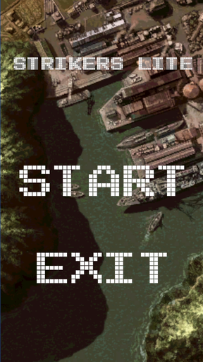

*메인 메뉴 : START를 누르면 게임이 시작되고, EXIT를 누르면 종료됩니다.*

- **핵심 루프**: 이동하며 사격 → 적 격추(점수) → 아이템 획득(무기 강화·체력 회복) → 60초 버티기 → 보스 격추
- 적을 격추하면 일정 확률로 무기 강화·체력 회복 아이템이 떨어져, 오래 버틸수록 화력이 세집니다.

| 항목 | 내용 |
|---|---|
| 씬 | `MainMenu` → `InGame` |
| 한 판의 흐름 | 카운트다운 3초 → 60초 생존 → 보스전 → 결과 화면 (2초 뒤 표시) |
| 적 | 일반 적(한 발에 격추, 직진) · 3방향 적(체력 7, 좌우 순찰하며 3방향 탄 발사) |
| 보스 | 체력 500, 공격 패턴 4종 (부채꼴 연사 · 시계 방향 · 반시계 방향 · 레이저) |
| 성장 | 무기 1→3단계 (한 번에 1·2·3발), 체력 최대 9 (시작 6) |
| 점수 | 일반 적 100 · 3방향 적 300 · 보스 명중 1발당 10 · 보스 격추 5,000 |

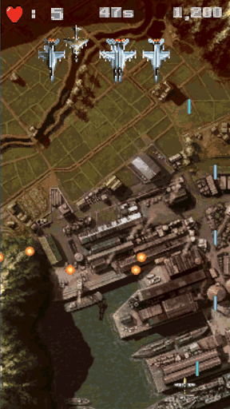

*생존 중 화면 : 위에서 적이 내려오고, 아래쪽 기체가 총을 쏘며 피합니다. 화면 위쪽에 체력 · 남은 시간 · 점수가 표시됩니다.*

| 조작 | 결과 |
|---|---|
| 방향키 | 8방향 이동 (화면 밖으로 나가지 않음). 좌우 입력에 따라 기체가 기울어짐 |
| Space (누르고 있기) | 0.2초마다 발사. 무기 단계에 따라 1·2·3발 |
| 마우스 클릭 | 메인 메뉴 Start / Exit, 결과 화면 Retry / Main Menu |

### 2.2 만들며 부딪힌 세 가지 문제

슈팅 게임은 수십 개의 총알·적이 동시에 부딪히고 사라지는 장르입니다. 만들면서 부딪힌 문제는 세 가지였습니다.

1. **흐름 문제** — 한 판 안에 카운트다운·생존·보스·결과 네 단계가 있고, 단계가 바뀔 때마다
   스포너·타이머·UI·남아 있는 적·시간 배율이 **한꺼번에** 바뀌어야 합니다.
   보스가 나왔는데 스포너가 계속 적을 내보내거나, 게임 오버 뒤에도 점수가 오르면 한 판의 규칙이 무너집니다. → 3.3
2. **피격 공정성 문제** — 플레이어의 피격 판정은 닿아 있는 동안 **매 프레임** 호출됩니다(`OnTriggerStay2D`).
   아무 장치 없이 체력을 깎으면, 1.5초 동안 켜져 있는 보스 레이저에 스치기만 해도 60fps 기준 약 90번 판정되어 즉사합니다.
   레이저 때문에 판정을 Stay로 바꾸며 무적 검사를 맨 위로 올리자, 이번에는 **무적 중에 아이템을 먹지 못하는** 버그가 생겼습니다. → 3.4, 4.1
3. **보스 패턴 문제** — 보스는 이동(내려오기 → 좌우 순찰)과 공격(4가지 패턴, 각 패턴은 0.1~0.2초 간격의 연속 발사)을
   동시에 해야 합니다. `Update` 한 곳에서 타이머 변수로 처리하면 패턴이 늘 때마다 타이머와 카운터가 함께 늘어납니다. → 3.5

### 2.3 기획서와 달라진 점

처음 쓴 컨셉 기획서와 실제로 만든 게임을 나란히 놓았습니다.

| 항목 | 기획서 | 실제 | 이유 |
|---|---|---|---|
| 기간 | 1인 / 7~8일 | 2주 (커밋 38개) | 미숙한 제작 실력과 예상치 못한 오류로 시간을 잡아먹었습니다 |
| 화면 | 1080×1920 | 607×1080 (마지막 날 변경) | 모니터 크기를 생각하지 못해, 빌드해 실행하면 글자가 게임 화면을 벗어났습니다 |
| 아이템 | 적을 파괴하면 일정 확률로 생성 | 확률(3방향 적 6.5% · 일반 적 5%) + 3방향 적을 10번 격추하면 무기 강화 아이템 확정 | 확률만으로는 운이 나쁘면 한 판 내내 무기가 1단계에 머물 수 있어서. 체력 아이템에는 확정 드랍을 두지 않았습니다(천장이 있으면 너무 쉬워질 것 같아서) |

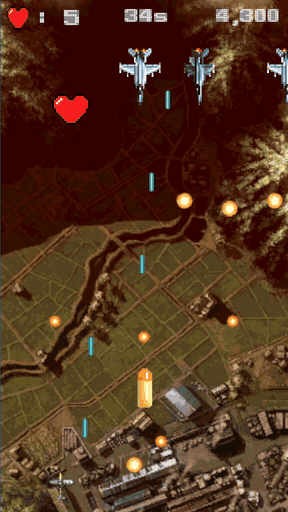

### 2.4 직접 정한 큰 틀

**학원에서 배운 방식으로 게임의 큰 틀을 직접 짰습니다.**

- **오브젝트 나누기** — 기획서에서 플레이어·적 2종·보스·총알·아이템을 프리팹 단위로 나누고,
  체력·속도 같은 속성을 정했습니다.
- **스크립트 나누기** — 플레이어·적·총알·스포너·`GameManager`처럼 역할마다 스크립트를 나눴습니다(구조는 3.2).
- **화면 구성** — 메인 메뉴 → 게임 → 결과 화면(GAME OVER · VICTORY)으로 이어지는 흐름과,
  화면에 놓을 오브젝트·UI를 정했습니다.
- **수치와 그림** — 체력·속도·확률 같은 인스펙터 값을 맞추고, 그림 같은 리소스도 직접 골라 배치했습니다.

---

## 3. AI 활용

### 3.1 AI와 나눈 역할

그때는 코드에 대한 이해가 지금보다 훨씬 부족해서, 큰 틀 위의 세부 코드는 대부분 AI가 생성했습니다.
기능을 AI에게 설명해 코드를 받았고, 원하는 대로 움직이지 않으면 다시 요청해 고쳤습니다.

| 제가 한 것 | AI가 한 것 |
|---|---|
| 기획서, 오브젝트 · 스크립트 · 화면의 큰 틀 (2.4) | 세부 코드 — 단계 전환 · 피격 판정 · 보스 패턴 |
| 인스펙터 값 맞추기, 그림 리소스 고르기 · 배치 (2.4) | 원하는 대로 움직이지 않을 때 다시 요청받아 고치기 |
| 플레이 테스트, 버그 찾기 (4장) · 문서를 쓰며 고치기 전후 커밋으로 원인 다시 확인 | |

지금도 코드를 처음부터 혼자 짤 실력은 부족합니다.
그래서 이 문서는 코드 한 줄 한 줄보다, **무엇이 이상했고 어떻게 원인을 찾았는지**를 중심으로 씁니다.
아래 세 기능(3.3 ~ 3.5)은 2.2의 세 문제에 하나씩 대응합니다.

### 3.2 전체 구성

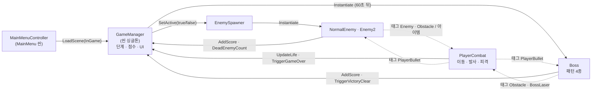

실선은 메서드 호출, 점선은 **태그로 약속한 충돌**입니다.
게임 규칙을 가진 객체(플레이어·적·보스)는 **서로를 직접 참조하지 않습니다.** 결과는 `GameManager.Instance`에만 알리고,
서로에게 주는 영향은 태그가 붙은 오브젝트와 부딪히는 것뿐입니다. 덕분에 적 종류를 추가할 때도
플레이어 코드는 고치지 않고, 새 적에 `Enemy` 태그만 붙이면 됩니다.

| 태그 | 붙은 프리팹 | 부딪히면 | 처리하는 곳 |
|---|---|---|---|
| `PlayerBullet` | 플레이어 총알 | 적·보스 체력 -1, 총알 파괴 | `NormalEnemy` · `Enemy2` · `Boss` |
| `Enemy` | 일반 적, 3방향 적, 보스 | 플레이어 체력 -1, 부딪힌 오브젝트 파괴 | `PlayerCombat` |
| `Obstacle` | 적 총알, 보스 총알 | 플레이어 체력 -1, 총알 파괴 | `PlayerCombat` |
| `BossLaser` | 보스 레이저 | 플레이어 체력 -1 (레이저는 남음) | `PlayerCombat` |
| `Item` / `HpItem` | 무기 강화 / 체력 회복 아이템 | 무기 단계 +1 (최대 3) / 체력 +1 (최대 9) | `PlayerCombat` |

### 3.3 스테이지 흐름 관리

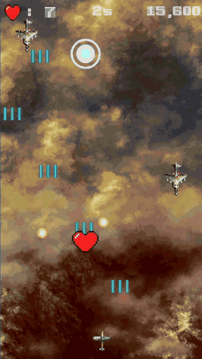

*생존 시간이 0초가 되면 보스가 내려오고, 화면 위 HUD에 BOSS 표시가 나옵니다.*

한 판의 단계(카운트다운 → 생존 → 보스전 → 결과)를 `GameManager` 한 곳에서 바꿉니다. 2.2의 흐름 문제를 푸는 기능입니다.

#### 한 판의 상태 변화

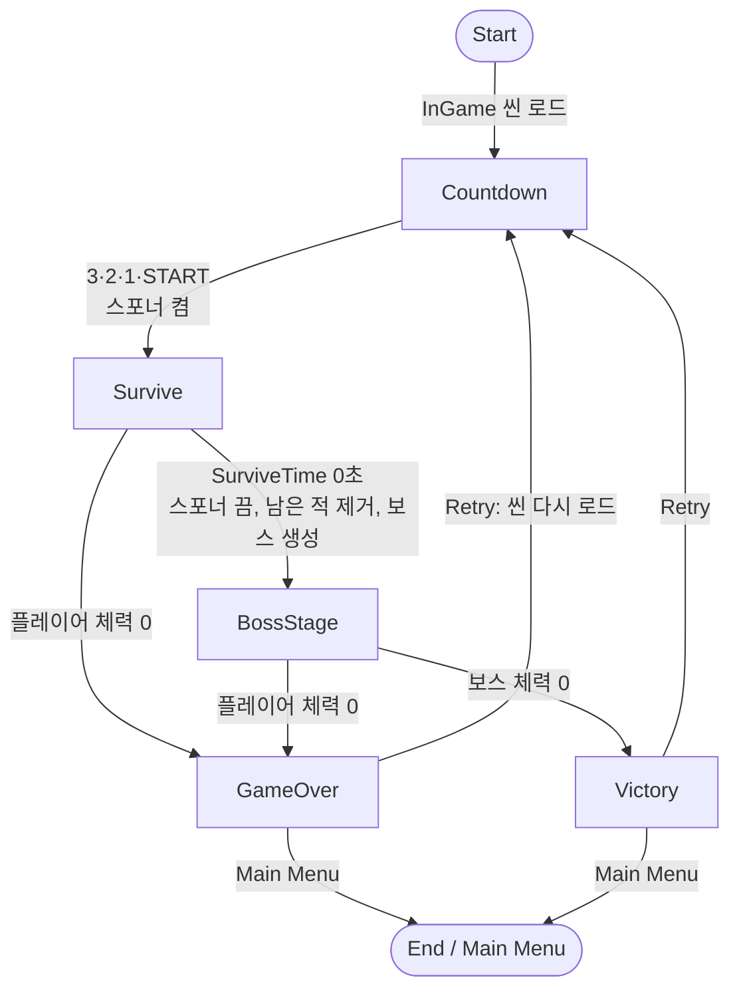

`GameManager`는 위 상태를 `IsGameStarted` · `isBossSpawned`(`IsBossStage`) · `isGameOver` 세 플래그로 표현합니다.
**상태를 바꾸는 코드는 모두 `GameManager` 안에만** 있고, 다른 클래스는 "무슨 일이 일어났다"만 알립니다.

#### 생존 타이머와 보스전 전환

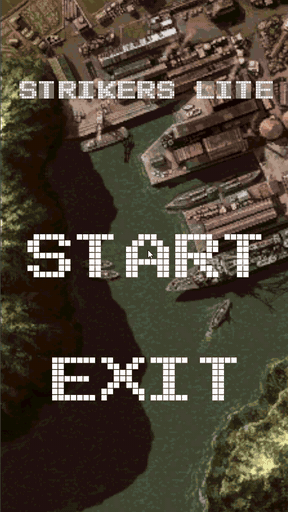

*메인 메뉴에서 START를 누르면 3·2·1 카운트다운 뒤 게임이 시작됩니다. 카운트다운 동안 시간은 "TIME"으로 멈춰 있다가, 시작된 뒤 59초부터 줄어듭니다.*

- 타이머는 카운트다운이 끝나 게임이 시작된 **뒤부터** 줄어듭니다. 3초 카운트다운이 생존 시간을 깎지 않습니다.
- 0초가 되면 보스전 전환을 **딱 한 번만** 실행합니다(`isBossSpawned` 플래그). 이 플래그가 없으면 매 프레임 보스가 생깁니다.
- 보스전으로 넘어갈 때 정리하는 순서가 중요합니다. **① 스포너를 먼저 끄고 → ② 화면에 남은 적을 지우고 → ③ 보스를 만듭니다.**
  ②를 ③보다 먼저 해야 `Enemy` 태그가 붙은 보스가 함께 지워지지 않습니다.
- 스포너를 끄는 것과 별도로 `EnemySpawner` 쪽에서도 보스전인지 확인해, 한쪽이 빠져도 보스전에 적이 나오지 않게 했습니다.

#### 게임 종료 처리

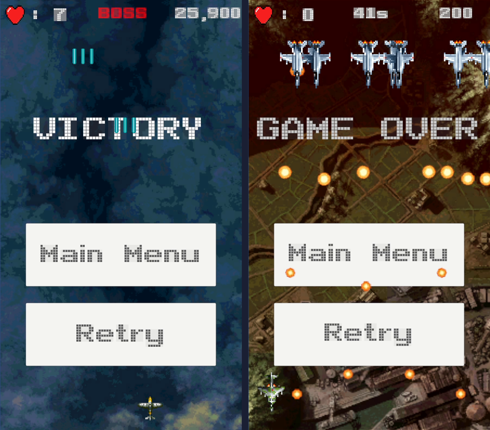

*결과 화면 : 왼쪽은 보스를 격추했을 때(VICTORY), 오른쪽은 체력이 0이 되었을 때(GAME OVER)입니다. 두 화면 모두 Main Menu·Retry 버튼이 있습니다.*

- **예외 방어**: 게임이 이미 끝났으면 종료 처리를 다시 하지 않아, 같은 프레임에 플레이어와 보스가 함께 죽어도 결과는 먼저 온 하나만 처리됩니다.
  같은 플래그 덕분에 게임이 끝난 뒤의 점수도 무시합니다.
- **2초 지연**: 처음에는 죽는 즉시 결과 화면을 띄웠는데, 그러면 플레이어·보스의 폭발 연출이 보이지 않았습니다.
  그래서 2초 기다린 뒤 결과 창을 열고 게임을 멈추게 바꿨습니다(커밋 `18f53ee`).
  기다리는 시간도 게임 시간의 영향을 받으므로, **멈추는 코드를 기다림 뒤에** 둬야 기다림이 끝나지 않고 멈춰 버리는 일이 없습니다.
- Retry·Main Menu 버튼은 멈춘 시간을 되돌린 뒤 씬을 다시 불러옵니다.

#### 게임 상태를 나누는 방법

**당시의 선택** — 학원에서 배운 `GameManager` 싱글톤(`GameManager.Instance`)을 쓰고 싶다고 AI에 요청해 만들었습니다.
다른 방법과 비교해서 고른 것은 아니고, 배운 방법을 그대로 썼습니다.

**지금 돌아본 비교** — 문서를 쓰며 다른 두 방법과 나란히 놓아 봤습니다.

| | A. 씬 싱글톤 `GameManager.Instance` | B. 인스펙터로 참조 연결 | C. 이벤트(`Action`)로 알림 |
|---|---|---|---|
| 방법 | `Awake`에서 `Instance = this`, 어디서나 `GameManager.Instance.AddScore()` | 각 스크립트에 `public GameManager gm` 필드를 두고 드래그로 연결 | 적이 `OnEnemyKilled` 이벤트를 발행, `GameManager`가 구독 |
| 장점 | 코드 한 줄로 접근, 런타임에 생성되는 적·보스도 바로 사용 | 의존 관계가 인스펙터에 드러남 | 적이 `GameManager`를 몰라도 됨 (결합도 가장 낮음) |
| 단점 | 5개 클래스가 `GameManager`에 묶임 | **런타임에 `Instantiate`한 프리팹에는 씬 오브젝트를 드래그할 수 없음** | 구독·해제 관리 필요, 흐름 추적이 어려움 |

돌아보면 이 게임에는 A가 맞았다고 생각합니다. 적·보스·아이템이 모두 실행 중에 `Instantiate`로 생기므로 B는 생성할 때마다 참조를 넘겨줘야 하고,
알려야 할 일이 점수·체력·승리·패배 네 가지뿐이라 C처럼 구독을 관리할 만큼은 아니었습니다.

또 `DontDestroyOnLoad`를 쓰지 않는 씬 싱글톤이라, Retry가 씬을 다시 불러오면 `GameManager`도 새로 만들어집니다.
그래서 점수·타이머·플래그를 하나하나 초기화하는 코드 없이 **한 판이 깨끗하게 처음부터** 시작됩니다.
대가(5개 클래스가 `GameManager`에 묶임)는 5.2에 개선 계획으로 적었습니다.

### 3.4 플레이어 피격과 아이템

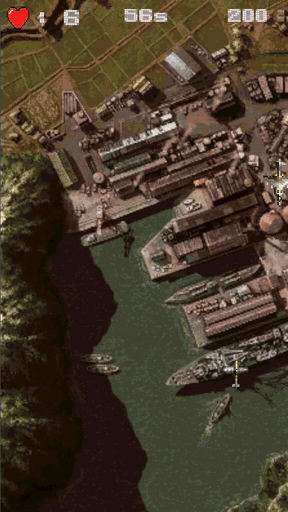

*적 비행기와 부딪히거나 적의 총알에 맞을 때마다 체력이 1씩 줄어듭니다(왼쪽 위 6 → 5 → 4).*

닿아 있는 동안 매 프레임 불리는 피격 판정에서, 한 번 맞으면 2초 동안 무적이 되고 아이템은 무적 중에도 먹힙니다. 2.2의 피격 공정성 문제를 푸는 기능입니다.

*무기 강화 아이템을 먹을 때마다 한 번에 쏘는 총알이 1발 → 2발 → 3발로 늘어납니다.*

#### 충돌 판정 흐름

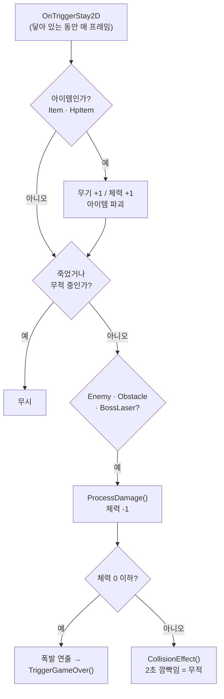

**아이템 처리가 무적 검사보다 앞에 있는 것**이 이 그림의 핵심입니다. 이 순서는 버그를 고치며 정해졌습니다(4.1).

#### 판정 순서와 무적 시간

1. **아이템 먼저** — 무적 중에도 아이템은 먹어야 하므로 무적 검사(`isColliding`)보다 위에 둡니다.
2. **무적 검사** — 무적이거나 이미 죽었으면 아래 피격 판정을 건너뜁니다.
3. **피격** — 총알·적 기체는 부딪히면 함께 사라지지만, 레이저는 **지우지 않습니다**. 보스 레이저는 1.5초 동안 남아 있어야 하기 때문입니다.
4. 상한값(무기 3, 체력 9)은 더하자마자 잘라서, 아이템을 아무리 먹어도 범위를 넘지 않습니다.

무적 시간은 별도 타이머 없이 **깜빡임 연출 코루틴(`CollisionEffect`)이 끝나는 시간**으로 정했습니다.
0.1초씩 투명(알파 0.2)과 원래 색을 10번 오가므로 무적은 정확히 **2초**입니다(3.4 맨 위 GIF에서 보이는 깜빡임).
플레이어가 보는 "깜빡이는 동안은 안 맞는다"와 실제 판정이 **같은 변수 하나**로 묶여 있어, 연출과 판정이 어긋날 일이 없습니다.

#### 피격 판정: Enter vs Stay

**처음에는 `OnTriggerEnter2D`였습니다.** 총알·적처럼 한 번 닿고 사라지는 것만 있을 때는 문제가 없었습니다.
보스 레이저를 만들면서 문제가 생겨, 레이저를 완성한 날(07.03, 커밋 `3303073`) `OnTriggerStay2D`로 바꿨습니다.
그때 본 증상은 정확히 기억나지 않아, 두 방식의 차이를 다시 정리했습니다.

| | A. `OnTriggerEnter2D` | B. `OnTriggerStay2D` + 무적 플래그 |
|---|---|---|
| 호출 시점 | 처음 닿은 프레임에 한 번 | 닿아 있는 동안 매 프레임 |
| 장점 | 한 번 닿으면 한 번만 맞음. 무적 장치 없이도 연속 피격이 없음 | 무적이 끝난 순간에도 **계속 닿아 있으면** 다시 맞음 |
| 단점 | 무적 중에 레이저 안으로 들어가 그대로 있으면, 무적이 끝나도 다시 '들어오는' 일이 없어 **레이저 속에서 안전** | 무적 장치가 없으면 매 프레임 체력이 깎임. 판정 순서를 잘못 짜면 다른 처리도 함께 막힘 |

레이저는 1.5초 동안 **계속 머무는 공격**입니다. A는 처음 닿은 순간 한 번만 불리므로,
무적 중에 레이저 안으로 들어가 그대로 있으면 무적이 끝나도 다시 맞지 않습니다. B는 닿아 있는 동안 계속 불리므로 무적이 끝나면 다시 맞습니다.

대신 B로 바꾸면서 새 문제가 따라왔습니다. 매 프레임 피격되는 것을 막으려고 무적 검사를 함수 **맨 위**로 올렸는데,
이 검사가 아래의 아이템 처리까지 막았습니다. Enter였을 때는 무적 검사가 적·총알 분기 안에만 있어서 생기지 않던 문제입니다.
3일 뒤 플레이 중에 **무적 중에 아이템이 먹히지 않는 것**을 발견해, 판정 순서를 바꿔 고쳤습니다(4.1).

### 3.5 보스 공격 패턴

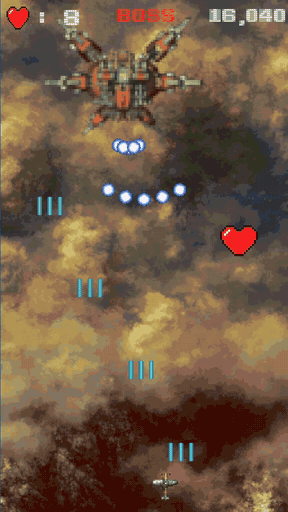

*보스 공격 패턴 : 부채꼴 연사, 회전하며 쏘는 연사, 레이저가 차례로 나옵니다. (2.5배속)*

보스는 좌우로 순찰하면서 4가지 패턴 중 하나를 골라 쏩니다. 2.2의 보스 패턴 문제를 푸는 기능입니다.

#### 패턴을 고르는 방식

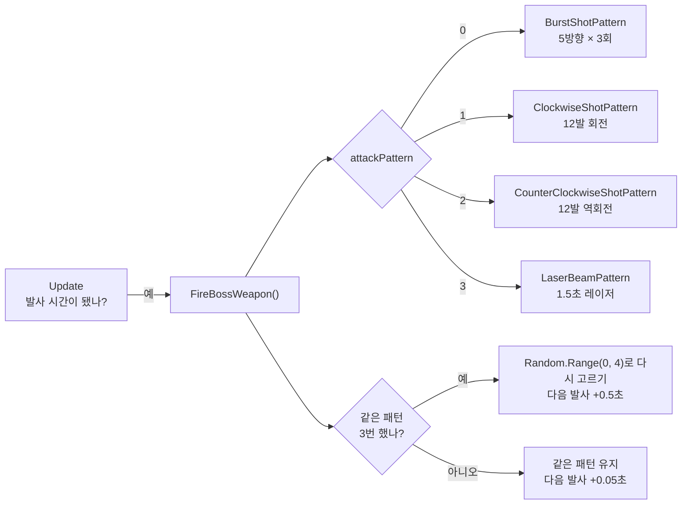

보스는 생성 위치에서 y 3.5까지 내려온 뒤 x -2 ~ 2를 1초씩 멈추며 순찰합니다(`BossPatrolRoutine`).
순찰과 공격은 **서로 다른 코루틴**이라 이동하면서 쏩니다.

- **같은 패턴을 3번 반복**한 뒤 다시 고릅니다(무작위라 같은 패턴이 또 나올 수도 있습니다). 매번 무작위로 바꾸면 플레이어가 패턴을 읽을 틈이 없고, 계속 같으면 단조롭기 때문입니다.
- 패턴이 바뀔 때는 다음 발사를 0.5초 더 늦춰(`FireRate` 2초 + 0.5초) **패턴 사이에 숨 돌릴 틈**을 줍니다.

#### 패턴 4종

| 패턴 | 동작 | 총알 수 | 쏘는 시간 (첫 발 ~ 마지막 발) |
|---|---|---|---|
| 0. 부채꼴 연사 | 아래쪽 150°~210°에 15° 간격 5발, 0.2초 간격 3회 | 15 | 0.4초 |
| 1. 시계 방향 | 120°부터 12°씩 돌리며 0.1초마다 1발 | 12 | 1.1초 |
| 2. 반시계 방향 | 240°부터 12°씩 거꾸로 돌리며 0.1초마다 1발 | 12 | 1.1초 |
| 3. 레이저 | 발사 위치에 레이저를 붙여 1.5초 유지 후 제거 | — | 1.5초 (켜져 있는 시간) |

- 총알은 생성될 때의 회전값만 받고, 스스로 `transform.up` 방향으로 날아갑니다(`BossBullet`). 그래서 **패턴은 '각도'만 정하면 됩니다.**
- 패턴 하나는 함수 하나이고, "0.1초 쉬고 다음 발"을 한 줄로 쓰므로 발사 순서가 코드 순서 그대로 읽힙니다.
- 패턴 시작·끝에서 공격 애니메이션을 켜고 꺼서, 그림과 실제 발사 시간이 일치합니다.
- 레이저는 그림과 판정을 따로 맞춰야 했습니다. 매 프레임 선(LineRenderer)을 아래로 20만큼 그리고,
  맞는 범위(BoxCollider2D)의 높이도 20으로 맞춰 **보이는 선과 맞는 범위를 같게** 만듭니다.

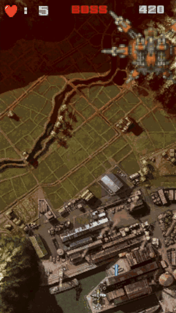

*1. 시계 방향 : 왼쪽 아래에서 시작해 오른쪽 아래로 돌며 0.1초마다 1발씩 쏘고, 같은 패턴을 3번 반복합니다(1배속). 위 GIF에는 나오지 않는 패턴이라 따로 찍었습니다.*

<!-- 🎞 (선택) 나머지 패턴도 따로 찍으면 같은 방식으로 넣을 수 있습니다 → images/boss_pattern_0.gif · 2.gif · 3.gif -->

#### 보스 프리팹 설정

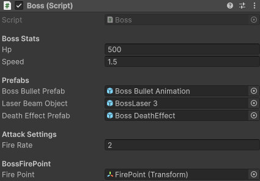

*Boss 프리팹의 인스펙터 : 체력 · 속도 · 발사 간격과 총알 · 레이저 · 폭발 이펙트 · 총알이 나가는 위치를 여기서 정합니다.*

| 인스펙터 항목 | 값 | 하는 일 |
|---|---|---|
| `Hp` | 500 | 보스 체력 |
| `Speed` | 1.5 | 내려오기 · 순찰 이동 속도 |
| `FireRate` | 2초 | 패턴 사이 발사 간격 (패턴이 바뀔 때는 +0.5초) |
| `BossBulletPrefab` | 보스 총알 | 패턴 0~2가 쏘는 총알 |
| `LaserBeamObject` | 레이저 | 패턴 3에서 1.5초 동안 켜는 레이저 |
| `DeathEffectPrefab` | 폭발 이펙트 | 격추될 때 나오는 폭발 |
| `FirePoint` | Transform | 총알이 나가는 위치. 처음에는 보스 중앙에서 쐈는데, 그림의 포구와 맞지 않아 별도 Transform으로 분리했습니다(커밋 `3d109cf`) |

**새 패턴 추가 순서**: ① 패턴 함수를 하나 만든다 → ② 패턴을 고르는 분기에 번호를 하나 더한다 → ③ `Random.Range(0, 4)`의 4를 패턴 개수로 바꾼다.

#### 패턴 타이밍을 만드는 방법

**당시의 선택** — 학원에서 배운 코루틴으로 만들고 싶다고 AI에 요청했습니다. 다른 방식과 비교해서 고른 것은 아닙니다.

**지금 돌아본 비교**

| | A. `Update` + 타이머 변수 | B. 코루틴 (`IEnumerator` + `WaitForSeconds`) | C. Animator / Timeline 이벤트 |
|---|---|---|---|
| 방법 | 패턴마다 `shotTimer`, `shotIndex`를 두고 매 프레임 비교 | 패턴 하나를 함수 하나로, 기다림은 `yield` | 애니메이션 클립의 이벤트에서 발사 함수 호출 |
| 장점 | 실행 흐름이 `Update` 한 곳에 모임. 중간에 끊기 쉬움 | **발사 순서가 코드 순서 그대로**. 패턴 추가 = 함수 추가 | 연출과 타이밍을 에디터에서 눈으로 조정 |
| 단점 | 패턴마다 변수가 늘어 4개 패턴이면 타이머·카운터 8개 이상 | 실행 중인 코루틴을 따로 저장하지 않아 중간에 멈추기 어려움 | 로직이 애니메이션 파일에 흩어져 코드로 추적하기 어려움 |

보스 패턴은 "몇 도로, 몇 초 간격으로, 몇 발"이라는 **순서**이고, 코루틴은 그 순서를 위에서 아래로 읽히는 코드로 옮길 수 있습니다.
패턴 하나가 함수 하나로 나뉘어 있어서, 패턴 3종을 한 번에 추가할 수 있었습니다(07.01, 커밋 `c87b496`).
'중간에 멈추기 어렵다'는 단점은, 보스가 죽으면 `Destroy(gameObject)`로 오브젝트와 함께 코루틴도 모두 멈추는 구조라 이 게임에서는 문제가 되지 않았습니다.

**그래서 지금 고른다면** — `Update` + 타이머(A)를 고르겠습니다. 표처럼 패턴마다 변수가 늘어나는 단점은 있지만, 학원 과제에서 `Time.deltaTime`으로 남은 시간을 줄이는 코드를 직접 짜 본 방식이라 AI가 만든 코드도 제가 읽고 고칠 수 있기 때문입니다.
레이저 전조처럼 패턴 중간에 끊거나 바꿀 일이 생겨도 `Update` 한 곳만 보면 됩니다.

---

## 4. 문제 해결

아래 네 버그는 모두 **플레이 중에 제가 직접 발견**했습니다.
원인을 어떻게 찾았는지는 기억이 정확하지 않아, 이 문서를 쓰며 **고치기 전과 후의 커밋을 다시 비교해** 원인을 확인했습니다.
각 항목의 🔍는 그 확인 방법입니다.

### 4.1 무적 중에 아이템을 먹지 못함

(07.06, 커밋 `e003278`)

- **발견**: 적이나 총알에 맞아 깜빡이는 2초 동안 체력·무기 아이템에 닿아도 먹어지지 않았습니다.
- **원인**: `OnTriggerStay2D`의 **맨 위**에 무적 검사(`if (IsDead || isColliding) return;`)를 두어, 그 아래 있던 아이템 처리까지 함께 건너뛰고 있었습니다.
- **해결**: 아이템 처리를 무적 검사 **위로** 옮겼습니다. "무적이 막아야 하는 것은 피격뿐"이라는 규칙을 코드 순서로 표현했습니다.
- 🔍 **확인**: 레이저 완성 커밋 `3303073`에서 피격 함수를 `OnTriggerStay2D`로 바꾸며 무적 검사가 맨 위로 올라간 것을 찾았습니다(3.4 「피격 판정: Enter vs Stay」).
  그 전(`OnTriggerEnter2D`)에는 무적 검사가 적·총알 분기 안에만 있었습니다.

| As-Is | To-Be |
|---|---|
| 무적 검사 → 피격 처리 → 아이템 처리 | 아이템 처리 → 무적 검사 → 피격 처리 |
| 무적 2초 동안 아이템 무시 | 무적 중에도 아이템 획득, 피격만 무시 |

### 4.2 적은 안 보이고 점수만 오름

(06.24 첫날, 커밋 `6f05495`)

- **발견**: 일반 적이 화면에 나타나지 않는데, 점수는 혼자 계속 올라갔습니다.
- **원인**: 격추 시 실행해야 할 `AddScore(100)`과 `Destroy(gameObject)`를 `OnTriggerEnter2D`가 아니라 **`Update` 안에** 써서,
  적이 생성된 첫 프레임에 스스로 점수를 올리고 사라지고 있었습니다. 스포너가 적을 만드는 주기만큼 점수가 오른 것입니다.
- **해결**: 두 줄을 `OnTriggerEnter2D`의 `PlayerBullet` 충돌 분기 안으로 옮겼습니다.
- **결과**: 일반 적이 화면에 나타나고, 점수는 총알로 격추할 때만 오르게 됐습니다.
- 🔍 **확인**: 첫 작업 커밋 `1390705`의 `Enemy1.Update`에 `AddScore(100)`·`Destroy(gameObject)`가 있었고,
  고친 커밋에서 두 줄이 `OnTriggerEnter2D`로 옮겨진 것을 비교했습니다.

### 4.3 좌우를 함께 누르면 기체가 기울어짐

(07.01, 커밋 `40d1afd`)

- **발견**: 플레이 중 좌우를 동시에 누르자, 기체는 멈췄는데 왼쪽으로 기울어 있었습니다.
- **문제**: 이동은 좌우 입력을 **더해서**(-1 + 1 = 0) 멈추는데, 애니메이션은 `if / else if`로 왼쪽을 먼저 검사해 왼쪽으로 기울었습니다.
- **원인**: 이동(`PlayerCombat`)과 애니메이션(`PlayerAnimation`)이 같은 입력을 **서로 다른 규칙**으로 읽고 있었습니다.
- **해결**: 애니메이션도 이동과 같이 `horizontal`에 -1·+1을 더하는 방식으로 바꿔 둘의 규칙을 맞췄습니다.
  또 값이 바뀔 때만 `SetInteger`를 부르게 해 매 프레임 같은 값을 다시 넣지 않도록 했습니다.
- **결과**: 좌우를 동시에 누르면 멈춘 채 기울지 않습니다.
- 🔍 **확인**: 고친 커밋에서 `PlayerAnimation`의 `if / else if`가 `horizontal`에 -1·+1을 더하는 방식으로 바뀐 것을 비교했습니다.

### 4.4 3방향 적이 오른쪽으로 기울지 않음

(07.06, 커밋 `2b25c21`, `e003278`)

- **발견**: 3방향 적이 왼쪽으로 갈 때는 기우는데, 오른쪽으로 갈 때는 기울지 않았습니다.
- **원인**: 애니메이터 전이 조건은 `Move`가 -1 / 0 / 1과 **같을 때**인데, 코드는 오른쪽에 2, 왼쪽에 1을 넘기고 있었습니다.
  2는 어느 조건과도 맞지 않았습니다.
- **해결**: 플레이어와 같은 규칙(왼쪽 -1 · 정지 0 · 오른쪽 1)으로 값을 맞추고, 같은 값이면 다시 넣지 않는 검사를 더했습니다.
- **결과**: 좌우 모두 이동 방향으로 기웁니다.
- 🔍 **확인**: `2b25c21`에서 `Enemy2Anim(2)` → `(1)`, `(1)` → `(-1)`로 바뀐 것과, `e003278`에서 같은 값을 다시 넣지 않는 검사가 더해진 것을 비교했습니다.

### 4.5 코드를 다시 읽다 찾은 문제

문서를 쓰며 AI와 함께 코드를 다시 읽다가 찾은 문제입니다. ①②는 게임에서 직접 재현해 확인했고, 아직 고치지 않았습니다.

| # | 문제 | 원인 | 고치는 방법(제안) |
|---|---|---|---|
| ① | 플레이어가 보스에 몸으로 부딪히면 보스가 사라지고 VICTORY가 뜨지 않음 (게임에서 확인) | 보스도 `Enemy` 태그인데, `PlayerCombat`은 `Enemy`와 부딪히면 상대를 `Destroy`함. 승리 처리는 보스가 총알에 맞아 죽을 때만 실행 | 보스에 별도 태그(`Boss`)를 주고, 부딪히면 플레이어만 피해를 받게 분리 |
| ② | Space를 누를 때마다 날아가는 총알이 모두 복제되어 총알 수가 두 배씩 늘어남. 빠르게 연타하면 에디터가 잠깐 멈출 정도 (게임에서 확인) | `PlayerBullet.Update`에 Space 입력 검사와 `Instantiate(BulletPrefab)`가 남아 있고, 총알 프리팹의 `BulletPrefab`이 자기 자신을 가리킴. 복제본도 같은 코드를 가지고 있어, 누를 때마다 화면의 총알이 모두 다시 복제됨 | 총알에서 입력·생성 코드를 지우고 발사는 `PlayerCombat`만 담당 |
| ③ | 일반 적 코드에 "카운터가 10 이상이면 체력 아이템 확정" 조건이 남아 있지만 실제로는 실행되지 않음. 체력 아이템에 확정 드랍이 없는 것 자체는 의도(2.3) | 카운터(`DeadEnemyCount`)를 올리는 곳은 `Enemy2`뿐이고, 10이 되는 순간 `Enemy2`가 파워업을 주며 바로 0으로 되돌림 | 쓰이지 않는 조건을 `NormalEnemy`에서 지워, 코드를 읽는 사람이 체력 아이템에도 확정 드랍이 있다고 오해하지 않게 함 |

---

## 5. 결과와 배운 점

### 5.1 결과

- 기획한 한 판의 흐름(카운트다운 → 60초 생존 → 보스전 → 결과 → 재시작)을 **2주(커밋 38개)** 안에 완성하고 Windows 빌드까지 만들었습니다.
- 2.2의 세 문제를 이렇게 풀었습니다.

| 문제 | 해결 | 결과 |
|---|---|---|
| 흐름 | 단계 전환을 `GameManager` 한 곳에 모으고 플래그로 한 번만 실행 | 보스전에 일반 적 0, 게임 종료 뒤 점수 변화 0. 재시작은 씬 다시 로드로 초기화 코드 없이 처리 |
| 피격 공정성 | `OnTriggerStay2D` + 2초 무적(깜빡임과 같은 변수) | 1.5초 레이저 안에서도 피격은 1회. 무적 중에도 아이템 획득 |
| 보스 패턴 | 패턴 하나 = 코루틴 하나, 3회 반복 후 무작위로 다시 고름 | 패턴 4종. 새 패턴은 함수 1개 + 분기 1줄로 추가 |

### 5.2 아쉬운 점과 다음 계획

**만들고 플레이하며 느낀 점** (업데이트 기획서의 회고에서)

- **난이도** — 원작보다 쉽게 만들려고 했지만, 제작자인 저도 가끔 설정한 곳에 도달하지 못할 정도로 어려웠습니다.
- **화면 크기** — 모니터 크기를 생각하지 못하고 1080×1920으로 만들어, 빌드해 실행하면 글자가 게임 화면을 벗어났습니다.
  세로 게임이라 빌드했을 때 양옆이 비어 보이는 것도 예상하지 못했습니다.
- **단조로움** — 적이 2종뿐이고 출현 방식과 공격 패턴이 단조로우며, 이펙트가 단순해 게임이 전체적으로 비어 보입니다.
- **보스** — 등장 연출 없이 바로 공격이 이어지고, 레이저가 전조 없이 발사돼 플레이어가 예측할 수 없습니다.
- **일정** — 기획서에서는 7~8일로 잡았지만 2주가 걸렸습니다. 미숙한 제작 실력과 예상치 못한 오류로 시간을 잡아먹은 것이 위의 아쉬움으로 나타났다고 생각합니다.

**다음 버전 계획** (업데이트 기획서 — 아직 만들지 않았습니다)

- **난이도** → 스테이지마다 세이브 포인트를 두어 플레이어가 박탈감을 덜 느끼게 합니다.
- **화면 크기** → 비어 있던 양옆에 점수·목숨·타이머를 옮겨, 가운데에는 게임만 온전히 보이게 합니다.
- **단조로움** → 스테이지 3개(일반 2 · 보스 1)마다 다른 적과 패턴을 넣고, 성능이 다른 비행기 여러 대와 비행기마다의 필살기를 더합니다.
- **보스** → 보스 스테이지에 들어갈 때 보스 쪽으로 시점을 3초간 확대하는 등장 연출을 넣습니다.
- 그 밖에 Esc 일시 정지와, 지금은 전혀 없는 BGM·효과음을 넣을 계획입니다.

코드에서 찾은 문제 ①②③은 4.5에 적었습니다.

**설계상 감수한 부분** — AI와 함께 코드를 다시 읽으며 정리

- **총알을 매번 생성·파괴** — 모든 총알·적·이펙트를 `Instantiate`/`Destroy`합니다. 보스 부채꼴 패턴만 해도 0.6초에 15발입니다.
  이번에는 프레임·GC를 **측정하지 않았습니다**. → 제안: 프로파일러로 보스전 GC 할당을 먼저 재고 오브젝트 풀링을 적용해 전후를 비교.
- **화면 경계가 숫자로 흩어져 있음** — `-6.0f`, `±4.0f`, `±2.8f`, `±4.8f` 같은 경계가 6개 파일에 직접 적혀 있습니다.
  마지막 날 해상도를 1080×1920에서 607×1080으로 바꿨을 때(커밋 `2973284`) 이 값들을 손으로 맞춰야 했습니다.
  → 제안: 카메라 크기에서 경계를 계산하는 클래스 하나로 모으기.
- **`GameManager`가 하는 일이 많음** — 단계 전환·점수·UI 텍스트·결과 창·씬 이동을 모두 맡아 244줄이고, 5개 클래스가 직접 의존합니다.
  → 제안: UI 갱신을 `HUD` 클래스로 떼어 내고, 점수·체력 변화는 이벤트로 알리는 구조(3.3 「게임 상태를 나누는 방법」의 C안)로 옮기기.
- **총알 데미지가 고정** — `PlayerBullet.Damage` 필드가 있지만 적·보스는 항상 1씩 깎습니다. 무기 강화가 '발 수'만 늘리는 이유입니다.
- **같은 코드의 총알 스크립트 2개** — `EnemyBullet`과 `BossBullet`은 내용이 같고, 쓰이지 않는 프리팹(`BossMissile`, `BossLaser` 등)도 남아 있습니다. → 제안: 하나로 합치고 정리하기.

### 5.3 배운 점

- **도형으로 먼저 만들기** — 총알·아이템·적·보스를 처음부터 그림으로 만들지 않고 도형으로 먼저 구현했습니다.
  덕분에 나중에 그림과 애니메이션을 넣을 때 90% 이상 원활하게 진행됐습니다.
- **한 판을 끝까지 완성하기** — 게임 시작, 승리·패배, 재시작, 메인 메뉴로 돌아가기까지 가장 기본인 루프가 잘 돌았습니다.
  처음 만든 게임이지만 한 판이 처음부터 끝까지 돌아가게 만든 경험이 남았습니다.
- **화면 크기와 난이도는 처음에 정해야 한다** — 해상도를 마지막 날 바꾸느라 화면 경계 숫자를 손으로 맞춰야 했고(5.2),
  '원작보다 쉽게'라는 의도와 달리 제가 해도 어려운 게임이 됐습니다.
  다음에는 기획 단계에서 화면 크기를 먼저 정하고, 난이도는 만들면서 직접 플레이해 맞춰 보겠습니다.

---

## 부록. 코드 구조

코드는 큰 틀을 직접 나누고 세부는 AI와 함께 만들었습니다. 구조가 궁금한 분을 위해 클래스 역할과 `GameManager`의 공개 멤버만 남깁니다.
실제 코드는 GitHub와 이 폴더의 `code/`에 있습니다.

| 클래스 | 책임 | 하지 않는 일 |
|---|---|---|
| `GameManager` | 단계 전환(카운트다운·생존·보스·결과), 점수·체력·타이머 UI, 스포너 켜고 끄기, 재시작·메뉴 이동 | 적·보스 피격 판정 |
| `EnemySpawner` | 1초마다 두 종류 중 하나를 화면 위 x -3 ~ 3에 생성 | 언제 멈출지 판단 (`GameManager`가 끔) |
| `PlayerCombat` | 이동(화면 안으로 제한), 무기 단계별 발사, 피격·무적, 아이템 획득 | 점수·UI 갱신 (`GameManager`에 알림) |
| `NormalEnemy` / `Enemy2` | 이동·사격, 피격 시 점수와 아이템 드랍 | 다른 적·플레이어 상태 확인 |
| `Boss` | 등장 이동·좌우 순찰, 패턴 선택·실행, 격추 시 승리 알림 | 애니메이터 파라미터 직접 조작 (`BossAnimation`에 맡김) |
| `LaserBeam` | 레이저의 그림(LineRenderer)과 판정(BoxCollider2D) 길이를 맞춤 | 데미지 계산 (`BossLaser` 태그로 `PlayerCombat`이 처리) |
| `PlayerBullet` · `EnemyBullet` · `BossBullet` | 바라보는 방향으로 직진, 화면 밖이면 파괴 | 데미지 계산 |
| `ScrollController` | 배경 레이어를 대기열에 미리 만들어 두고 이어 붙여 스크롤 | 게임 규칙 |
| `PlayerAnimation` · `Enemy2Animation` · `BossAnimation` | 애니메이터 파라미터를 감싼 얇은 래퍼 | 이동·판정 |

다른 스크립트는 `GameManager.Instance`의 아래 멤버만 씁니다.

| 멤버 | 누가 부르나 | 하는 일 |
|---|---|---|
| `AddScore(int amount)` | 적·보스 | 점수를 더하고 UI 갱신. **게임이 끝난 뒤에는 무시** |
| `UpdateLife(int currentLife)` | `PlayerCombat` | 체력 UI 갱신 |
| `TriggerGameOver()` | `PlayerCombat` (체력 0) | 스포너 끄고 2초 뒤 GAME OVER 화면 + 일시정지 |
| `TriggerVictoryClear()` | `Boss` (체력 0) | 스포너 끄고 2초 뒤 VICTORY 화면 + 일시정지 |
| `IsBossStage` (읽기 전용) | `EnemySpawner` | 보스전이면 생성을 멈춤 |
| `DeadEnemyCount` | 적 | 무기 강화 아이템 확정 드랍 카운터 (2.3) |
