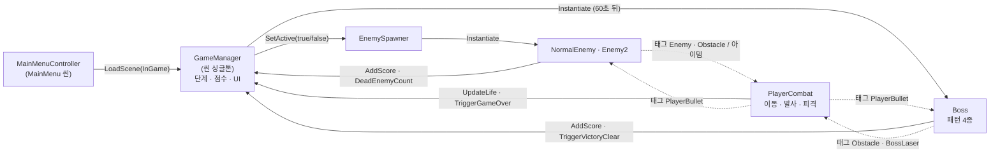
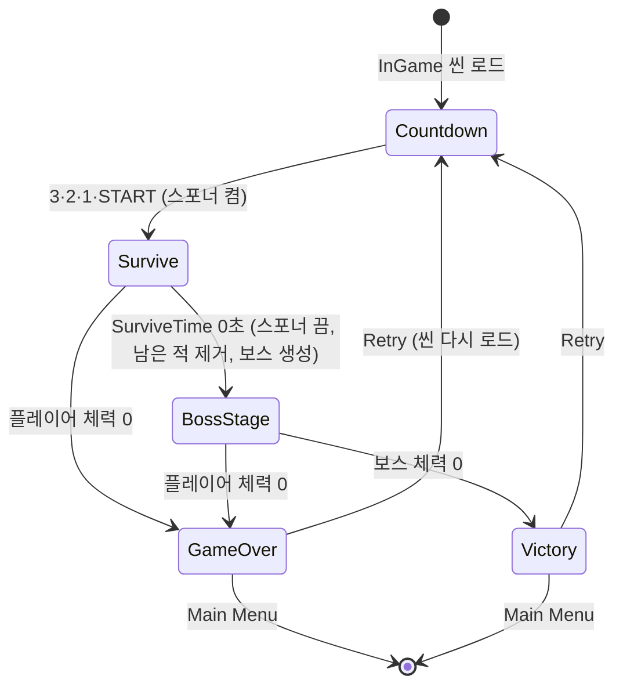
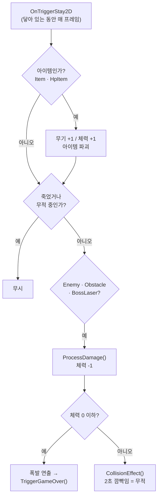
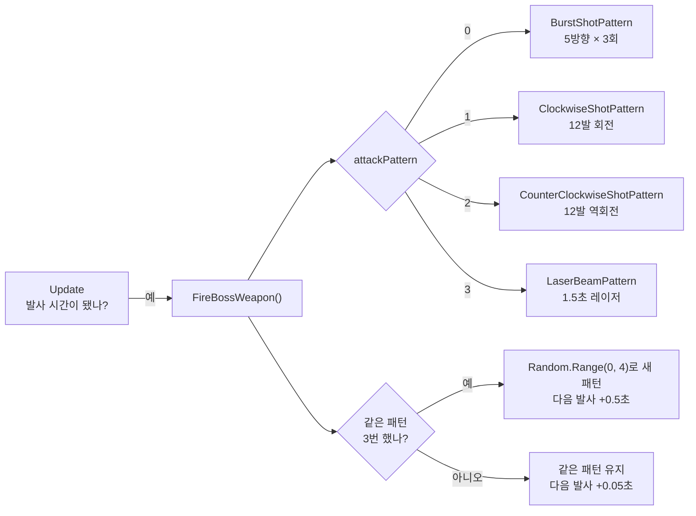

<!--
✍ 작성자 확인 목록 (이 주석은 화면에 보이지 않습니다. 다 확인하면 지워도 됩니다)

이 문서는 Claude가 코드(Assets/01_Scripts)·프리팹·커밋 메시지에서 확인한 사실로 쓴 초안입니다.
아래 항목은 코드만으로는 알 수 없는 내용이라, 본인 생각과 다르면 고쳐 주세요. 면접에서 질문받는 부분입니다.

1. 게임 제목 "Strikers Lite" — 포트폴리오 폴더 이름에서 가져왔습니다. 실제 제목이 다르면 바꾸세요.
2. 1.5 레퍼런스 "스트라이커즈 1945" — 폴더 이름에서 추정했습니다. 실제로 참고한 게임으로 고치세요.
3. 1.4 시연 영상 링크 — 비어 있습니다. 영상을 올린 뒤 주소를 넣으세요.
4. 3.5 / 4.5 / 5.5 "고민과 선택"의 판단 이유 — 코드에 드러난 선택을 바탕으로 이유를 정리했습니다.
   당시 실제로 비교했던 대안·이유와 다르면 본인 말로 고쳐 주세요.
5. 6.3 아쉬운 점 중 ①②③은 문서를 쓰며 코드에서 찾은 문제입니다. 게임을 실행해 정말 그런지 확인하세요.
6. 6.4 배운 점 — 트러블슈팅 기록을 바탕으로 썼습니다. 본인이 느낀 점으로 바꿔 쓰는 것을 권합니다.
7. 수치는 인스펙터(프리팹·씬) 값 기준입니다. 단, 작업 중인 Boss.prefab의 Hp가 10으로 바뀌어 있습니다(커밋된 값 500).
   테스트용이면 500으로 되돌리세요.
-->

# Strikers Lite 기술 문서

> 60초를 버티면 보스가 내려오는 세로 화면 2D 비행 슈팅 게임
> Unity 6 · URP 2D · C# · 개인 프로젝트 (2주)

---

## 1. 개요

### 1.1 무엇을 만들었나 (What)

**Strikers Lite**는 세로 화면(607×1080)에서 비행기를 조종해 적을 격추하는 2D 슈팅 게임입니다.
한 판은 **60초 생존 → 보스전** 두 단계입니다. 보스를 격추하면 VICTORY, 체력이 0이 되면 GAME OVER이고,
결과 화면에서 바로 다시 하거나(Retry) 메인 메뉴로 돌아갈 수 있습니다.
적을 격추하면 일정 확률로 무기 강화·체력 회복 아이템이 떨어져, 오래 버틸수록 화력이 세집니다.

| 항목 | 내용 |
|---|---|
| 씬 | `MainMenu` → `InGame` |
| 한 판의 흐름 | 카운트다운 3초 → 60초 생존 → 보스전 → 결과 화면 (2초 뒤 표시) |
| 적 | 일반 적(한 발에 격추, 직진) · 3방향 적(체력 7, 좌우 순찰하며 3방향 탄 발사) |
| 보스 | 체력 500, 공격 패턴 4종 (부채꼴 연사 · 시계 방향 · 반시계 방향 · 레이저) |
| 성장 | 무기 1→3단계 (한 번에 1·2·3발), 체력 최대 9 (시작 6) |
| 점수 | 일반 적 100 · 3방향 적 300 · 보스 명중 1발당 10 · 보스 격추 5,000 |

### 1.2 왜 이 부분이 어려웠나 (Why)

슈팅 게임은 수십 개의 총알·적이 동시에 부딪히고 사라지는 장르입니다. 만들면서 부딪힌 문제는 세 가지였습니다.

1. **흐름 문제** — 한 판 안에 카운트다운·생존·보스·결과 네 단계가 있고, 단계가 바뀔 때마다
   스포너·타이머·UI·남아 있는 적·시간 배율이 **한꺼번에** 바뀌어야 합니다.
   보스가 나왔는데 스포너가 계속 적을 내보내거나, 게임 오버 뒤에도 점수가 오르면 한 판의 규칙이 무너집니다.
2. **피격 공정성 문제** — 플레이어의 피격 판정은 닿아 있는 동안 **매 프레임** 호출됩니다(`OnTriggerStay2D`).
   아무 장치 없이 체력을 깎으면, 1.5초 동안 켜져 있는 보스 레이저에 스치기만 해도 60fps 기준 약 90번 판정되어 즉사합니다.
   반대로 무적 시간을 두자 이번에는 **무적 중에 아이템을 먹지 못하는** 버그가 생겼습니다(6.2).
3. **보스 패턴 문제** — 보스는 이동(내려오기 → 좌우 순찰)과 공격(4가지 패턴, 각 패턴은 0.1~0.2초 간격의 연속 발사)을
   동시에 해야 합니다. `Update` 한 곳에서 타이머 변수로 처리하면 패턴이 늘 때마다 타이머와 카운터가 함께 늘어납니다.

### 1.3 이 문서에서 다루는 것

| 문제 | 기능 | 섹션 |
|---|---|---|
| 흐름 | 스테이지 흐름 관리 (`GameManager`) | 3 |
| 피격 공정성 | 플레이어 전투: 피격·무적·아이템·무기 강화 (`PlayerCombat`, 적 드랍) | 4 |
| 보스 패턴 | 보스 공격 패턴 (`Boss`, 코루틴) | 5 |

### 1.4 개발 환경

- **Engine**: Unity 6000.3.15f1 (Unity 6), URP 2D 17.3, Input System 1.19, TextMeshPro
- **Language**: C# — 스크립트 17개, 1,338줄 (전부 직접 작성)
- **화면**: 세로 607×1080
- **기간**: 2026.06.24 ~ 2026.07.07 (2주, 커밋 38개, 개인 프로젝트)
- **링크**: GitHub https://github.com/KooHoo-Dev/3rd-2D-Project-wjsdudgh99 · 시연 영상 ✍ (업로드 후 주소 추가)

### 1.5 레퍼런스, 핵심 루프, 조작

- **레퍼런스**: 「스트라이커즈 1945」 같은 세로 스크롤 비행 슈팅.
  이 프로젝트는 긴 스테이지 대신 **한 판을 '60초 생존 + 보스 1기'로 압축**해, 짧은 시간 안에 성장(무기 강화)과 보스전을 모두 겪게 했습니다.
- **핵심 루프**: 이동하며 사격 → 적 격추(점수) → 아이템 획득(무기 강화·체력 회복) → 60초 버티기 → 보스 격추

| 조작 | 결과 |
|---|---|
| 방향키 | 8방향 이동 (화면 밖으로 나가지 않음). 좌우 입력에 따라 기체가 기울어짐 |
| Space (누르고 있기) | 0.2초마다 발사. 무기 단계에 따라 1·2·3발 |
| 마우스 클릭 | 메인 메뉴 Start / Exit, 결과 화면 Retry / Main Menu |

---

## 2. 시스템 구조

### 2.1 전체 구성



실선은 메서드 호출, 점선은 **태그로 약속한 충돌**입니다.
게임 규칙을 가진 객체(플레이어·적·보스)는 **서로를 직접 참조하지 않습니다.** 결과는 `GameManager.Instance`에만 알리고,
서로에게 주는 영향은 태그가 붙은 오브젝트와 부딪히는 것뿐입니다. 덕분에 적 종류를 추가할 때도
플레이어 코드는 고치지 않고, 새 적에 `Enemy` 태그만 붙이면 됩니다.

### 2.2 핵심 클래스 역할

| 클래스 | 책임 | 하지 않는 일 |
|---|---|---|
| `GameManager` | 단계 전환(카운트다운·생존·보스·결과), 점수·체력·타이머 UI, 스포너 켜고 끄기, 재시작·메뉴 이동 | 적·보스 피격 판정 |
| `EnemySpawner` | 1초마다 두 종류 중 하나를 화면 위 x -3 ~ 3에 생성 | 언제 멈출지 판단 (`GameManager`가 끔) |
| `PlayerCombat` | 이동(화면 안으로 제한), 무기 단계별 발사, 피격·무적, 아이템 획득 | 점수·UI 갱신 (`GameManager`에 알림) |
| `NormalEnemy` / `Enemy2` | 이동·사격, 피격 시 점수와 아이템 드랍 | 다른 적·플레이어 상태 확인 |
| `Boss` | 등장 이동·좌우 순찰, 패턴 선택·실행, 격추 시 승리 알림 | 애니메이터 파라미터 직접 조작 (`BossAnimation`에 맡김) |
| `LaserBeam` | 레이저의 그림(LineRenderer)과 판정(BoxCollider2D) 길이를 맞춤 | 데미지 계산 (`BossLaser` 태그로 `PlayerCombat`이 처리) |
| `PlayerBullet` · `EnemyBullet` · `BossBullet` | 바라보는 방향으로 직진, 화면 밖이면 파괴 | 데미지 계산 |
| `ScrollController` | 배경 레이어를 대기열에 미리 만들어 두고 이어 붙여 스크롤 | 게임 규칙 |
| `PlayerAnimation` · `Enemy2Animation` · `BossAnimation` | 애니메이터 파라미터를 감싼 얇은 래퍼 | 이동·판정 |

### 2.3 태그로 정한 충돌 규칙

| 태그 | 붙은 프리팹 | 부딪히면 | 처리하는 곳 |
|---|---|---|---|
| `PlayerBullet` | 플레이어 총알 | 적·보스 체력 -1, 총알 파괴 | `NormalEnemy` · `Enemy2` · `Boss` |
| `Enemy` | 일반 적, 3방향 적, 보스 | 플레이어 체력 -1, 부딪힌 오브젝트 파괴 | `PlayerCombat` |
| `Obstacle` | 적 총알, 보스 총알 | 플레이어 체력 -1, 총알 파괴 | `PlayerCombat` |
| `BossLaser` | 보스 레이저 | 플레이어 체력 -1 (레이저는 남음) | `PlayerCombat` |
| `Item` / `HpItem` | 무기 강화 / 체력 회복 아이템 | 무기 단계 +1 (최대 3) / 체력 +1 (최대 9) | `PlayerCombat` |

---

## 3. 기능 1: 스테이지 흐름 관리 (GameManager)

### 3.1 구조: 한 판의 상태 변화



`GameManager`는 위 상태를 `IsGameStarted` · `isBossSpawned`(`IsBossStage`) · `isGameOver` 세 플래그로 표현합니다.
**상태를 바꾸는 코드는 모두 `GameManager` 안에만** 있고, 다른 클래스는 "무슨 일이 일어났다"만 알립니다.

### 3.2 사용법 (API)

다른 스크립트는 `GameManager.Instance`의 아래 멤버만 씁니다.

| 멤버 | 누가 부르나 | 하는 일 |
|---|---|---|
| `AddScore(int amount)` | 적·보스 | 점수를 더하고 UI 갱신. **게임이 끝난 뒤에는 무시** |
| `UpdateLife(int currentLife)` | `PlayerCombat` | 체력 UI 갱신 |
| `TriggerGameOver()` | `PlayerCombat` (체력 0) | 스포너 끄고 2초 뒤 GAME OVER 화면 + 일시정지 |
| `TriggerVictoryClear()` | `Boss` (체력 0) | 스포너 끄고 2초 뒤 VICTORY 화면 + 일시정지 |
| `IsBossStage` (읽기 전용) | `EnemySpawner` | 보스전이면 생성을 멈춤 |
| `DeadEnemyCount` | 적 | 아이템 확정 드랍 카운터 (4.4) |

### 3.3 핵심 동작: 생존 타이머와 보스전 전환

```csharp
void Update()
{
    if (isGameOver) return;

    if (IsGameStarted == false)
    {
        return;
    }

    if (SurviveTime > 0)
    {
        SurviveTime -= Time.deltaTime;

        if (TimerText != null)
        {
            TimerText.text = Mathf.Max(0, (int)SurviveTime) + "s";
        }
    }
    else if (isBossSpawned == false)
    {
        SpawnBossStage();
    }
}
```

- 타이머는 카운트다운 코루틴이 `IsGameStarted = true`로 바꾼 **뒤부터** 줄어듭니다. 3초 카운트다운이 생존 시간을 깎지 않습니다.
- 0초가 되면 `isBossSpawned` 플래그로 `SpawnBossStage()`를 **딱 한 번만** 부릅니다. 이 플래그가 없으면 매 프레임 보스가 생깁니다.

```csharp
private void SpawnBossStage()
{
    isBossSpawned = true;
    IsBossStage = true;

    if (TimerText != null)
    {
        TimerText.text = "BOSS";
        TimerText.color = Color.red;
    }

    if (EnemySpawner != null)
    {
        EnemySpawner.SetActive(false);
    }

    GameObject[] remainingEnemies = GameObject.FindGameObjectsWithTag("Enemy");
    foreach (GameObject enemy in remainingEnemies)
    {
        Destroy(enemy);
    }

    if (BossPrefab != null)
    {
        Vector3 bossSpawnPos = new Vector3(0f, 4.0f, 0f);
        Instantiate(BossPrefab, bossSpawnPos, Quaternion.identity);
    }
}
```

보스전으로 넘어갈 때 정리하는 순서가 중요합니다. **① 스포너를 먼저 끄고 → ② 화면에 남은 적을 지우고 → ③ 보스를 만듭니다.**
②를 ③보다 먼저 해야 `Enemy` 태그가 붙은 보스가 함께 지워지지 않습니다.
스포너는 `SetActive(false)`로 끄는 것과 별도로 `EnemySpawner` 쪽에서도 `IsBossStage`를 확인해, 한쪽이 빠져도 보스전에 적이 나오지 않게 했습니다.

### 3.4 핵심 동작: 게임 종료는 한 번만, 2초 뒤에

```csharp
public void TriggerGameOver()
{
    if (isGameOver) return;

    isGameOver = true;
    Debug.Log("GAME OVER");

    if (EnemySpawner != null)
    {
        EnemySpawner.SetActive(false);
    }

    StartCoroutine(GameOverDelay());
}

private IEnumerator GameOverDelay()
{
    yield return new WaitForSeconds(2);

    if (GameOverCanvas != null)
    {
        GameOverCanvas.SetActive(true);
    }

    Time.timeScale = 0f;
}
```

- **예외 방어**: 첫 줄의 `if (isGameOver) return;`으로, 같은 프레임에 플레이어와 보스가 함께 죽어도 결과는 먼저 온 하나만 처리됩니다.
  같은 플래그 덕분에 `AddScore`도 게임이 끝난 뒤의 점수를 무시합니다.
- **2초 지연**: 처음에는 죽는 즉시 결과 화면을 띄웠는데, 그러면 플레이어·보스의 폭발 연출이 보이지 않았습니다.
  그래서 2초 기다린 뒤 결과 창을 열고 `Time.timeScale = 0f`로 멈추게 바꿨습니다(커밋 `18f53ee`).
  `WaitForSeconds`는 시간 배율의 영향을 받으므로, **멈추는 코드를 기다림 뒤에** 둬야 코루틴이 멈추지 않습니다.
- Retry·Main Menu 버튼은 `Time.timeScale = 1f`로 되돌린 뒤 씬을 다시 불러옵니다.

### 3.5 고민과 선택: 게임 상태를 어떻게 공유할 것인가

| | A. 씬 싱글톤 `GameManager.Instance` | B. 인스펙터로 참조 연결 | C. 이벤트(`Action`)로 알림 |
|---|---|---|---|
| 방법 | `Awake`에서 `Instance = this`, 어디서나 `GameManager.Instance.AddScore()` | 각 스크립트에 `public GameManager gm` 필드를 두고 드래그로 연결 | 적이 `OnEnemyKilled` 이벤트를 발행, `GameManager`가 구독 |
| 장점 | 코드 한 줄로 접근, 런타임에 생성되는 적·보스도 바로 사용 | 의존 관계가 인스펙터에 드러남 | 적이 `GameManager`를 몰라도 됨 (결합도 가장 낮음) |
| 단점 | 5개 클래스가 `GameManager`에 묶임 | **런타임에 `Instantiate`한 프리팹에는 씬 오브젝트를 드래그할 수 없음** | 구독·해제 관리 필요, 흐름 추적이 어려움 |

**A를 선택했습니다.** 이 게임의 적·보스·아이템은 모두 실행 중에 `Instantiate`로 생기므로, B는 생성할 때마다 참조를 넘겨줘야 합니다.
C는 결합도가 가장 낮지만, 알려야 할 일이 점수·체력·승리·패배 네 가지뿐인 2주짜리 1인 프로젝트에는 구독 관리 비용이 더 크다고 봤습니다.

대신 **`DontDestroyOnLoad`를 쓰지 않는 씬 싱글톤**으로 만들었습니다. Retry가 씬을 다시 불러오면 `GameManager`도 새로 만들어지므로,
점수·타이머·플래그를 하나하나 초기화하는 코드 없이 **한 판이 깨끗하게 처음부터** 시작됩니다.
감수한 대가(5개 클래스의 결합)는 6.3에 개선 계획으로 적었습니다.

---

## 4. 기능 2: 플레이어 전투 — 피격·무적·아이템

### 4.1 구조: 플레이어가 무엇과 부딪히나



**아이템 처리가 무적 검사보다 앞에 있는 것**이 이 그림의 핵심입니다. 이 순서는 버그를 고치며 정해졌습니다(6.2 ①).

### 4.2 사용법

`PlayerCombat`는 다른 스크립트가 호출하는 메서드가 없습니다. 바깥과는 **태그로만** 연결됩니다(2.3 표).
새 위험 요소(예: 운석)를 추가하려면 프리팹에 `Obstacle` 태그와 트리거 콜라이더만 붙이면 피격·무적·체력 UI가 그대로 동작합니다.

인스펙터에서 정하는 값: `Speed`(5), `FireRate`(0.2초), `PlayerHp`(6), `WeaponLevel`(1), `BulletPrefab`, `DeathEffectPrefab`.

### 4.3 핵심 동작: 판정 순서와 무적 시간

```csharp
private void OnTriggerStay2D(Collider2D collider)
{
    if (collider.gameObject.CompareTag("Item"))
    {
        WeaponLevel += 1;
        if (WeaponLevel > 3) WeaponLevel = 3;
        Destroy(collider.gameObject);
    }

    if (collider.gameObject.CompareTag("HpItem"))
    {
        PlayerHp += 1;
        if (PlayerHp > 9) PlayerHp = 9;
        Destroy(collider.gameObject);
        GameManager.Instance.UpdateLife(PlayerHp);
    }

    if (IsDead || isColliding) return;

    if (collider.gameObject.CompareTag("Obstacle") || collider.gameObject.CompareTag("Enemy"))
    {
        Destroy(collider.gameObject);
        ProcessDamage();
        return;
    }

    if (collider.gameObject.CompareTag("BossLaser"))
    {
        ProcessDamage();
        return;
    }
}
```
(`Debug.Log` 줄은 생략했습니다.)

1. **아이템 먼저** — 무적 중에도 아이템은 먹어야 하므로 무적 검사(`isColliding`)보다 위에 둡니다.
2. **무적 검사** — 무적이거나 이미 죽었으면 아래 피격 판정을 건너뜁니다.
3. **피격** — 총알·적 기체는 부딪히면 함께 사라지지만, 레이저는 **지우지 않습니다**. 보스 레이저는 1.5초 동안 남아 있어야 하기 때문입니다.
4. 상한값(무기 3, 체력 9)은 더하자마자 잘라서, 아이템을 아무리 먹어도 범위를 넘지 않습니다.

무적 시간은 별도 타이머 없이 **깜빡임 연출 코루틴이 끝나는 시간**으로 정했습니다.

```csharp
private IEnumerator CollisionEffect()
{
    isColliding = true;

    Color origin = spriteRenderer.color;
    Color effect = spriteRenderer.color;
    effect.a = 0.2f;

    float term = 0.1f;

    for (int i = 0; i < 10; ++i)
    {
        spriteRenderer.color = effect;
        yield return new WaitForSeconds(term);
        spriteRenderer.color = origin;
        yield return new WaitForSeconds(term);
    }

    isColliding = false;
}
```

0.1초씩 투명(알파 0.2)과 원래 색을 10번 오가므로 무적은 정확히 **2초**입니다.
플레이어가 보는 "깜빡이는 동안은 안 맞는다"와 실제 판정이 **같은 변수 하나**로 묶여 있어, 연출과 판정이 어긋날 일이 없습니다.

### 4.4 핵심 동작: 아이템 드랍 — 확률 + 확정 카운터

```csharp
// Enemy2.OnTriggerEnter2D — 체력이 0이 되었을 때
GameManager.Instance.AddScore(300);

GameManager.Instance.DeadEnemyCount++;

float dice = Random.Range(0f, 100f);

if (dice <= 6.5f || GameManager.Instance.DeadEnemyCount >= 10)
{
    Instantiate(PowerUpItemPrefab, transform.position, Quaternion.identity);

    GameManager.Instance.DeadEnemyCount = 0;
}
```

3방향 적은 6.5%(일반 적은 5%) 확률로 아이템을 떨어뜨립니다. 확률만으로는 운이 나쁘면 한 판 내내 무기가 1단계에 머물 수 있으므로,
**격추 수가 10에 닿으면 확률과 상관없이 떨어뜨리고** 카운터를 0으로 되돌립니다. 카운터는 `GameManager`에 두어 모든 적이 함께 씁니다.

### 4.5 고민과 선택: 피격을 Enter로 받을까, Stay로 받을까

| | A. `OnTriggerEnter2D` | B. `OnTriggerStay2D` + 무적 플래그 |
|---|---|---|
| 호출 시점 | 처음 닿은 프레임에 한 번 | 닿아 있는 동안 매 프레임 |
| 장점 | 한 번 닿으면 한 번만 맞음. 무적 장치 없이도 연속 피격이 없음 | 무적이 끝난 순간에도 **계속 닿아 있으면** 다시 맞음 |
| 단점 | 무적 중에 레이저 안으로 들어가 그대로 있으면, 무적이 끝나도 다시 '들어오는' 일이 없어 **레이저 속에서 안전** | 무적 장치가 없으면 매 프레임 체력이 깎임. 판정 순서를 잘못 짜면 다른 처리도 함께 막힘 |

**B를 선택했습니다.** 이 게임에는 총알처럼 한 번 닿고 사라지는 것과 달리, **레이저처럼 계속 머무는 공격**이 있습니다.
A로 하면 무적이 끝난 뒤에도 레이저 안에 서 있는 플레이어가 맞지 않아, 보스의 가장 강한 패턴이 무력해집니다.
B의 단점인 '매 프레임 피격'은 2초 무적 플래그로 막았고, '다른 처리까지 막히는 문제'는 실제로 겪은 뒤 판정 순서를 바꿔 해결했습니다(6.2 ①).

---

## 5. 기능 3: 보스 공격 패턴

### 5.1 구조: 패턴이 고르고 반복되는 방식



보스는 생성 위치에서 y 3.5까지 내려온 뒤 x -2 ~ 2를 1초씩 멈추며 순찰합니다(`BossPatrolRoutine`).
순찰과 공격은 **서로 다른 코루틴**이라 이동하면서 쏩니다.

| 패턴 | 동작 | 총알 수 |
|---|---|---|
| 0. 부채꼴 연사 | 아래쪽 150°~210°에 15° 간격 5발, 0.2초 간격 3회 | 15 |
| 1. 시계 방향 | 120°부터 12°씩 돌리며 0.1초마다 1발 | 12 |
| 2. 반시계 방향 | 240°부터 12°씩 거꾸로 돌리며 0.1초마다 1발 | 12 |
| 3. 레이저 | 발사 위치에 레이저를 붙여 1.5초 유지 후 제거 | — |

### 5.2 사용법: 보스 프리팹 설정과 패턴 추가

- 인스펙터: `Hp`(500), `Speed`(1.5), `FireRate`(2초), `BossBulletPrefab`, `LaserBeamObject`, `DeathEffectPrefab`, `FirePoint`
  (`FirePoint`는 총알이 나가는 위치. 처음에는 보스 중앙에서 쐈는데, 그림의 포구와 맞지 않아 별도 Transform으로 분리했습니다 — 커밋 `3d109cf`)
- **새 패턴 추가 순서**: ① `IEnumerator` 패턴 함수를 하나 만든다 → ② `FireBossWeapon()`의 분기에 번호를 하나 더한다 → ③ `Random.Range(0, 4)`의 4를 패턴 개수로 바꾼다.

### 5.3 핵심 동작: 패턴 선택

```csharp
void FireBossWeapon()
{
    if (attackPattern == 0)
    {
        StartCoroutine(BurstShotPattern());
    }
    else if (attackPattern == 1)
    {
        StartCoroutine(ClockwiseShotPattern());
    }
    else if (attackPattern == 2)
    {
        StartCoroutine(CounterClockwiseShotPattern());
    }
    else if (attackPattern == 3)
    {
        StartCoroutine(LaserBeamPattern());
    }
    patternRepeatCount += 1;

    if (patternRepeatCount == 3)
    {
        patternRepeatCount = 0;

        attackPattern = Random.Range(0, 4);

        lastFireTime = Time.time + 0.5f;
    }

    else
    {
        lastFireTime = Time.time + 0.05f;
    }
}
```

- **같은 패턴을 3번 반복**한 뒤에 바꿉니다. 매번 무작위로 바꾸면 플레이어가 패턴을 읽을 틈이 없고, 계속 같으면 단조롭기 때문입니다.
- 패턴이 바뀔 때는 다음 발사를 0.5초 더 늦춰(`FireRate` 2초 + 0.5초) **패턴 사이에 숨 돌릴 틈**을 줍니다.
- 정수 `Random.Range(0, 4)`는 끝값 4를 포함하지 않으므로 0~3, 즉 4개 패턴 중 하나가 나옵니다.

### 5.4 핵심 동작: 패턴 하나 = 코루틴 하나

```csharp
private IEnumerator ClockwiseShotPattern()
{
    bossAnim.BossBulletAnim(true);

    float currentAngle = 120f;

    for (int i = 0; i < 12; ++i)
    {
        if (BossBulletPrefab != null)
        {
            Quaternion rot = Quaternion.Euler(0, 0, currentAngle);

            Instantiate(BossBulletPrefab, FirePoint.position, rot);
        }

        currentAngle += 12f;

        yield return new WaitForSeconds(0.1f);
    }

    bossAnim.BossBulletAnim(false);
}
```

- 총알은 생성될 때의 회전값만 받고, 스스로 `transform.up` 방향으로 날아갑니다(`BossBullet`). 그래서 **패턴은 '각도'만 정하면 됩니다.**
- "0.1초 쉬고 다음 발"을 `yield return new WaitForSeconds(0.1f)` 한 줄로 쓰므로, 발사 순서가 코드 순서 그대로 읽힙니다.
- 패턴 시작·끝에서 공격 애니메이션을 켜고 꺼서, 그림과 실제 발사 시간이 일치합니다.
- **예외 방어**: 프리팹이 연결되지 않아도(`null`) 오류로 멈추지 않고 그 발만 건너뜁니다.

레이저는 그림과 판정을 따로 맞춰야 했습니다. `LaserBeam`은 매 프레임 LineRenderer를 아래로 20만큼 그리고,
BoxCollider2D의 높이도 20, 중심을 -10으로 옮겨 **보이는 선과 맞는 범위를 같게** 만듭니다.

### 5.5 고민과 선택: 패턴의 시간을 어떻게 표현할까

| | A. `Update` + 타이머 변수 | B. 코루틴 (`IEnumerator` + `WaitForSeconds`) | C. Animator / Timeline 이벤트 |
|---|---|---|---|
| 방법 | 패턴마다 `shotTimer`, `shotIndex`를 두고 매 프레임 비교 | 패턴 하나를 함수 하나로, 기다림은 `yield` | 애니메이션 클립의 이벤트에서 발사 함수 호출 |
| 장점 | 실행 흐름이 `Update` 한 곳에 모임. 중간에 끊기 쉬움 | **발사 순서가 코드 순서 그대로**. 패턴 추가 = 함수 추가 | 연출과 타이밍을 에디터에서 눈으로 조정 |
| 단점 | 패턴마다 변수가 늘어 4개 패턴이면 타이머·카운터 8개 이상 | 실행 중인 코루틴을 따로 저장하지 않아 중간에 멈추기 어려움 | 로직이 애니메이션 파일에 흩어져 코드로 추적하기 어려움 |

**B를 선택했습니다.** 보스 패턴의 본질은 "몇 도로, 몇 초 간격으로, 몇 발"이라는 **순서**이고,
코루틴은 그 순서를 위에서 아래로 읽히는 코드로 그대로 옮길 수 있습니다. 실제로 패턴 3종을 한 번에 추가할 수 있었습니다(커밋 `c87b496`).
'중간에 멈추기 어렵다'는 대가는, 보스가 죽으면 `Destroy(gameObject)`로 오브젝트와 함께 코루틴도 모두 멈추는 구조라 이 게임에서는 문제가 되지 않았습니다.

---

## 6. 결과 및 배운 점

### 6.1 결과

- 기획한 한 판의 흐름(카운트다운 → 60초 생존 → 보스전 → 결과 → 재시작)을 **2주(커밋 38개)** 안에 완성하고 Windows 빌드까지 만들었습니다.
- 개요의 세 문제를 이렇게 풀었습니다.

| 문제 | 해결 | 결과 |
|---|---|---|
| 흐름 | 단계 전환을 `GameManager` 한 곳에 모으고 플래그로 한 번만 실행 | 보스전에 일반 적 0, 게임 종료 뒤 점수 변화 0. 재시작은 씬 다시 로드로 초기화 코드 없이 처리 |
| 피격 공정성 | `OnTriggerStay2D` + 2초 무적(깜빡임과 같은 변수) | 1.5초 레이저 안에서도 피격은 1회. 무적 중에도 아이템 획득 |
| 보스 패턴 | 패턴 하나 = 코루틴 하나, 3회 반복 후 무작위 교체 | 패턴 4종. 새 패턴은 함수 1개 + 분기 1줄로 추가 |

### 6.2 문제 해결 경험 (Troubleshooting)

**① 무적 중에 아이템을 먹지 못함** (커밋 `e003278`)

- **문제**: 적이나 총알에 맞아 깜빡이는 2초 동안 체력·무기 아이템에 닿아도 먹어지지 않았습니다.
- **원인**: `OnTriggerStay2D`의 **맨 위**에 무적 검사(`if (IsDead || isColliding) return;`)를 두어, 그 아래 있던 아이템 처리까지 함께 건너뛰고 있었습니다.
- **해결**: 아이템 처리를 무적 검사 **위로** 옮겼습니다. "무적이 막아야 하는 것은 피격뿐"이라는 규칙을 코드 순서로 표현했습니다.

| As-Is | To-Be |
|---|---|
| 무적 검사 → 피격 처리 → 아이템 처리 | 아이템 처리 → 무적 검사 → 피격 처리 |
| 무적 2초 동안 아이템 무시 | 무적 중에도 아이템 획득, 피격만 무시 |

**② 일반 적이 보이지 않고 점수만 1초에 100점씩 오름** (커밋 `6f05495`)

- **문제**: 일반 적이 화면에 나타나지 않는데, 점수는 혼자 계속 올라갔습니다.
- **원인**: 격추 시 실행해야 할 `AddScore(100)`과 `Destroy(gameObject)`를 `OnTriggerEnter2D`가 아니라 **`Update` 안에** 써서,
  적이 생성된 첫 프레임에 스스로 점수를 올리고 사라지고 있었습니다. 스포너가 적을 만드는 주기만큼 점수가 오른 것입니다.
- **해결**: 두 줄을 `OnTriggerEnter2D`의 `PlayerBullet` 충돌 분기 안으로 옮겼습니다. 이후 "매 프레임 할 일(이동)"과 "사건이 일어났을 때 할 일(피격)"을 나눠 쓰는 습관이 생겼습니다.

**③ 좌우를 동시에 누르면 기체는 멈췄는데 왼쪽으로 기울어 있음** (커밋 `40d1afd`)

- **문제**: 이동은 좌우 입력을 **더해서**(-1 + 1 = 0) 멈추는데, 애니메이션은 `if / else if`로 왼쪽을 먼저 검사해 왼쪽으로 기울었습니다.
- **원인**: 이동(`PlayerCombat`)과 애니메이션(`PlayerAnimation`)이 같은 입력을 **서로 다른 규칙**으로 읽고 있었습니다.
- **해결**: 애니메이션도 이동과 같이 `horizontal`에 -1·+1을 더하는 방식으로 바꿔 둘의 규칙을 맞췄습니다.
  또 값이 바뀔 때만 `SetInteger`를 부르게 해 매 프레임 같은 값을 다시 넣지 않도록 했습니다.

**④ 3방향 적이 오른쪽으로 기울지 않음** (커밋 `2b25c21`, `e003278`)

- **문제**: 3방향 적이 왼쪽으로 갈 때는 기우는데, 오른쪽으로 갈 때는 기울지 않았습니다.
- **원인**: 애니메이터 전이 조건은 `Move`가 -1 / 0 / 1과 **같을 때**인데, 코드는 오른쪽에 2, 왼쪽에 1을 넘기고 있었습니다.
  2는 어느 조건과도 맞지 않았습니다.
- **해결**: 플레이어와 같은 규칙(왼쪽 -1 · 정지 0 · 오른쪽 1)으로 값을 맞추고, 같은 값이면 다시 넣지 않는 검사를 더했습니다.
  애니메이터 파라미터 값은 코드와 에디터 두 곳에 나뉘어 있어, **한쪽만 보면 원인이 보이지 않는다**는 것을 배웠습니다.

### 6.3 아쉬운 점(기술 부채)과 향후 계획

**문서를 쓰며 코드에서 새로 찾은 문제**

| # | 문제 | 원인 | 개선 계획 |
|---|---|---|---|
| ① | 플레이어가 보스에 몸으로 부딪히면 보스가 사라지고 VICTORY가 뜨지 않을 수 있음 | 보스도 `Enemy` 태그인데, `PlayerCombat`은 `Enemy`와 부딪히면 상대를 `Destroy`함. 승리 처리는 보스가 총알에 맞아 죽을 때만 실행 | 보스에 별도 태그(`Boss`)를 주고, 부딪히면 플레이어만 피해를 받게 분리 |
| ② | 날아가는 플레이어 총알이 Space를 누를 때마다 자기 복제본을 만들 수 있음 | `PlayerBullet.Update`에 Space 입력 검사와 `Instantiate(BulletPrefab)`가 남아 있고, 총알 프리팹의 `BulletPrefab`이 자기 자신을 가리킴 | 총알에서 입력·생성 코드를 지우고 발사는 `PlayerCombat`만 담당 |
| ③ | 확정 드랍 카운터가 3방향 적 격추만 셈 | `DeadEnemyCount++`가 `Enemy2`에만 있고 `NormalEnemy`에는 없음 | 의도한 규칙인지 정하고, 셀 대상이면 공통 처리로 옮김 |

**설계상 감수한 부분**

- **총알을 매번 생성·파괴** — 모든 총알·적·이펙트를 `Instantiate`/`Destroy`합니다. 보스 부채꼴 패턴만 해도 0.6초에 15발입니다.
  이번에는 프레임·GC를 **측정하지 않았으므로**, 다음에는 프로파일러로 보스전 GC 할당을 먼저 재고 오브젝트 풀링을 적용해 전후를 비교하겠습니다.
- **화면 경계가 숫자로 흩어져 있음** — `-6.0f`, `±4.0f`, `±2.8f`, `±4.8f` 같은 경계가 6개 파일에 직접 적혀 있습니다.
  마지막 날 해상도를 1080×1920에서 607×1080으로 바꿨을 때(커밋 `2973284`) 이 값들을 손으로 맞춰야 했습니다.
  → 카메라 크기에서 경계를 계산하는 클래스 하나로 모을 계획입니다.
- **`GameManager`가 하는 일이 많음** — 단계 전환·점수·UI 텍스트·결과 창·씬 이동을 모두 맡아 244줄이고, 5개 클래스가 직접 의존합니다.
  → UI 갱신을 `HUD` 클래스로 떼어 내고, 점수·체력 변화는 이벤트로 알리는 구조(3.5의 C안)로 옮기겠습니다.
- **총알 데미지가 고정** — `PlayerBullet.Damage` 필드가 있지만 적·보스는 항상 1씩 깎습니다. 무기 강화가 '발 수'만 늘리는 이유입니다.
- **같은 코드의 총알 스크립트 2개** — `EnemyBullet`과 `BossBullet`은 내용이 같고, 쓰이지 않는 프리팹(`BossMissile`, `BossLaser` 등)도 남아 있습니다. → 하나로 합치고 정리하겠습니다.

### 6.4 배운 점

- **순서도 설계다.** 아이템 버그(①)는 코드 한 줄 없이 순서만 바꿔 고쳤습니다. 함수 안의 `return` 위치가 "무엇을 막고 무엇을 허락하는지"를 정한다는 것을 알게 됐습니다.
- **같은 입력은 같은 규칙으로 읽는다.** 이동과 애니메이션이 같은 키를 다르게 해석하자 화면이 거짓말을 했습니다(③). 이후 애니메이션 값은 이동 값과 같은 방식으로 계산했습니다.
- **연출 시간도 규칙의 일부다.** 결과 화면을 2초 늦춘 것이나, 깜빡임이 끝나는 시간을 무적 시간으로 쓴 것처럼, 플레이어가 **보는 것과 판정이 같아야** 게임이 공정하게 느껴집니다.
- **태그는 편하지만 약속이다.** 태그 덕분에 클래스끼리 몰라도 동작했지만, 보스에 `Enemy` 태그를 붙인 순간 '부딪히면 지운다'는 약속까지 함께 붙었습니다(6.3 ①). 다음에는 태그 표(2.3)를 먼저 정하고 만들겠습니다.
