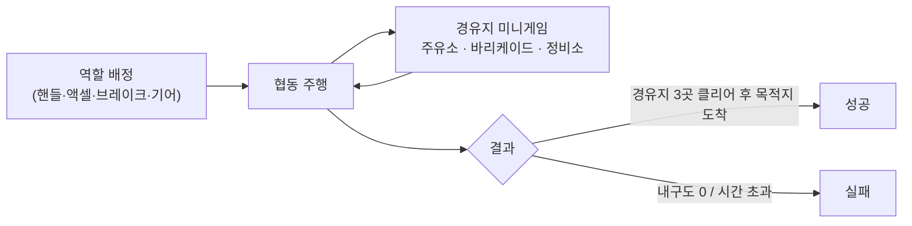
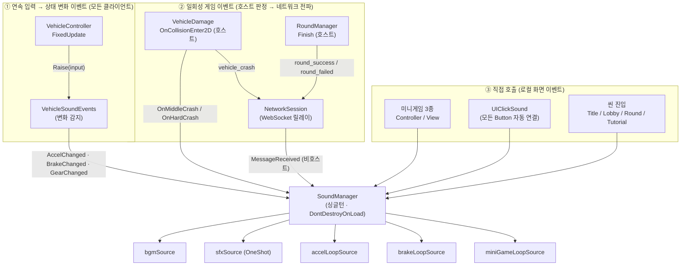
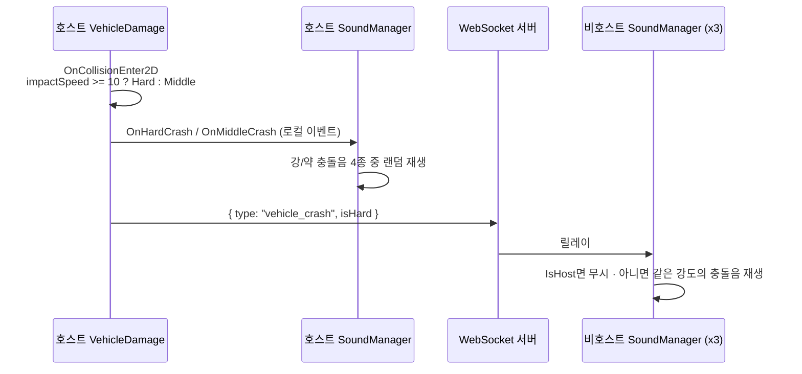
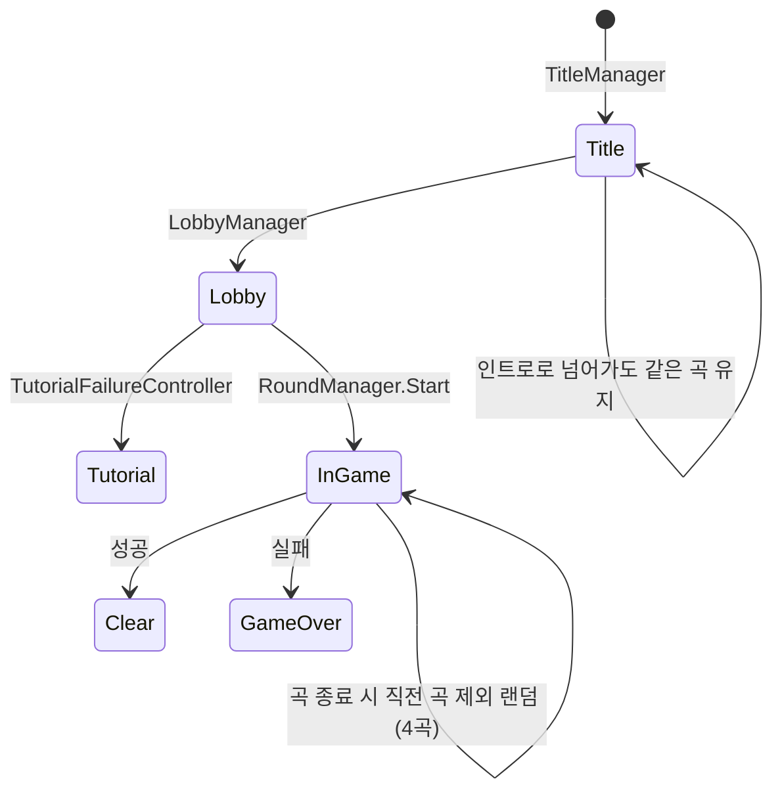

# 4인 협동 운전 게임 — 네트워크 사운드 시스템 기술 문서

> **작성자**: 전영호 (Team CY · 사운드 시스템 / 레벨 디자인 담당)
> **문서 범위**: 팀 프로젝트 전체가 아니라, 제가 맡은 **사운드 시스템**의 설계·구현·트러블슈팅을 다룹니다.

---

## 1. 개요

### 1.1 프로젝트 소개

**4명이 차 한 대를 나눠 운전하는 온라인 협동 2D 게임**입니다.
플레이어는 각자 **핸들(조향) · 액셀 · 브레이크 · 기어(D/N/R + 내비게이션)** 중 하나만 맡고,
제한 시간 안에 경유지 3곳의 미니게임을 클리어한 뒤 목적지에 도착해야 합니다.



| 항목 | 내용 |
|---|---|
| 팀 구성 | 4인 (이찬영, 김지혜, 송은빈, 전영호) |
| 개발 기간 | 2026.08.18 ~ 2026.09.12 (약 4주) |
| **내 담당** | **사운드 시스템 전담** (BGM 9종 · SFX 22종, 네트워크 사운드 동기화) / **레벨 디자인** (본 맵 · 튜토리얼 맵, 장애물·차량 배치) |
| 네트워크 구조 | **호스트 권한(Host-authoritative)** — 물리·판정은 호스트만 계산, 나머지는 결과를 받아 보간 |

### 1.2 무엇을 (What)

이 문서는 **호스트만 물리를 계산하는 네트워크 구조 위에서, 4명 모두가 같은 소리를 듣도록 만든 사운드 시스템**을 설명합니다.

- 조작 입력 → 엔진·브레이크·기어 변속음 (조작자가 아닌 플레이어에게도 재생)
- 차량 충돌 → 강도별 충돌음 (약 4종 / 강 4종 중 랜덤)
- 씬·라운드 흐름 → 타이틀/로비/튜토리얼/인게임(4곡 셔플)/클리어/게임오버 BGM
- 미니게임 3종 · 모든 UI 버튼 → 전용 효과음

### 1.3 왜 (Why) — 문제 정의

이 게임의 사운드는 **"소리를 낼 근거가 호스트에게만 있다"** 는 문제를 안고 있었습니다.

1. **충돌 판정이 호스트에서만 일어난다.**
   비호스트의 차량은 `Rigidbody2D.simulated = false` 상태로 호스트가 보낸 위치를 따라가기만 합니다.
   따라서 비호스트에서는 `OnCollisionEnter2D` 자체가 호출되지 않아,
   **4명 중 3명(75%)이 충돌음을 전혀 듣지 못했습니다.**
2. **조작이 4명에게 분산되어 있다.**
   액셀을 밟는 사람은 1명이지만, 엔진 소리는 4명 모두에게 들려야 "한 차에 타고 있다"는 느낌이 납니다.
3. **라운드 결과도 호스트만 판정한다.**
   성공/실패 BGM을 비호스트에게 어떻게 알릴지 정해야 했습니다.

> **목표**: 사운드를 **"내 화면에서 일어난 일"** 이 아니라 **"차에서 일어난 일"** 기준으로 재생해,
> 호스트·비호스트 구분 없이 4명이 같은 사운드 경험을 하도록 만든다.

### 1.4 개발 환경 · 링크

- **Engine**: Unity 6000.3.15f1 (URP 2D) · C#
- **Network**: 자체 WebSocket 릴레이 서버 (`ClientWebSocket`) · Newtonsoft.Json · UniTask
- **Level**: LDtk (ldtkunity 6.12.3)
- **GitHub**: https://github.com/KooHoo-Dev/3rd-TeamProject-CY
<!-- TODO: 시연 영상 링크 추가 -->

---

## 2. 시스템 구조

### 2.1 아키텍처 — 사운드가 발생하는 세 갈래

사운드 요청은 성격에 따라 **세 갈래**로 `SoundManager`에 도착합니다.



### 2.2 핵심 클래스 역할 분담

| 클래스 | 위치 | 역할 |
|---|---|---|
| `SoundManager` | `Sound/SoundManager.cs` | 사운드 재생 총괄. AudioSource 5개를 용도별로 관리하고, 이벤트 구독·네트워크 수신·공개 API를 제공 |
| `VehicleSoundEvents` | `Vehicle/Sound/VehicleSoundEvents.cs` | 매 물리 프레임의 입력을 받아 **값이 바뀐 순간에만** 이벤트 발행 (Edge 검출) |
| `VehicleDamage` | `Vehicle/Damage/VehicleDamage.cs` | (호스트) 충돌 강도 판정 → 로컬 이벤트 + `vehicle_crash` 패킷 송신 |
| `RoundManager` | `Core/GameFlow/RoundManager.cs` | 라운드 시작 시 인게임 BGM, 종료 시 클리어/게임오버 BGM + 결과 패킷 송신 |
| `UIClickSound` | `Sound/SFX/Click/UIClickSound.cs` | 씬이 로드될 때마다 모든 `Button`에 클릭음 리스너를 자동 등록 |
| `NetworkSession` | `Network/NetworkSession.cs` | (팀원 담당) 메시지 송수신. `MessageReceived(type, json)` 이벤트 제공 |

### 2.3 설계 의도 (미리 보기)

- **차량 소리는 "입력"이 아니라 "병합된 차량 입력"을 기준으로 냅니다.**
  4명의 입력이 합쳐진 최종 `VehicleInput`을 모든 클라이언트가 같이 읽기 때문에, 누가 액셀을 밟았든 4명 모두 엔진 소리를 듣습니다.
- **판정은 호스트, 재생은 모두.** 충돌·결과처럼 호스트만 아는 사건은 호스트가 **이벤트 패킷으로 알리고**, 각 클라이언트가 자기 스피커로 재생합니다.
- **루프음은 전용 AudioSource로 분리**했습니다. `PlayOneShot`은 개별 정지가 불가능하기 때문입니다. (→ 4.3)

자세한 근거는 **4. 고민과 선택**에서 다룹니다.

---

## 3. 핵심 기능 및 사용법

### 3.1 사용법 (API)

`SoundManager`는 타이틀 씬에서 생성되어 `DontDestroyOnLoad`로 유지됩니다.
외부에서는 **`SoundManager.Instance?.메서드()` 한 줄**만 호출하면 됩니다.

| 분류 | 메서드 | 비고 |
|---|---|---|
| BGM | `PlayTitleBgm()` `PlayLobbyBgm()` `PlayTutorialBgm()` | 반복 재생. 이미 같은 곡이 나오면 **재시작하지 않음** |
| BGM | `PlayInGameBgm()` | 4곡 중 랜덤, 곡이 끝나면 **직전 곡을 피해** 다음 곡 |
| BGM | `PlayGameClearBgm()` `PlayGameOverBgm()` `StopBgm()` | 1회 재생 |
| UI | `PlayUIClick()` | `UIClickSound`가 모든 버튼에 자동 연결 |
| 미니게임 | `StartFuelLoopSound()` / `StopFuelLoopSound()` / `PlayFuelSuccessSound()` … | 주유소 · 바리케이드 · 정비소 각각 전용 메서드 |
| 차량 | `UpdateVehicleSpeed(float)` | 브레이크음 자동 정지 판단에 사용 |

```csharp
// GasStationMinigameView.cs (발췌) — 노즐을 누르는 동안 루프음, 떼면 정지
if (isPressed && isCurrentlyPressed == false)
{
    isCurrentlyPressed = true;
    CY.Vehicle.SoundManager.Instance?.StartFuelLoopSound();
}
else if (isPressed == false && isCurrentlyPressed)
{
    isCurrentlyPressed = false;
    CY.Vehicle.SoundManager.Instance?.StopFuelLoopSound();
}
```

> **(Why) `?.`를 강제한 이유**: `SoundManager`는 타이틀 씬에만 배치되어 있습니다. 팀원들이 미니게임 테스트 씬을
> 단독 실행하면 `Instance`가 `null`이므로, `?.` 덕분에 **에러 없이 소리만 빠진 채** 테스트를 이어갈 수 있습니다.
> 사운드 담당이 다른 사람의 작업을 막지 않게 하는 규칙입니다.

### 3.2 핵심 동작 ① — 입력을 '변화 이벤트'로 바꾸기

`VehicleController.FixedUpdate`는 **초당 50회** 입력을 읽습니다. 이를 그대로 소리로 바꾸면
초당 50번 `Play()`가 호출됩니다. `VehicleSoundEvents`는 직전 값을 기억해 **바뀐 순간에만** 이벤트를 발행합니다.

```csharp
// VehicleSoundEvents.cs (발췌) — 호스트·비호스트 모두 이 한 곳으로 입력이 들어온다
public static void Raise(VehicleInput input)
{
    bool accel = input.Accel > 0f;
    bool brake = input.Brake > 0f;
    Gear gear  = input.CurrentGear;

    // (Why) 값이 '바뀐 순간'에만 발행 → 50Hz 입력이 몇 번의 이벤트로 줄어든다
    if (accel != lastAccel) { lastAccel = accel; AccelChanged?.Invoke(accel); }
    if (brake != lastBrake) { lastBrake = brake; BrakeChanged?.Invoke(brake); }
    if (gear  != lastGear)  { lastGear  = gear;  GearChanged?.Invoke(gear); }
}
```

`SoundManager`는 이 이벤트를 받아 **차량 상태에 맞는지 한 번 더 검사**한 뒤 재생합니다.

```csharp
// SoundManager.cs (발췌 · null 검사 생략)
private void HandleAccel(bool on)
{
    // (Why) 기어가 N이면 실제로 차가 나가지 않으므로 엔진음도 내지 않는다
    if (on && currentGear == Gear.N) { StopAccelSound(); return; }
    if (on) StartAccelSound(); else StopAccelSound();
}

private void HandleBrake(bool on)
{
    if (on && currentGear == Gear.N) { StopBrakeSound(); return; }
    // (Why) 이미 멈춘 차(속도 ≤ 0.1)에서 브레이크 끼익 소리가 나면 어색하다
    if (on && currentSpeed <= 0.1f) { StopBrakeSound(); return; }
    if (on) StartBrakeSound(); else StopBrakeSound();
}

private void HandleGearChanged(Gear gear)
{
    if (currentGear == gear) return;                   // 같은 기어 중복 신호 차단
    if (Time.time - lastGearShiftTime < 0.2f) return;  // 0.2초 내 연속 변속음 차단 (→ 5.2)
    currentGear = gear;
    lastGearShiftTime = Time.time;

    sfxSource.PlayOneShot(gearShiftClip);
    if (currentGear == Gear.N) { StopAccelSound(); StopBrakeSound(); }
}
```

> **비호스트의 속도는 어떻게 아나요?** 비호스트는 물리를 끈 상태라 `rb.linearVelocity`가 0입니다.
> 그래서 `VehicleController.Update`에서 **보간된 위치의 프레임 간 이동량 ÷ deltaTime**으로 속도를 계산해
> `UpdateVehicleSpeed()`에 넘깁니다. (호스트는 물리 속도를 그대로 사용)

### 3.3 핵심 동작 ② — 호스트만 아는 충돌을 모두에게 들려주기



```csharp
// VehicleDamage.cs (발췌) — 판정은 호스트, 재생은 모두
private void OnCollisionEnter2D(Collision2D collision)
{
    float impactSpeed = collision.relativeVelocity.magnitude;
    if (impactSpeed < ignoreSpeed) return;          // 살짝 스친 건 무시
    if (Time.time < nextDamageAt) return;           // 쪼개진 콜라이더 연속 충돌 방지
    nextDamageAt = Time.time + damageCooldown;

    bool isHard = impactSpeed >= hardCrashSpeedThreshold;
    if (isHard) OnHardCrash?.Invoke(); else OnMiddleCrash?.Invoke();

    if (!Session.IsHost) return;

    // (Why) 비호스트는 물리가 꺼져 있어 이 함수가 불리지 않는다 → 호스트가 직접 알린다
    _ = NetworkSession.Instance?.SendAsync(new { type = "vehicle_crash", isHard = isHard });
    // ... 이하 데미지 계산 (호스트 전용)
}
```

```csharp
// SoundManager.cs — 비호스트 수신부
private void OnNetworkMessageReceived(string type, string json)
{
    if (Network.Session.IsHost) return;   // 호스트는 이미 로컬에서 재생함

    if (type == "vehicle_crash")
    {
        var msg = JsonConvert.DeserializeObject<NetCrashMsg>(json);
        if (msg != null && msg.isHard) PlayHardCrashSound(); else PlayMiddleCrashSound();
    }
    else if (type == "round_success") PlayGameClearBgm();
    else if (type == "round_failed")  PlayGameOverBgm();
}
```

**예외 처리**
- 클립이 Inspector에서 비어 있으면(`null`) 재생하지 않고 조용히 넘어갑니다 → 에셋 누락이 크래시로 이어지지 않음
- `NetworkSession`이 아직 초기화되지 않았으면 `Update`에서 **초기화될 때까지 재시도** 후 1회만 구독 (`isNetworkSubscribed` 플래그)
- 같은 BGM이 이미 재생 중이면 `PlayBgmSingle`이 즉시 반환 → 결과 패킷이 여러 번 와도 곡이 처음부터 다시 시작되지 않음

### 3.4 BGM 흐름



---

## 4. 고민과 선택 (Trade-offs)

### 4.1 사운드를 어떻게 '트리거'할 것인가

> **[대안 A] 모든 곳에서 `SoundManager`를 직접 호출**
> - (+) 흐름이 코드에 그대로 보여 추적이 쉬움. 구현이 빠름.
> - (−) 사운드를 내는 쪽이 `SoundManager`를 알아야 함(강결합). 한 사건에 반응할 곳이 늘면 호출부를 계속 수정.
>
> **[대안 B] 모든 사운드를 이벤트 구독으로 처리 (관찰자 패턴)**
> - (+) 발생원은 "일이 일어났다"만 알림. 느슨한 결합.
> - (−) 미니게임 버튼 하나 소리에도 이벤트를 정의해야 해서 **이벤트 수가 폭증**. 흐름 추적이 어려움.
>
> **[결정] 사건의 성격에 따라 섞었습니다.**
> - **차량 입력·충돌 → 이벤트(B)**: 발생원이 여러 곳(호스트 물리 / 네트워크 수신)이고, 같은 사건에
>   사운드 외의 반응(내구도 UI 등)도 붙을 수 있습니다. 결합도를 낮추는 이득이 큽니다.
> - **미니게임·UI·씬 진입 → 직접 호출(A)**: 발생원이 한 곳이고 소리와 1:1로 대응합니다.
>   이벤트를 만드는 비용이 이득보다 크다고 판단했습니다(과한 설계 방지).
> - **대가**: `SoundManager`를 직접 호출하는 곳이 **14개 파일, 38곳**으로 늘었습니다. (→ 5.3 개선 계획)

### 4.2 비호스트에게 충돌을 어떻게 알릴 것인가

> **[대안 A] 비호스트도 물리를 켜서 직접 충돌 판정**
> - (+) 네트워크 패킷이 필요 없음. 지연 없이 즉시 재생.
> - (−) 비호스트는 호스트 위치를 **보간으로 따라가는 중**이라, 물리를 켜면 보간과 충돌 반발이 싸우며 차가 튀고,
>   호스트와 판정이 어긋남(유령 충돌음). 팀의 호스트 권한 구조 자체를 깨뜨림.
>
> **[대안 B] 호스트가 `vehicle_crash` 이벤트 패킷을 송신**
> - (+) 판정은 호스트 한 곳 → 4명이 **같은 사건에 같은 강도**의 소리를 들음.
> - (−) 네트워크 왕복만큼 비호스트의 소리가 늦음.
>
> **[대안 C] 이미 주기적으로 오는 `round_state`의 내구도 감소로 추론**
> - (+) 새 패킷 타입이 필요 없음.
> - (−) `round_state`는 (기본) 초당 5회 · **최신 값만 남기는 큐**로 전송됩니다. 짧은 시간에 두 번 부딪히면 한 번으로 합쳐지고,
>   강/약을 "내구도 10% 이상 감소"로 추측해야 해 호스트 판정(충돌 속도 10 이상)과 기준이 달라짐.
>
> **[결정] 대안 B.** 충돌음은 네트워크 왕복만큼 늦어도 크게 어색하지 않지만, **4명이 서로 다른 소리를 듣는 것**은
> 협동 게임에서 "방금 누가 박았어?"라는 소통을 깨뜨립니다. **정확성을 위해 약간의 지연을 감수**했습니다.
> 또 `NetworkSession.SendAsync`는 상태 메시지(`round_state` 등)는 최신 값만 보내지만, 익명 객체 같은
> **이벤트 메시지는 즉시 원본 그대로 전송**하므로, 일회성 사건인 충돌이 합쳐져 사라지지 않습니다.

### 4.3 루프음을 어떻게 재생하고 끌 것인가

> **[대안 A] 하나의 `sfxSource`에서 `PlayOneShot`** — (+) 소스 하나로 단순 / (−) **OneShot은 개별 정지 불가.** 액셀을 떼도 소리가 끝까지 남음
> **[대안 B] 루프 종류별 전용 AudioSource** — (+) `Stop()`으로 즉시 정지, 엔진음·브레이크음이 서로 끊지 않음 / (−) 소스 관리 부담
>
> **[결정] 대안 B.** 액셀·브레이크·미니게임(주유) 루프는 **"누르는 동안만"** 나야 하므로 즉시 정지가 필수입니다.
> 일회성 효과음(충돌·클릭·성공/실패)만 `sfxSource.PlayOneShot`으로 겹쳐 재생하고, 루프는 전용 소스 3개로 분리했습니다.

### 4.4 협업 이슈 — 남의 코드에 소리를 '꽂는' 방법

사운드는 혼자 완결되는 기능이 아니라 **팀원 전원의 코드에 걸쳐 있는 횡단 관심사**였습니다.
실제로 사운드 연동을 위해 차량·네트워크·라운드·미니게임 등 **팀원이 담당한 스크립트**를 수정해야 했습니다.

- **규칙 1 — 한 줄로 끝낸다**: 팀원 코드에는 `SoundManager.Instance?.PlayXxx()` 한 줄만 추가하고, 판단 로직은
  `SoundManager` 안에 둡니다. 리뷰어가 "소리 한 줄 추가"로 바로 이해할 수 있게 하기 위해서입니다.
- **규칙 2 — 없어도 돌아간다**: `?.`로 `SoundManager`가 없는 테스트 씬에서도 팀원 작업이 멈추지 않게 합니다.
- **교훈**: 기어 변속음 버그(→ 5.2)의 원인은 **사운드 이벤트를 발행하는 곳이 두 군데**로 갈라진 데 있었습니다.
  팀원이 네트워크 입력 처리부에 추가한 발행 코드와 차량 컨트롤러의 발행 코드가 공존했습니다.
  수정하면서 **사운드 이벤트 발행 지점을 `VehicleController.FixedUpdate` 한 곳**으로 정리했습니다.

---

## 5. 결과 및 배운 점

### 5.1 결과

| 항목 | Before | After |
|---|---|---|
| 충돌음을 듣는 플레이어 | **1 / 4명** (호스트만) | **4 / 4명** |
| 라운드 종료 시 기어 변속음 (호스트) | 매 프레임 반복 재생 | **1회** |
| 결과 BGM (비호스트) | 호스트만 결과를 앎 | `round_success / round_failed` 수신 시 재생, 중복 수신해도 곡 재시작 없음 |

- 구현 규모: BGM **9종**(타이틀·로비·튜토리얼·인게임 4·클리어·게임오버), SFX **22종**(차량 2 · 기어 1 · 클릭 1 · 미니게임 10 · 충돌 8)
- `UIClickSound`가 씬 로드마다 버튼을 자동 등록 → **씬에 버튼을 새로 배치해도 사운드 작업 0줄**

### 5.2 문제 해결 경험 (Troubleshooting)

#### ① 라운드가 끝나면 호스트에서만 기어 변속음이 "드드드득" 연속 재생

- **(현상)** 성공·실패 어떤 방식으로든 라운드가 끝나는 순간, 호스트 화면에서만 변속음이 멈추지 않고 반복됨.
- **(원인)** `VehicleSoundEvents.Raise()`를 호출하는 곳이 **두 군데**였습니다.

  | 호출 위치 | 주기 | 라운드 종료 후 넘기는 기어 |
  |---|---|---|
  | `NetworkInputSource.Update` | 매 프레임 | 플레이어 원본 입력 → **D** |
  | `VehicleController.FixedUpdate` | 물리 프레임 | 입력 잠금(`SetInputEnabled(false)`)으로 `default` → **N** |

  두 곳이 **같은 정적 변수 `lastGear`** 를 공유하므로 D → N → D → N … 이 번갈아 들어가 매번 "기어가 바뀌었다"고 판정됐습니다.
  비호스트는 `VehicleController`가 `rb.simulated == false`에서 `Raise` 전에 return 했기 때문에 발행원이 하나뿐이라 증상이 없었습니다.
  **"호스트만 발생"이라는 단서가 원인을 좁히는 열쇠**였습니다.
- **(해결)**
  1. `NetworkInputSource.Update`의 발행 코드를 제거하고 **발행원을 `VehicleController.FixedUpdate` 하나로 통일**
  2. 비호스트도 `Read()`로 병합 입력을 받아 같은 경로로 발행하도록 변경 (비호스트 엔진음 유지)
  3. 방어 코드: `SoundManager`에서 **같은 기어 무시 + 0.2초 디바운스**
- **(배운 점)** 상태를 "변화"로 바꾸는 Edge 검출은 **입력원이 하나일 때만** 성립한다. 공유 상태를 가진 이벤트는 발행 지점을 하나로 강제해야 한다.

#### ② 비호스트에게 충돌음이 들리지 않음

- **(원인)** 비호스트 차량은 `Rigidbody2D.simulated = false` → `OnCollisionEnter2D`가 호출되지 않음.
- **(해결)** 호스트가 충돌 판정 직후 `vehicle_crash { isHard }` 패킷 송신, 비호스트가 수신해 재생 (→ 3.3, 4.2)

#### ③ 주유 미니게임에서 한 번 실패하면 이후 주유 소리가 나지 않음

- **(원인)** 실패 연출 중에도 "노즐을 누르고 있음" 플래그(`isCurrentlyPressed`)가 `true`로 남아,
  다음에 누를 때 **새로 누른 것으로 인식되지 않아** `StartFuelLoopSound()`가 호출되지 않음.
- **(해결)** 실패 루틴 시작 시 눌림 상태를 강제로 해제하고 루프음을 정지. 루프 재시작 시 `time = 0`으로 처음부터 재생.

### 5.3 아쉬운 점 (기술 부채) 및 향후 계획

| 아쉬운 점 | 영향 | 향후 계획 |
|---|---|---|
| **비호스트 충돌음 수신 경로가 3개** — `VehicleDamage`·`SoundManager`가 각각 `vehicle_crash`를 처리하고, `RoundStateSync`도 내구도 감소로 `OnNetworkCrash`를 발행 | 한 번의 충돌에 충돌음이 **최대 3번 겹쳐** 재생될 수 있고, 경로마다 강/약 기준이 다름 | 수신 경로를 `SoundManager` 한 곳으로 일원화하고, 충돌마다 ID를 붙여 중복 제거 |
| JSON을 `json.Contains("\"isHard\":true")` 같은 **문자열 검사**로 판별하는 코드가 남아 있음 (`VehicleDamage`, `RoundManager`) | 직렬화 포맷(공백 등)이 바뀌면 조용히 오작동 | `SoundManager`처럼 **타입이 있는 메시지 클래스로 역직렬화** |
| 미니게임마다 `SoundManager`에 전용 메서드·클립 필드 추가 (383줄) | 새 미니게임 = `SoundManager` 수정 (OCP 위반) | `ScriptableObject` 기반 **SoundLibrary + `PlaySfx(SoundId)`** 로 전환, `AudioMixer` 그룹으로 BGM/SFX 볼륨 분리 |
| 사용되지 않는 초기 구현 `Sound/SFX/Vehicle/Vehicle.cs`와 디버그 로그 잔존 | 혼동 · 로그 노이즈 | 삭제 |

> **TO-BE**: "사건은 한 곳에서 한 번 발행되고, 사운드는 데이터로 정의된다" —
> 발행 지점 단일화와 데이터 기반 사운드 테이블로, 기획자가 코드 없이 사운드를 교체·추가할 수 있는 구조를 목표로 합니다.
