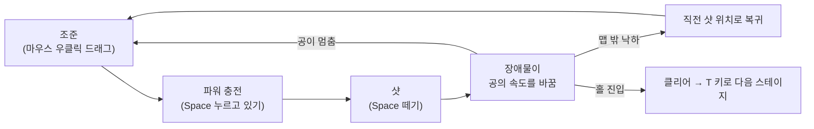
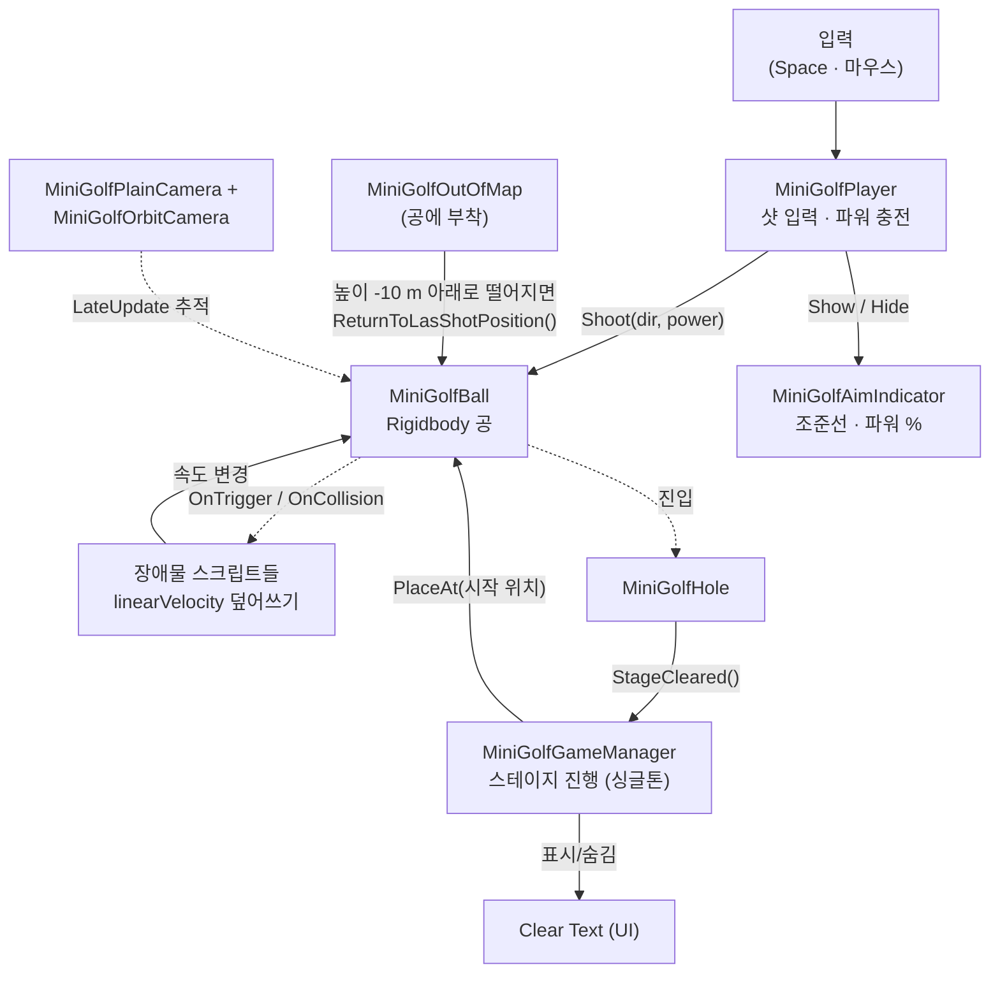
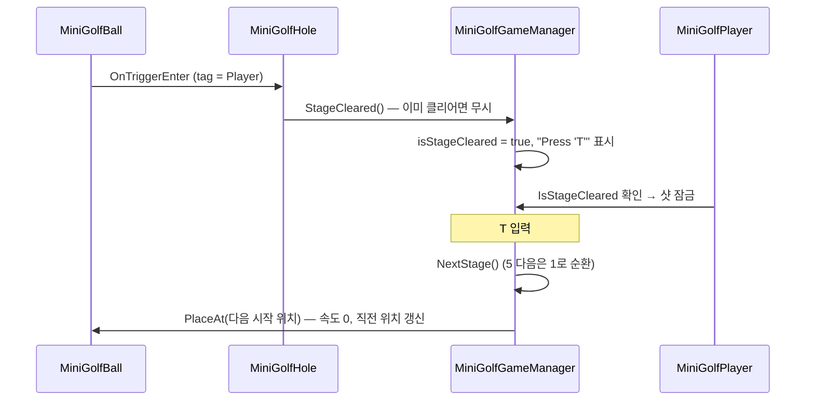

# 미니골프 장애물 레벨 디자인 — 기술 문서

> **한 줄 요약** — 공의 속도를 "더하지 않고 **덮어쓰는**" 장애물 5종과 물리 재질 3종을 만들고,
> 5개 스테이지에 배치해 **같은 장애물이 배치에 따라 다른 질문이 되도록** 설계한 Unity 미니골프 프로젝트입니다.

<!-- 문서 유형: Part 2 가이드의 "B. 다기능" 구조 (개요 → 구조 → 기능별 동작 → 고민과 선택 → 결과) -->
<!-- TODO(작성자): 퇴고 시 개요를 맨 마지막에 다시 읽고 다듬기 -->

---

## 1. 개요

### 1.1 무엇을 (What)

Unity로 만든 3D 미니골프 게임의 **장애물 시스템**과 **레벨(스테이지 5개)** 을 설명합니다.
수업에서 제공된 기본 골프 코드(공·샷·카메라) 위에 다음을 직접 구현했습니다.

| 구분 | 내용 |
|---|---|
| 새 장애물 스크립트 | 방향 부스터 · 360 부스터 · 360 점프 패드 · 방향 점프 패드 · 고정 속도 범퍼 · 왕복 장애물(엘리베이터 포함) — 직접 작성 6종<br/>+ 회전 장애물 (GolfAssets의 `RotateObject` 재사용) |
| 물리 재질 장애물 | 튕김 벽(`PM_Yellow`) · 흡수 벽(`PM_Pupple`) · 얼음 바닥(`PM_Friction Ice Road`) |
| 게임 흐름 | 스테이지 관리(`MiniGolfGameManager`) · 홀 판정 · 낙하 복귀 · 파워 % 표시 |
| 레벨 | 1개 씬 안에 스테이지 5개, 프리팹 24종 · 배치 인스턴스 약 400개 |

> 이 문서는 **장애물이 공의 속도를 어떻게 바꾸는가**와 **그것을 어떤 순서로 배치했는가**만 다룹니다.
> 공의 샷·카메라 궤도 로직은 수업 제공 코드이므로 구조도에서만 짚습니다.

### 1.2 왜 (Why)

과제의 핵심 문장은 **"난이도는 장애물 안에 있지 않고 배치 안에 있다"** 였습니다.
그런데 배치로 난이도를 설계하려면, 먼저 **장애물이 매번 같은 결과를 내야** 합니다.

- 물리 엔진에만 맡긴 장애물(예: 튕김 재질)은 **들어온 속도에 비례해** 결과가 달라집니다.
  같은 부스터를 밟아도 약하게 친 공과 세게 친 공의 착지점이 다르면, 레벨 디자이너는 착지점에 무엇을 놓을지 정할 수 없습니다.
- 작업지시서도 **"보고 나면 풀 수 있어야 한다. 운만으로 결정되는 구간은 난이도가 아니라 벌이다"** 라고 요구했습니다.

그래서 장애물 대부분을 **공의 속도를 정해진 값으로 덮어쓰는 방식**으로 만들었고,
"결과가 고정된 장애물"을 블록처럼 조합해 스테이지를 설계했습니다. (근거는 [4.1](#41-장애물이-공의-속도를-다루는-방식--더하기-vs-덮어쓰기)에서 다룹니다.)

### 1.3 핵심 루프와 조작법



| 입력 | 결과 |
|---|---|
| 마우스 우클릭 드래그 | 공 중심으로 카메라 회전 (1픽셀 = 0.2°, 높이각 15~60°) |
| 마우스 휠 | 카메라 거리 1~10 m |
| `Space` 누름 → 뗌 | 파워 게이지가 1초 동안 0→100%, 다음 1초 동안 100→0%로 왕복, 떼는 순간 0~10 m/s로 샷 |
| `T` | (클리어 후) 다음 스테이지 |
| `R` / `1`~`5` | (테스트용) 직전 위치로 복귀 / 해당 스테이지로 이동 |

### 1.4 개발 환경

- **Engine**: Unity 6 (6000.3.15f1), URP 17.3, Input System 1.19, ProBuilder 6.0, TextMeshPro
- **기간**: 2026.10.01 ~ 2026.10.08 (8일, 커밋 12회) · 개인 과제
- **사용 에셋**: GolfAssets(십자 범퍼 프리팹, 회전 스크립트), 배경음 *Need U 2 B Complete* (Caine1989)

**링크**: GitHub <https://github.com/KooHoo-Dev/3rd-minigolf_level_design-wjsdudgh99> · 시연 영상 `TODO`

<!-- TODO(작성자): 시연 영상 주소를 실제 링크로 교체. 빈 링크는 "링크 없음"과 같습니다. -->

---

## 2. 시스템 구조

### 2.1 아키텍처 흐름



**읽는 법**: 실선은 "명령(메서드 호출)", 점선은 "감지(물리 이벤트·추적)"입니다.
핵심은 **장애물이 서로를, 그리고 매니저를 전혀 모른다**는 점입니다. 장애물은 `Player` 태그를 가진
Rigidbody가 닿으면 **속도만 바꾸고 끝**이므로, 프리팹을 씬 어디에 몇 개를 놓아도 추가 연결 작업이 없습니다.
덕분에 Stage-4에만 방향 점프 패드 27개, Stage-5에 고정 속도 범퍼 26개를 배치할 수 있었습니다.

### 2.2 핵심 클래스 역할 분담

| 클래스 | 책임 | 하지 않는 일 | 비고 |
|---|---|---|---|
| `MiniGolfBall` | 샷 적용(`FixedUpdate`), 정지 판정, 순간이동 | 입력 처리 | 수업 제공 |
| `MiniGolfPlayer` | Space 충전 → 샷, 피드백 갱신 | 물리 계산 | 제공 + **클리어 중 샷 잠금** 추가 |
| `MiniGolfAimIndicator` | 조준선 길이, 파워 % 텍스트 | 입력 판단 | 제공 + **% 텍스트** 추가 |
| `MiniGolfGameManager` | 현재 스테이지, 클리어 상태, 스테이지 이동 | 공 물리 | **신규** |
| `MiniGolfHole` | 홀 진입 감지 → 매니저에 알림 | 진행 로직 | **신규** |
| `MiniGolfOutOfMap` | 낙하 감지 → 직전 위치 복귀 | — | **신규** |
| 장애물 스크립트 7종 | 공의 속도·장애물 자체의 위치/회전 변경 | 게임 상태 | **신규 6종** + 에셋 재사용 1종 (3절) |

### 2.3 레벨 구조 — 한 씬, 다섯 스테이지

스테이지 5개는 하나의 씬(`Need U 2 B Complete.unity`)에 `Stage-1` ~ `Stage-5` 오브젝트로 나란히 놓여 있고,
`MiniGolfGameManager.stageStartPositions[5]`가 각 스테이지의 시작 지점을 가리킵니다.
스테이지 이동 = **공을 다음 시작 지점으로 순간이동**하는 것입니다. (선택 이유는 [4.3](#43-스테이지-관리--씬-5개-vs-한-씬--시작-지점-배열))

---

## 3. 핵심 기능

### 3.1 스테이지 진행 (사용법)

외부에서 알아야 할 API는 두 개뿐입니다.

```csharp
MiniGolfGameManager.Instance.StageCleared();   // 홀에서 호출: 클리어 처리 + 안내 문구 표시
MiniGolfGameManager.Instance.GoToStage(index); // 0~4: 해당 스테이지 시작 지점으로 공 이동
```



**방어 처리** — `MiniGolfHole`은 `!IsStageCleared`일 때만 신호를 보내므로, 공이 홀 안에서
트리거를 여러 번 드나들어도 클리어가 중복 처리되지 않습니다. `GoToStage`는 인덱스 범위를 검사합니다.

### 3.2 장애물이 공의 속도를 바꾸는 방식 (핵심 동작)

모든 장애물을 **"들어온 속도(방향·속력) 중 무엇을 남기고 무엇을 버리는가"** 라는 한 가지 기준으로 정리했습니다.

| 장애물 (프리팹) | 스크립트 / 재질 | 적용 공식 | 입사 방향 | 입사 속력 | 설정값 |
|---|---|---|---|---|---|
| 방향 부스터 (`Boost Pad Speed 1~3`) | `MiniGolfBoostPad` | **v = 패드 정면 × s** | 버림 | 버림 | s = 10 / 15 / 20 m/s |
| 360 부스터 (`Boost Pad 360 Speed 1~3`) | `MiniGolfDirectionBoostPad` | **v = 입사 방향 × s** | 유지 | 버림 | s = 10 / 15 / 20 m/s |
| 방향 점프 패드 | `MiniGolfDirectionJumpPad` | **v = 정면 × 5 + 위 × 7** | 버림 | 버림 | 5 / 7 m/s |
| 360 점프 패드 | `MiniGolf360JumpPad` | **v += 패드 위쪽 × 7** | 유지 | 유지 | 7 m/s |
| 고정 속도 범퍼 (`Speed 7 Box/Capsule`) | `FixedSpeedBumper` | **v = 반사 방향 × 7** | 반사 | 버림 | 7 m/s |
| 튕김 벽 (`Yellow Capsule`, `Bounce Box`) | `PM_Yellow` | 탄성 1, Combine **Maximum** | 반사 | 유지 | — |
| 흡수 벽 (`Purple Box`) | `PM_Pupple` | 탄성 0.1, Combine **Multiply** | 반사 | 크게 감소 | — |
| 얼음 바닥 (Stage-5 `Donut` 1개) | `PM_Friction Ice Road` | 마찰 0.01 **Minimum**, 탄성 1 | — | 거의 유지 | — |

> **Combine 모드를 고른 이유** — 공(`PM_Ball 1`)은 탄성 1·마찰 0.4·**Average** 입니다. Unity는 두 재질의 Combine 모드가 다르면
> 우선순위가 높은 쪽(Average < Minimum < Multiply < Maximum)을 쓰므로, 장애물 쪽 모드가 항상 이깁니다.
> 그래서 튕김 벽은 Maximum으로 **max(1, 1) = 1**, 흡수 벽은 Multiply로 **0.1 × 1 = 0.1**,
> 얼음은 Minimum으로 **min(0.01, 0.4) = 0.01** 이 확정적으로 적용됩니다.

**코드 — "버릴 것"만 다른 네 개의 트리거**

```csharp
// 공통: OnTriggerEnter에서 tag == "Player"인 Rigidbody만 처리 (공 = ballRb)

// ① 방향 부스터 — 방향·속력 모두 버림: 어디서 들어오든 같은 곳으로 나간다
ballRb.linearVelocity = transform.forward * boostSpeed;

// ② 360 부스터 — 방향은 유지, 속력만 고정: 플레이어의 조준이 의미를 가진다
Vector3 dir = ballRb.linearVelocity.normalized;
if (dir == Vector3.zero) dir = transform.forward;   // (방어) 정지한 공이 닿으면 0벡터 → 패드 정면
ballRb.linearVelocity = dir * boostSpeed;

// ③ 방향 점프 — 궤적 자체를 고정: 착지점을 레벨에서 설계할 수 있다
ballRb.linearVelocity = transform.forward * forwardSpeed + Vector3.up * upwardSpeed;

// ④ 360 점프 — 유일하게 '더하기': 수평 속도(=플레이어 샷)는 그대로, 위로만 튀긴다
ballRb.AddForce(transform.up * jumpForce, ForceMode.VelocityChange);
```

**(Why) 방향 점프 패드의 착지점 계산** — 정면 5 m/s, 위 7 m/s로 고정했기 때문에 궤적을 미리 계산할 수 있습니다.
최고 높이 = 7² / (2 × 9.81) ≈ **2.5 m**, 체공 시간 ≈ **1.43 초**, 수평 거리 ≈ **7.1 m**(감쇠 무시 이론값).
실제로는 공의 `LinearDamping 0.5` 때문에 이보다 짧으므로, 착지 발판은 플레이 테스트로 위치를 맞췄습니다.

<!-- TODO(작성자): 실제 착지 거리를 측정했다면 수치로 교체 (예: "실측 약 5 m") -->

**고정 속도 범퍼** 는 `OnCollisionEnter`에서 동작합니다. 이 시점의 `linearVelocity`는 물리 엔진이 이미 반사를 계산한 뒤의 값이므로,
**반사 방향은 엔진에 맡기고 속력만 7 m/s로 정규화**합니다. 너무 느리게 닿아 방향이 0이면 접촉면 법선(`contacts[0].normal`)으로 튕깁니다.

### 3.3 움직이는 장애물

| 장애물 | 스크립트 | 동작 | 배치값 |
|---|---|---|---|
| 왕복 벽 (Stage-3 `Holl Road` 내부 벽 2개) | `MiniGolfMovingObstacle` | `MoveTowards`로 시작↔끝 왕복 | z축 ±1~2 m, 1~2 m/s |
| 왕복 캡슐·박스 (Stage-4) | 〃 | 끝에서 대기 옵션 | z축 1~2 m, 일부 2초 대기 |
| 엘리베이터 ×2 (Stage-4) | 〃 | 위로 6.75 m 이동 후 **3초 대기** | y축 6.75 m, 2 m/s |
| 풍차 날개 ×3 (Stage-3) | `MiniGolfRotateObject` (GolfAssets 재사용) | x축 회전 | **60 → 90 → 120 °/s** |
| 회전 벽 ×2, 회전 점프 패드 (Stage-5) | 〃 | y축 회전 | 10 / 15 °/s |

`MiniGolfMovingObstacle`은 `enablePause` 하나로 "계속 왕복"과 "끝에서 멈춤"을 바꿀 수 있어,
같은 스크립트로 **타이밍 장애물**(왕복 벽)과 **탑승물**(엘리베이터: 공이 올라탈 시간을 3초 확보)을 모두 만들었습니다.

### 3.4 레벨 구성 — 장애물이 처음 등장하는 순서

| 스테이지 | 처음 등장하는 것 | 다시 쓰이는 것 | 돌린 손잡이 (작업지시서 4절) |
|---|---|---|---|
| **Stage-1** | 기본 레인, 홀 | — | 없음 (조작 학습) |
| **Stage-2** | 삼각 벽 ×6, 낮은 벽, 런웨이 벽, 십자 범퍼 | 레인 | **조준 정밀도** (꺾어 치기) |
| **Stage-3** | 튕김 박스, 고정 속도 범퍼, 풍차 ×3, 왕복 벽 ×2 | 낮은 벽 | **타이밍 창** — 풍차 속도를 60→90→120 °/s로 한 스테이지 안에서 단계적으로 올림 |
| **Stage-4** | 방향 부스터 ×19, 방향 점프 ×27, 360 점프 ×7, 흡수 벽, 엘리베이터 ×2, 아치 | 삼각 벽, 튕김 캡슐(왕복) | **겹침** — 부스터·점프 패드 53개를 한 스테이지에 연달아 배치 |
| **Stage-5** | 360 부스터 ×6, 얼음 바닥, 회전 벽 | 고정 속도 범퍼 ×26, 튕김 캡슐 ×28, 점프 패드 | **겹침** — 범퍼·회전 벽·부스터가 동시에 (핀볼 구간) |

<!-- TODO(작성자): 스테이지별 의도(소개/응용/심화 중 무엇인지), 기준 타수(Par), 실측 플레이 타임(과제 기준 3분 이상)을 추가.
     스크린샷 1장씩 넣으면 이 표가 훨씬 빨리 읽힙니다. -->

---

## 4. 고민과 선택 (Trade-offs)

### 4.1 장애물이 공의 속도를 다루는 방식 — 더하기 vs 덮어쓰기

> **결정 대상**: 부스터·점프 패드가 공에 힘을 줄 때, 기존 속도에 **더할 것인가**, **덮어쓸 것인가**?

**[대안 A] `AddForce`로 더하기**
- (+) 물리적으로 자연스럽고, 플레이어가 친 힘이 끝까지 결과에 반영됨
- (−) 결과가 **입사 속도에 따라 매번 달라짐** → 점프 뒤 착지점, 부스터 뒤 도착점을 레벨에서 설계할 수 없음
- (−) 세게 친 공 + 부스터 = 예측 못 한 과속 → 맵 이탈이 "실력"이 아니라 "운"이 됨

**[대안 B] `linearVelocity =` 로 덮어쓰기**
- (+) 결과가 **항상 같음** → 레벨 디자이너가 착지점·도착점을 정확히 배치 가능, 플레이어는 한 번 보면 학습 가능
- (−) 패드를 밟는 순간 플레이어의 샷 파워가 무의미해짐 → 조작의 재미가 줄어듦
- (−) 물리적으로 부자연스러운 급정지·급가속

**[최종 결정] 기본은 B(덮어쓰기), 단 "무엇을 남길지"를 장애물마다 다르게 했습니다.**
작업지시서의 "보고 나면 풀 수 있어야 한다"는 공정성 기준을 지키려면 결과가 고정되어야 했기 때문입니다.
B의 대가인 "플레이어 조작이 무의미해짐"은, **남기는 성분을 다르게 한 변형**으로 상쇄했습니다.

- 360 부스터: 속력만 고정하고 **방향은 플레이어 것**을 남김 → 조준이 여전히 중요
- 360 점프: 유일하게 A(더하기)를 써서 **수평 속도 전체를 플레이어 것**으로 남김 → 파워 조절이 여전히 중요

→ 결과적으로 "완전 고정(방향 부스터·방향 점프)"부터 "플레이어 의존(360 점프)"까지 **결정성의 단계**가 생겼고,
이것이 곧 난이도 손잡이가 되었습니다.

### 4.2 튕기는 장애물 — 물리 재질 vs 스크립트

> **결정 대상**: "튕겨 내는 벽"을 물리 재질로 만들 것인가, 스크립트로 만들 것인가?

| | **[A] 물리 재질** (`PM_Yellow`, 탄성 1) | **[B] 스크립트** (`FixedSpeedBumper`, 7 m/s) |
|---|---|---|
| 구현 | 코드 0줄, 재질만 교체 | `OnCollisionEnter` 스크립트 필요 |
| 결과 | 세게 치면 세게, 약하게 치면 약하게 튕김 | 어떻게 쳐도 **항상 7 m/s** |
| 플레이어에게 던지는 질문 | "얼마나 세게 칠래?" | "어느 각도로 맞힐래?" |

**[결정] 둘 다 남겼습니다.** 하나가 다른 하나를 대체하는 게 아니라 **다른 질문**을 던지기 때문입니다.
특히 Stage-5처럼 범퍼가 수십 개 모인 핀볼 구간에서는 A만 쓰면 속도가 누적되어 공이 통제 불능이 되므로,
**B(고정 속도 범퍼 26개)로 상한을 두고 A(튕김 캡슐 28개)를 섞어** 혼란스럽지만 예측 가능한 구간을 만들었습니다.

### 4.3 스테이지 관리 — 씬 5개 vs 한 씬 + 시작 지점 배열

**[대안 A] 스테이지마다 씬 분리 + `SceneManager.LoadScene`**
- (+) 씬 파일이 작아 관리·협업이 쉬움, 지금 플레이하지 않는 스테이지는 메모리에 없음
- (−) 공·카메라·UI·매니저를 씬마다 두거나 `DontDestroyOnLoad` 관리 필요, 전환 시 로딩

**[대안 B] 한 씬에 모두 배치 + 시작 지점 `Transform[]`으로 순간이동**
- (+) 공·카메라·UI가 **한 벌**, 스테이지 이동 = `ball.PlaceAt()` 한 줄, 로딩 없음
- (+) 테스트 단축키(`1`~`5`)로 **즉시 이동**해 반복 플레이 테스트가 빠름
- (−) 씬 파일 비대 (약 4.1만 줄) → Git 병합 충돌에 취약
- (−) 보이지 않는 스테이지의 장애물도 계속 `Update`

**[결정] B를 택했습니다.** 초기에는 `Stage-1.unity`에서 시작했지만, 스테이지 4·5를 만드는 시점(커밋 `1df0b73`)에
한 씬으로 합쳤습니다. 이 과제는 **8일 안에 배치 → 플레이 → 수정을 최대한 많이 반복하는 것**이 중요했고,
1인 작업이라 병합 충돌 위험이 낮았기 때문입니다. 성능 비용은 장애물 수백 개 규모에서는 감수할 수준으로 판단했습니다.

### 4.4 다음 스테이지 키 — Space vs T

샷 충전 키가 `Space`이므로, 클리어 후 진행 키도 `Space`로 하면 **"다음 스테이지로 넘어가자마자 충전이 시작되는"** 입력 충돌이 생깁니다.
그래서 진행 키를 `T`로 분리하고, 동시에 `MiniGolfPlayer`의 샷 조건에 `!IsStageCleared`를 추가해 **클리어 화면에서는 샷 자체를 잠갔습니다.**
대가는 키가 하나 늘어난 것인데, 클리어 문구에 `Press 'T' to Next Stage`를 띄워 학습 비용을 줄였습니다.

### 4.5 홀 → 매니저 알림 — 싱글톤 직접 호출 vs 이벤트

이벤트(관찰자 패턴)를 쓰면 `MiniGolfHole`이 매니저를 몰라도 되지만, 현재 클리어 결과를 듣는 곳은 **매니저 하나뿐**입니다.
듣는 곳이 하나인데 이벤트를 도입하는 것은 과한 설계라고 판단해 **싱글톤 직접 호출**을 택했습니다.
대가로 `MiniGolfHole`과 `MiniGolfPlayer`가 `MiniGolfGameManager.Instance`에 의존하므로, 매니저 없는 테스트 씬에서는
`MiniGolfPlayer`가 동작하지 않습니다. 사운드·연출·기록처럼 클리어를 듣는 곳이 늘어나면 `OnStageCleared` 이벤트로 바꿀 계획입니다.

---

## 5. 결과 및 배운 점

### 5.1 결과

| 항목 | 결과 |
|---|---|
| 새 장애물 | 과제 기준 **3종 이상** → 스크립트 장애물 **7종**(직접 작성 6 + 에셋 재사용 1) + 물리 재질 장애물 **3종** |
| 코스 | 과제 기준 **3홀** → **5개 스테이지** |
| 레벨 제작 단위 | 프리팹 **24종**, 씬 배치 인스턴스 약 **400개** — 장애물이 서로·매니저를 몰라 **배치 시 연결 작업 0건** |
| 장애물 튜닝 | 부스터는 속도별 프리팹 3단(10/15/20 m/s)으로 나눠, 인스펙터 수정 없이 **프리팹 교체만으로 난이도 조절** |
| 기본 코드 수정 | 제공 코드 3개(Player·AimIndicator·BallTester)만 최소 수정, 나머지는 새 컴포넌트로 추가 |

<!-- TODO(작성자): 실측 총 플레이 타임(과제 기준 3분 이상), 플레이 테스트 인원·평균 타수 등 측정값이 있으면 이 표에 추가 -->

### 5.2 문제 해결 경험 (Troubleshooting)

<!-- TODO(작성자): 아래는 코드 변경 이력에서 확인되는 사례입니다. 실제로 겪은 상황과 다르면 고치거나 직접 겪은 사례로 바꾸세요. -->

**① 클리어 화면에서 공을 또 칠 수 있음**
- **(문제)** 홀에 들어간 뒤에도 Space로 샷이 가능해, 클리어 상태에서 공이 홀 밖으로 나가 버림
- **(원인)** 제공 코드의 샷 조건이 `ball.IsStopped` 하나뿐이라 게임 상태를 몰랐음
- **(해결)** 샷 조건을 `ball.IsStopped && !IsStageCleared`로 확장하고, 진행 키를 Space와 겹치지 않는 `T`로 분리 (4.4)

**② 360 부스터에 멈춰 있는 공이 닿으면 공이 날아가지 않음**
- **(문제)** 입사 방향을 유지하는 부스터인데, 공이 거의 정지 상태로 패드에 올라오면 반응이 없음
- **(원인)** 속도 0인 벡터의 `normalized`는 `Vector3.zero` → `0 × 20 = 0`
- **(해결)** 방향이 0이면 패드 정면(`transform.forward`)으로 대체하는 안전장치 추가. 고정 속도 범퍼에도 같은 원리로 접촉면 법선을 대체값으로 사용

**③ 파워 0%인데도 "0%" 글자가 떠 있음**
- **(문제)** 파워 % 텍스트를 추가하자, 공이 멈춰 있기만 하면 "0%"가 항상 표시되어 화면이 지저분함
- **(해결)** `power01 > 0.01`일 때만 표시하도록 조건을 추가해, **Space를 누르는 동안만** 피드백이 보이게 함

### 5.3 아쉬운 점 (기술 부채) 및 향후 계획

| 아쉬운 점 | 영향 | 향후 계획 |
|---|---|---|
| **타수·Par·벌타 미구현** — 작업지시서는 "낙하 시 직전 위치 + 벌타 1"을 요구 | 난이도를 숫자로 비교할 수 없음 | `MiniGolfGameManager`에 타수 카운트, `Shoot` 시 +1, 낙하 시 +1, 스테이지별 Par 표시 |
| **장애물 첫 등장 규칙 위반** — 360 부스터·얼음 바닥이 마지막 Stage-5에서 처음 등장 | "처음 보는 것을 위험한 곳에서 만나게 하지 않는다"는 원칙에 어긋남 | Stage-4 초반에 안전한 소개 구간 추가 |
| **움직이는 장애물이 `transform`을 직접 이동** (Rigidbody 없음) | 물리 엔진이 이동을 "순간이동"으로 처리 → 엘리베이터·왕복 벽과의 충돌이 부정확할 수 있음 | Kinematic Rigidbody + `FixedUpdate`에서 `MovePosition` / `MoveRotation` |
| **파일명–클래스명 불일치** — `MiniGolfSuperBumper.cs` 안의 클래스가 `FixedSpeedBumper` | Unity는 MonoBehaviour 파일명과 클래스명이 같아야 컴포넌트를 안정적으로 로드 → 범퍼 프리팹 27개가 영향 범위 | 클래스명을 `MiniGolfSuperBumper`로 통일 후 프리팹 동작 재확인 |
| **하드코딩된 값** — `NextStage()`의 `5`, 낙하 기준 `y < -10` 고정 | 스테이지 추가 시 코드 수정 필요, 높이가 다른 스테이지에서 복귀 판정 시점이 달라짐 | `stageStartPositions.Length` 사용, 스테이지별 낙하 높이 또는 킬 트리거 |
| **장애물 트리거마다 `Debug.Log`**, 프리팹 이름 오타(`Holl`·`Junp`·`Load`·`Pupple`) | 빌드 성능·검색성 저하 | 로그 제거(또는 조건부), 이름 정리 |

### 5.4 배운 점

- **장애물 하나는 "질문 하나"이고, 그 질문은 "무엇을 버리고 무엇을 남기느냐"로 정해진다.**
  같은 부스터라도 방향을 남기면 조준 문제, 속력을 남기면 파워 문제가 됩니다.
  코드 한 줄(`=` vs `+=`)의 차이가 레벨 디자인의 어휘가 된다는 것을 배웠습니다.
- **결정적인(deterministic) 장애물이 있어야 배치로 난이도를 설계할 수 있다.**
  결과가 고정되어야 "이 점프 뒤에 낭떠러지를 둔다" 같은 설계가 가능하고, 플레이어도 실패에서 배울 수 있습니다.
- **같은 스크립트, 다른 설정값 = 다른 장애물.**
  풍차 3개를 60/90/120 °/s로, 부스터를 10/15/20 m/s 프리팹으로 나누면서 새 코드 없이 난이도 곡선을 만들 수 있었습니다.

---

## 부록. 파일 위치

| 구분 | 경로 |
|---|---|
| 씬 | `Assets/101. MiniGolfGame/Need U 2 B Complete.unity` |
| 스크립트 | `Assets/101. MiniGolfGame/Scripts/` |
| 프리팹 | `Assets/101. MiniGolfGame/Prefabs/` |
| 물리 재질 | `Assets/101. MiniGolfGame/Physics Materials/` |
| 과제 작업지시서 | `Assets/01. Docs/06. Mini Golf 과제 작업지시서.md` |
