# 미니골프 장애물 레벨 디자인 — 기술 문서

> **한 줄 요약** — 공의 속도를 "더하지 않고 **덮어쓰는**" 장애물 5종과 물리 재질 3종을 만들고,
> 5개 스테이지에 배치해 **같은 장애물이 배치에 따라 다른 질문이 되도록** 설계한 Unity 미니골프 프로젝트입니다.

<!-- 문서 유형: Part 2 가이드의 "B. 다기능" 구조 (개요 → 구조 → 기능별 동작 → 고민과 선택 → 결과) -->
<!--
✍ 작성자 확인 목록 (이 주석은 화면에 보이지 않습니다. 다 확인하면 지워도 됩니다)

이 문서는 Claude가 코드·씬·커밋·과제 작업지시서에서 확인한 사실로 쓴 초안을 바탕으로,
단계마다 본인 확인을 거쳐 고쳐 가는 중입니다(진행 기록: src/_draft/기술문서-수정-진행.md).
코드를 만든 방식(1.3)·스테이지 역할(4.2)·고민과 선택(3.3·3.4·4.4·4.5·4.6)에서 누가 무엇을 정했는지,
트러블슈팅(5.2)을 어떻게 찾았는지는 본인 확인을 마쳤습니다.
기준 타수(Par)·실측 플레이 타임·실측 착지 거리는 재지 않아서 쓰지 않습니다.
5.3 아쉬운 점(앞부분)·5.4 배운 점은 본인이 고르고 이유를 알려 준 내용으로 고쳤습니다.

1. 이미지 아래 기울임꼴 설명(캡션) — Claude가 쓴 문장입니다. 본인 말로 바꿔 주세요.
2. 퇴고 — 다 고친 뒤 개요(1.1 · 1.2)를 다시 읽고 다듬기.
-->

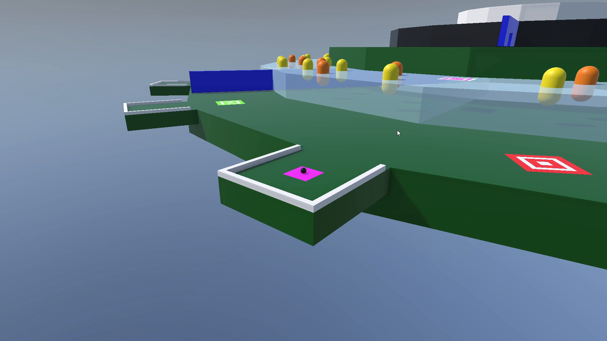

*Stage-5 — 고정 속도 범퍼·튕김 캡슐이 늘어선 얼음길과 회전 벽*

---

## 1. 개요

### 1.1 무엇을 (What)

Unity로 만든 3D 미니골프 게임의 **장애물 시스템**과 **레벨(스테이지 5개)** 을 설명합니다.
수업에서 제공된 기본 골프 코드(공·샷·카메라) 위에 다음을 만들었습니다(코드를 만든 방식은 1.3).

| 구분 | 내용 |
|---|---|
| 새 장애물 스크립트 | 방향 부스터 · 360 부스터 · 360 점프 패드 · 방향 점프 패드 · 고정 속도 범퍼 · 왕복 장애물(엘리베이터 포함) — 새로 만든 6종<br/>+ 회전 장애물 (GolfAssets의 `RotateObject` 재사용) |
| 물리 재질 장애물 | 튕김 벽(`PM_Yellow`) · 흡수 벽(`PM_Pupple`) · 얼음 바닥(`PM_Friction Ice Road`) |
| 게임 흐름 | 스테이지 관리(`MiniGolfGameManager`) · 홀 판정 · 낙하 복귀 · 파워 % 표시 |
| 레벨 | 1개 씬 안에 스테이지 5개, 프리팹 24종 · 배치 인스턴스 약 400개 |

> 이 문서는 **장애물이 공의 속도를 어떻게 바꾸는가**와 **그것을 어떤 순서로 배치했는가**만 다룹니다.
> 공의 샷·카메라 궤도 로직은 수업 제공 코드이므로 구조도에서만 짚습니다.

### 1.2 왜 (Why)

과제의 핵심 문장은 **"난이도는 장애물 안에 있지 않고 배치 안에 있다"** 였습니다.
그런데 배치로 난이도를 설계하려면, 먼저 **장애물이 매번 같은 결과를 내야** 합니다.

- 물리 엔진에만 맡긴 장애물(예: 튕김 재질)은 **들어온 속도에 비례해** 결과가 달라집니다.
  같은 부스터를 밟아도 약하게 친 공과 세게 친 공의 착지점이 다르면, 레벨 디자이너는 착지점에 무엇을 놓을지 정할 수 없습니다.
- 작업지시서도 **"보고 나면 풀 수 있어야 한다. 운만으로 결정되는 구간은 난이도가 아니라 벌이다"** 라고 요구했습니다.

그래서 장애물 대부분을 **공의 속도를 정해진 값으로 덮어쓰는 방식**으로 만들었고,
"결과가 고정된 장애물"을 블록처럼 조합해 스테이지를 설계했습니다. (근거는 [3.3](#33-고민과-선택-더하기-vs-덮어쓰기)에서 다룹니다.)

### 1.3 코드를 만든 방식 — 레벨은 제가, 코드는 AI와 함께

공·샷·카메라는 **수업에서 제공된 코드**입니다. 새로 만든 장애물 스크립트 6종과 게임 흐름 코드는
**채팅 AI에 필요한 장애물을 설명해 코드를 받고, 직접 스크립트에 넣는 방식**으로 만들었습니다.
장애물이 공의 속도를 정해진 값으로 덮어쓰는 설계(3.3)를 누가 먼저 정했는지는 기억이 정확하지 않습니다.

코드를 뺀 나머지는 직접 했습니다.

- **장애물 종류 기획** — 부스터·점프 패드·엘리베이터처럼 어떤 장애물을 만들지, 어떤 순서로 처음 등장시킬지 정했습니다(4.2).
- **스테이지 5개 레벨 디자인** — ProBuilder와 프리팹으로 맵을 만들고 장애물 약 400개를 배치했습니다.
- **물리 재질·수치 맞추기** — 튕김 벽·흡수 벽·얼음 바닥의 물리 재질과 부스터 속도 같은 인스펙터 값을 직접 맞췄습니다.
- **플레이 테스트** — 직접 플레이하며 이상한 동작을 찾았습니다. 5.2의 세 문제는 모두 제가 발견했습니다.

AI 없이 혼자 짠 코드는 아직 학원 개인 과제(전자레인지 — 버튼·타이머·상태 전환) 정도입니다.
그래서 이 문서는 AI가 만든 코드를 제 것처럼 설명하기보다, **무엇을 정했고, 무엇이 이상했고, 어떻게 확인했는지**를 중심으로 씁니다.

### 1.4 핵심 루프와 조작법

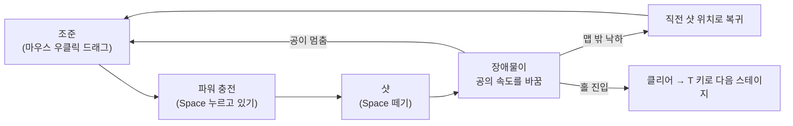

| 입력 | 결과 |
|---|---|
| 마우스 우클릭 드래그 | 공 중심으로 카메라 회전 (1픽셀 = 0.2°, 높이각 15~60°) |
| 마우스 휠 | 카메라 거리 1~10 m |
| `Space` 누름 → 뗌 | 파워 게이지가 1초 동안 0→100%, 다음 1초 동안 100→0%로 왕복, 떼는 순간 0~10 m/s로 샷 |
| `T` | (클리어 후) 다음 스테이지 |
| `R` / `1`~`5` | (테스트용) 직전 위치로 복귀 / 해당 스테이지로 이동 |

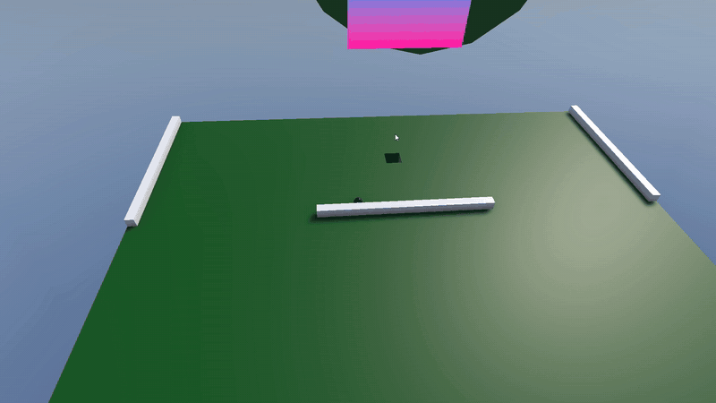

*Space를 누르는 동안 공 위에 파워 %가 표시되고, 떼는 순간 샷이 나갑니다(Stage-3 홀 앞)*

### 1.5 개발 환경

- **Engine**: Unity 6 (6000.3.15f1), URP 17.3, Input System 1.19, ProBuilder 6.0, TextMeshPro
- **기간**: 2026.10.01 ~ 2026.10.08 (8일, 커밋 12회) · 개인 과제
- **사용 에셋**: GolfAssets(십자 범퍼 프리팹, 회전 스크립트), 배경음 *Need U 2 B Complete* (Caine1989, CC BY-NC-SA 3.0)

**링크**: GitHub <https://github.com/KooHoo-Dev/3rd-minigolf_level_design-wjsdudgh99> · 시연 영상 <https://youtu.be/fMMJUNj-5iE> · 쇼츠 <https://youtube.com/shorts/KA6crrICaUU>

---

## 2. 시스템 구조

### 2.1 아키텍처 흐름

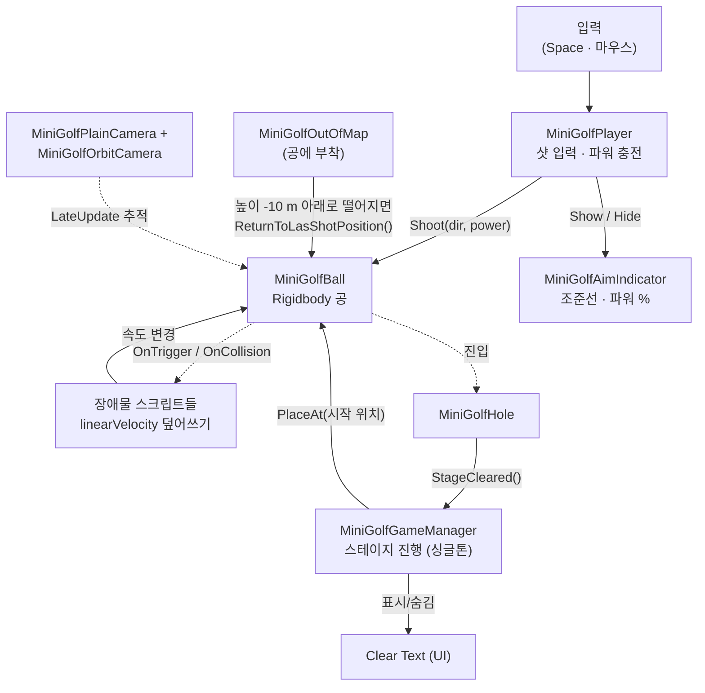

**읽는 법**: 실선은 "명령(메서드 호출)", 점선은 "감지(물리 이벤트·추적)"입니다.
핵심은 **장애물이 서로를, 그리고 매니저를 전혀 모른다**는 점입니다. 장애물은 `Player` 태그를 가진
Rigidbody가 닿으면 **속도만 바꾸고 끝**이므로, 프리팹을 씬 어디에 몇 개를 놓아도 추가 연결 작업이 없습니다.
덕분에 Stage-4에만 방향 점프 패드 27개, Stage-5에 고정 속도 범퍼 26개를 배치할 수 있었습니다.

### 2.2 핵심 클래스 역할 분담

| 클래스 | 책임 | 하지 않는 일 | 비고 |
|---|---|---|---|
| `MiniGolfBall` | 샷 적용(`FixedUpdate`), 정지 판정, 순간이동 | 입력 처리 | 수업 제공 |
| `MiniGolfPlayer` | Space 충전 → 샷, 피드백 갱신 | 물리 계산 | 제공 + **클리어 중 샷 잠금** 추가 |
| `MiniGolfAimIndicator` | 조준선 길이, 파워 % 텍스트 | 입력 판단 | 제공 + **% 텍스트** 추가 |
| `MiniGolfGameManager` | 현재 스테이지, 클리어 상태, 스테이지 이동 | 공 물리 | **신규** |
| `MiniGolfHole` | 홀 진입 감지 → 매니저에 알림 | 진행 로직 | **신규** |
| `MiniGolfOutOfMap` | 낙하 감지 → 직전 위치 복귀 | — | **신규** |
| 장애물 스크립트 7종 | 공의 속도·장애물 자체의 위치/회전 변경 | 게임 상태 | **신규 6종** + 에셋 재사용 1종 (3절) |

---

## 3. 기능 1: 장애물 — 공의 속도를 바꾸는 방식

### 3.1 핵심 동작: 장애물이 공의 속도를 바꾸는 방식

모든 장애물을 **"들어온 속도(방향·속력) 중 무엇을 남기고 무엇을 버리는가"** 라는 한 가지 기준으로 정리했습니다.

| 장애물 (프리팹) | 스크립트 / 재질 | 적용 공식 | 입사 방향 | 입사 속력 | 설정값 |
|---|---|---|---|---|---|
| 방향 부스터 (`Boost Pad Speed 1~3`) | `MiniGolfBoostPad` | **v = 패드 정면 × s** | 버림 | 버림 | s = 10 / 15 / 20 m/s |
| 360 부스터 (`Boost Pad 360 Speed 1~3`) | `MiniGolfDirectionBoostPad` | **v = 입사 방향 × s** | 유지 | 버림 | s = 10 / 15 / 20 m/s |
| 방향 점프 패드 | `MiniGolfDirectionJumpPad` | **v = 정면 × 5 + 위 × 7** | 버림 | 버림 | 5 / 7 m/s |
| 360 점프 패드 | `MiniGolf360JumpPad` | **v += 패드 위쪽 × 7** | 유지 | 유지 | 7 m/s |
| 고정 속도 범퍼 (`Speed 7 Box/Capsule`) | `FixedSpeedBumper` | **v = 반사 방향 × 7** | 반사 | 버림 | 7 m/s |
| 튕김 벽 (`Yellow Capsule`, `Bounce Box`) | `PM_Yellow` | 탄성 1, Combine **Maximum** | 반사 | 유지 | — |
| 흡수 벽 (`Purple Box`) | `PM_Pupple` | 탄성 0.1, Combine **Multiply** | 반사 | 크게 감소 | — |
| 얼음 바닥 (Stage-5 `Donut` 1개) | `PM_Friction Ice Road` | 마찰 0.01 **Minimum**, 탄성 1 | — | 거의 유지 | — |

> **Combine 모드를 고른 이유** — 공(`PM_Ball 1`)은 탄성 1·마찰 0.4·**Average** 입니다. Unity는 두 재질의 Combine 모드가 다르면
> 우선순위가 높은 쪽(Average < Minimum < Multiply < Maximum)을 쓰므로, 장애물 쪽 모드가 항상 이깁니다.
> 그래서 튕김 벽은 Maximum으로 **max(1, 1) = 1**, 흡수 벽은 Multiply로 **0.1 × 1 = 0.1**,
> 얼음은 Minimum으로 **min(0.01, 0.4) = 0.01** 이 확정적으로 적용됩니다.

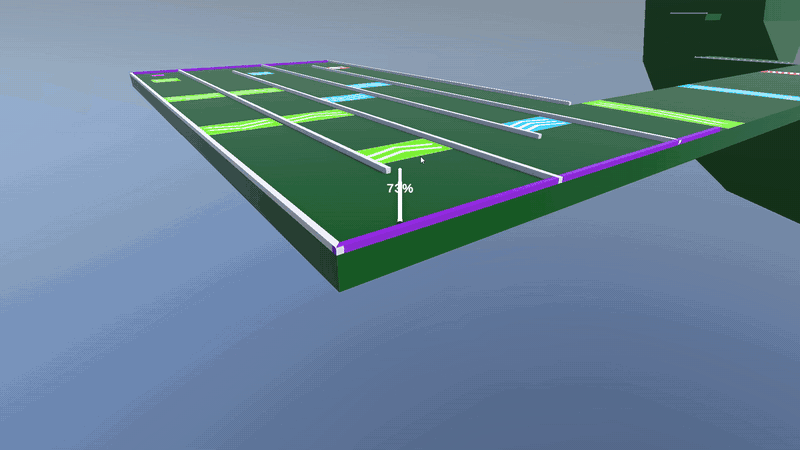

*Stage-4 — 여러 줄의 레인에 부스터 패드가 놓인 구간*

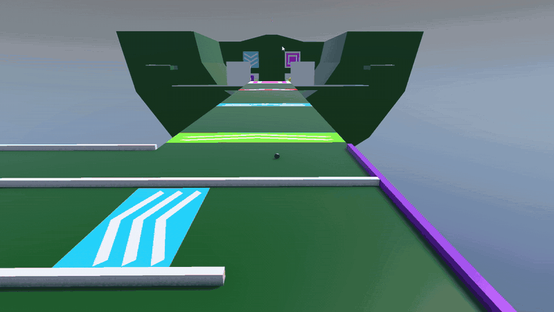

*Stage-4 — 부스터를 연달아 밟고 분홍 패드를 지나 터널 안으로 들어가는 구간*

**코드 — "버릴 것"만 다른 네 개의 트리거**

```csharp
// 공통: OnTriggerEnter에서 tag == "Player"인 Rigidbody만 처리 (공 = ballRb)

// ① 방향 부스터 — 방향·속력 모두 버림: 어디서 들어오든 같은 곳으로 나간다
ballRb.linearVelocity = transform.forward * boostSpeed;

// ② 360 부스터 — 방향은 유지, 속력만 고정: 플레이어의 조준이 의미를 가진다
Vector3 dir = ballRb.linearVelocity.normalized;
if (dir == Vector3.zero) dir = transform.forward;   // (방어) 정지한 공이 닿으면 0벡터 → 패드 정면
ballRb.linearVelocity = dir * boostSpeed;

// ③ 방향 점프 — 궤적 자체를 고정: 착지점을 레벨에서 설계할 수 있다
ballRb.linearVelocity = transform.forward * forwardSpeed + Vector3.up * upwardSpeed;

// ④ 360 점프 — 유일하게 '더하기': 수평 속도(=플레이어 샷)는 그대로, 위로만 튀긴다
ballRb.AddForce(transform.up * jumpForce, ForceMode.VelocityChange);
```

**(Why) 방향 점프 패드의 착지점 계산** — 정면 5 m/s, 위 7 m/s로 고정했기 때문에 궤적을 미리 계산할 수 있습니다.
최고 높이 = 7² / (2 × 9.81) ≈ **2.5 m**, 체공 시간 ≈ **1.43 초**, 수평 거리 ≈ **7.1 m**(감쇠 무시 이론값).
실제로는 공의 `LinearDamping 0.5` 때문에 이보다 짧으므로, 착지 발판은 플레이 테스트로 위치를 맞췄습니다.

**고정 속도 범퍼** 는 `OnCollisionEnter`에서 동작합니다. 이 시점의 `linearVelocity`는 물리 엔진이 이미 반사를 계산한 뒤의 값이므로,
**반사 방향은 엔진에 맡기고 속력만 7 m/s로 정규화**합니다. 너무 느리게 닿아 방향이 0이면 접촉면 법선(`contacts[0].normal`)으로 튕깁니다.

### 3.2 움직이는 장애물

| 장애물 | 스크립트 | 동작 | 배치값 |
|---|---|---|---|
| 왕복 벽 (Stage-3 `Holl Road` 내부 벽 2개) | `MiniGolfMovingObstacle` | `MoveTowards`로 시작↔끝 왕복 | z축 ±1~2 m, 1~2 m/s |
| 왕복 캡슐·박스 (Stage-4) | 〃 | 끝에서 대기 옵션 | z축 1~2 m, 일부 2초 대기 |
| 엘리베이터 ×2 (Stage-4) | 〃 | 위로 6.75 m 이동 후 **3초 대기** | y축 6.75 m, 2 m/s |
| 풍차 날개 ×3 (Stage-3) | `MiniGolfRotateObject` (GolfAssets 재사용) | x축 회전 | **60 → 90 → 120 °/s** |
| 회전 벽 ×2, 회전 점프 패드 (Stage-5) | 〃 | y축 회전 | 10 / 15 °/s |

`MiniGolfMovingObstacle`은 `enablePause` 하나로 "계속 왕복"과 "끝에서 멈춤"을 바꿀 수 있어,
같은 스크립트로 **타이밍 장애물**(왕복 벽)과 **탑승물**(엘리베이터: 공이 올라탈 시간을 3초 확보)을 모두 만들었습니다.

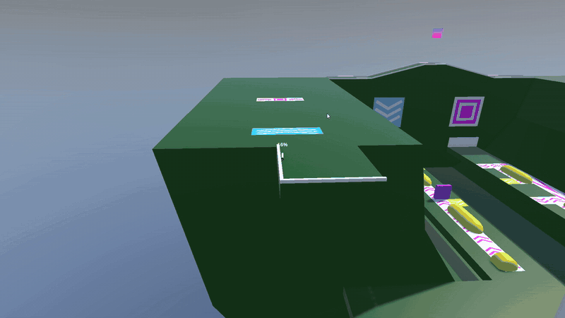

*엘리베이터 위 발판을 잘못 밟아 맵 밖으로 떨어진 공이 직전 샷 위치로 돌아오는 장면(`MiniGolfOutOfMap`)*

### 3.3 고민과 선택: 더하기 vs 덮어쓰기

**당시의 선택** — 장애물이 공의 속도를 덮어쓰는 방식을 누가 먼저 정했는지는 기억이 정확하지 않습니다(1.3).
아래는 **지금 돌아본 비교**입니다.

> **결정 대상**: 부스터·점프 패드가 공에 힘을 줄 때, 기존 속도에 **더할 것인가**, **덮어쓸 것인가**?

**[대안 A] `AddForce`로 더하기**
- (+) 물리적으로 자연스럽고, 플레이어가 친 힘이 끝까지 결과에 반영됨
- (−) 결과가 **입사 속도에 따라 매번 달라짐** → 점프 뒤 착지점, 부스터 뒤 도착점을 레벨에서 설계할 수 없음
- (−) 세게 친 공 + 부스터 = 예측 못 한 과속 → 맵 이탈이 "실력"이 아니라 "운"이 됨

**[대안 B] `linearVelocity =` 로 덮어쓰기**
- (+) 결과가 **항상 같음** → 레벨 디자이너가 착지점·도착점을 정확히 배치 가능, 플레이어는 한 번 보면 학습 가능
- (−) 패드를 밟는 순간 플레이어의 샷 파워가 무의미해짐 → 조작의 재미가 줄어듦
- (−) 물리적으로 부자연스러운 급정지·급가속

**[결과] 기본은 B(덮어쓰기)이고, "무엇을 남길지"는 장애물마다 다릅니다.**
작업지시서의 "보고 나면 풀 수 있어야 한다"는 공정성 기준을 지키려면 결과가 고정되어야 했기 때문입니다.
B의 대가인 "플레이어 조작이 무의미해짐"은, **남기는 성분을 다르게 한 변형**으로 상쇄됩니다.

- 360 부스터: 속력만 고정하고 **방향은 플레이어 것**을 남김 → 조준이 여전히 중요
- 360 점프: 유일하게 A(더하기)를 써서 **수평 속도 전체를 플레이어 것**으로 남김 → 파워 조절이 여전히 중요

→ 결과적으로 "완전 고정(방향 부스터·방향 점프)"부터 "플레이어 의존(360 점프)"까지 **결정성의 단계**가 생겼고,
이것이 곧 난이도 손잡이가 되었습니다.

### 3.4 고민과 선택: 튕기는 장애물 — 물리 재질 vs 스크립트

**당시의 선택** — 두 장애물이 서로 다르게 튕기는 것을 보고, 둘 다 쓰고 핀볼 구간에 섞기로 제가 정했습니다.
튕김 재질(`PM_Yellow`)은 10-05 커밋 「공 팅기기 매테리얼 제작」에서 직접 만들었고, 고정 속도 범퍼 스크립트는 AI로 받았습니다.

> **결정 대상**: "튕겨 내는 벽"을 물리 재질로 만들 것인가, 스크립트로 만들 것인가?

| | **[A] 물리 재질** (`PM_Yellow`, 탄성 1) | **[B] 스크립트** (`FixedSpeedBumper`, 7 m/s) |
|---|---|---|
| 구현 | 코드 0줄, 재질만 교체 | `OnCollisionEnter` 스크립트 필요 |
| 결과 | 세게 치면 세게, 약하게 치면 약하게 튕김 | 어떻게 쳐도 **항상 7 m/s** |
| 플레이어에게 던지는 질문 | "얼마나 세게 칠래?" | "어느 각도로 맞힐래?" |

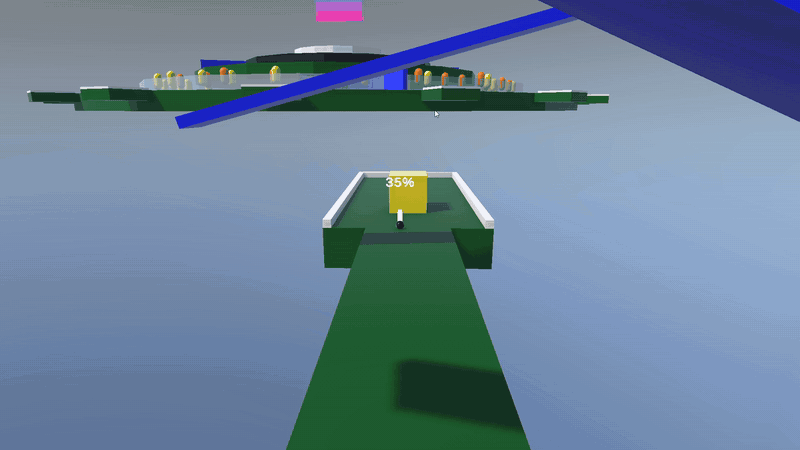

*Stage-3 — 노란 튕김 박스(A, 들어온 속도만큼 튕김) 다음 주황 고정 속도 범퍼(B, 항상 7 m/s로 튕김)*

**[결정] 둘 다 남겼습니다.** 하나가 다른 하나를 대체하는 게 아니라 **다른 질문**을 던지기 때문입니다.
특히 Stage-5처럼 범퍼가 수십 개 모인 핀볼 구간에서는 A만 쓰면 속도가 누적되어 공이 통제 불능이 되므로,
**B(고정 속도 범퍼 26개)로 상한을 두고 A(튕김 캡슐 28개)를 섞어** 혼란스럽지만 예측 가능한 구간을 만들었습니다.

---

## 4. 기능 2: 레벨 구성과 스테이지 진행

### 4.1 구조: 한 씬, 다섯 스테이지

스테이지 5개는 하나의 씬(`Need U 2 B Complete.unity`)에 `Stage-1` ~ `Stage-5` 오브젝트로 나란히 놓여 있고,
`MiniGolfGameManager.stageStartPositions[5]`가 각 스테이지의 시작 지점을 가리킵니다.
스테이지 이동 = **공을 다음 시작 지점으로 순간이동**하는 것입니다. (선택 이유는 [4.4](#44-고민과-선택-스테이지-관리--씬-5개-vs-한-씬--시작-지점-배열))

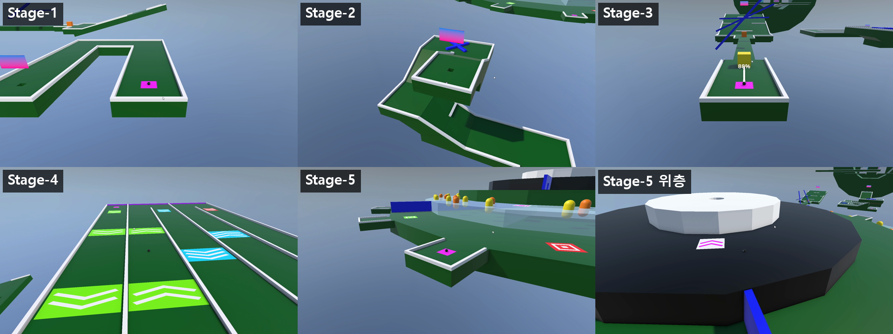

*스테이지 1~5의 플레이 화면(Stage-5는 아래층 핀볼 구간과 위층 원형 무대 두 장)*

### 4.2 레벨 구성 — 장애물이 처음 등장하는 순서

| 스테이지 | 역할 | 처음 등장하는 것 | 다시 쓰이는 것 | 돌린 손잡이 (작업지시서 4절) |
|---|---|---|---|---|
| **Stage-1** | 소개 | 기본 레인, 홀 | — | 없음 (조작 학습) |
| **Stage-2** | 응용 | 삼각 벽 ×6, 낮은 벽, 런웨이 벽, 십자 범퍼 | 레인 | **조준 정밀도** (꺾어 치기) |
| **Stage-3** | 응용 | 튕김 박스, 고정 속도 범퍼, 풍차 ×3, 왕복 벽 ×2 | 낮은 벽 | **타이밍 창** — 풍차 속도를 60→90→120 °/s로 한 스테이지 안에서 단계적으로 올림 |
| **Stage-4** | 심화 | 방향 부스터 ×19, 방향 점프 ×27, 360 점프 ×7, 흡수 벽, 엘리베이터 ×2, 아치 | 삼각 벽, 튕김 캡슐(왕복) | **겹침** — 부스터·점프 패드 53개를 한 스테이지에 연달아 배치 |
| **Stage-5** | 심화 | 360 부스터 ×6, 얼음 바닥, 회전 벽 | 고정 속도 범퍼 ×26, 튕김 캡슐 ×28, 점프 패드 | **겹침** — 범퍼·회전 벽·부스터가 동시에 (핀볼 구간) |

### 4.3 사용법: 스테이지 진행

외부에서 알아야 할 API는 두 개뿐입니다.

```csharp
MiniGolfGameManager.Instance.StageCleared();   // 홀에서 호출: 클리어 처리 + 안내 문구 표시
MiniGolfGameManager.Instance.GoToStage(index); // 0~4: 해당 스테이지 시작 지점으로 공 이동
```

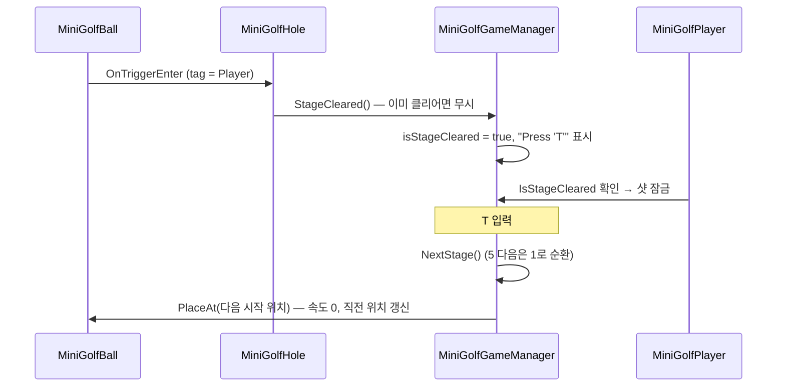

**방어 처리** — `MiniGolfHole`은 `!IsStageCleared`일 때만 신호를 보내므로, 공이 홀 안에서
트리거를 여러 번 드나들어도 클리어가 중복 처리되지 않습니다. `GoToStage`는 인덱스 범위를 검사합니다.

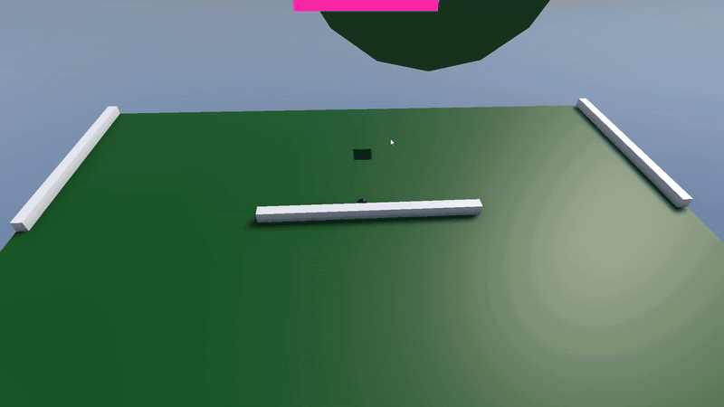

*공이 홀에 들어가면 `Press 'T' to Next Stage`가 뜨고, T를 누르면 다음 스테이지 시작 지점으로 이동합니다*

### 4.4 고민과 선택: 스테이지 관리 — 씬 5개 vs 한 씬 + 시작 지점 배열

**당시의 선택** — 스테이지 4·5를 만들 때(10-06 커밋 `1df0b73`), 반복 테스트가 편하도록 한 씬에 모으기로 제가 정했습니다.

**[대안 A] 스테이지마다 씬 분리 + `SceneManager.LoadScene`**
- (+) 씬 파일이 작아 관리·협업이 쉬움, 지금 플레이하지 않는 스테이지는 메모리에 없음
- (−) 공·카메라·UI·매니저를 씬마다 두거나 `DontDestroyOnLoad` 관리 필요, 전환 시 로딩

**[대안 B] 한 씬에 모두 배치 + 시작 지점 `Transform[]`으로 순간이동**
- (+) 공·카메라·UI가 **한 벌**, 스테이지 이동 = `ball.PlaceAt()` 한 줄, 로딩 없음
- (+) 테스트 단축키(`1`~`5`)로 **즉시 이동**해 반복 플레이 테스트가 빠름
- (−) 씬 파일 비대 (약 4.1만 줄) → Git 병합 충돌에 취약
- (−) 보이지 않는 스테이지의 장애물도 계속 `Update`

**[결정] B를 택했습니다.** 초기에는 `Stage-1.unity`에서 시작했지만, 스테이지 4·5를 만드는 시점(커밋 `1df0b73`)에
한 씬으로 합쳤습니다. 이 과제는 **8일 안에 배치 → 플레이 → 수정을 최대한 많이 반복하는 것**이 중요했고,
1인 작업이라 병합 충돌 위험이 낮았기 때문입니다. 성능 비용은 장애물 수백 개 규모에서는 감수할 수준으로 판단했습니다.

### 4.5 고민과 선택: 다음 스테이지 키 — Space vs T

**당시의 선택** — "키 하나에 기능 두 가지를 넣지 않는다"는 것은 첫 프로젝트 때부터 가지고 있던 원칙이라,
진행 키를 샷 키(`Space`)와 따로 두었습니다.

샷 충전 키가 `Space`이므로, 클리어 후 진행 키도 `Space`로 하면 **"다음 스테이지로 넘어가자마자 충전이 시작되는"** 입력 충돌이 생깁니다.
그래서 진행 키를 `T`로 분리하고, 동시에 `MiniGolfPlayer`의 샷 조건에 `!IsStageCleared`를 추가해 **클리어 화면에서는 샷 자체를 잠갔습니다.**
대가는 키가 하나 늘어난 것인데, 클리어 문구에 `Press 'T' to Next Stage`를 띄워 학습 비용을 줄였습니다.

### 4.6 고민과 선택: 홀 → 매니저 알림 — 싱글톤 직접 호출 vs 이벤트

**당시의 선택** — 학원에서 배운 싱글톤 방식으로 만들었습니다. 이벤트와 비교해서 고른 것은 아닙니다.

이벤트(관찰자 패턴)를 쓰면 `MiniGolfHole`이 매니저를 몰라도 되지만, 현재 클리어 결과를 듣는 곳은 **매니저 하나뿐**입니다.
돌아보면 듣는 곳이 하나인데 이벤트를 도입하는 것은 과한 설계였을 것입니다.
대가로 `MiniGolfHole`과 `MiniGolfPlayer`가 `MiniGolfGameManager.Instance`에 의존하므로, 매니저 없는 테스트 씬에서는
`MiniGolfPlayer`가 동작하지 않습니다. 사운드·연출·기록처럼 클리어를 듣는 곳이 늘어나면 `OnStageCleared` 이벤트로 바꿀 계획입니다.

---

## 5. 결과 및 배운 점

### 5.1 결과

| 항목 | 결과 |
|---|---|
| 새 장애물 | 과제 기준 **3종 이상** → 스크립트 장애물 **7종**(새로 만든 6 + 에셋 재사용 1) + 물리 재질 장애물 **3종** |
| 코스 | 과제 기준 **3홀** → **5개 스테이지** |
| 레벨 제작 단위 | 프리팹 **24종**, 씬 배치 인스턴스 약 **400개** — 장애물이 서로·매니저를 몰라 **배치 시 연결 작업 0건** |
| 장애물 튜닝 | 부스터는 속도별 프리팹 3단(10/15/20 m/s)으로 나눠, 인스펙터 수정 없이 **프리팹 교체만으로 난이도 조절** |
| 기본 코드 수정 | 제공 코드 3개(Player·AimIndicator·BallTester)만 최소 수정, 나머지는 새 컴포넌트로 추가 |

### 5.2 문제 해결 경험 (Troubleshooting)

아래 세 문제는 모두 플레이 테스트 중 제가 직접 발견했고, 어떤 상황에서만 생기는지 **조건을 좁혀** AI에게 알렸습니다.
원인을 찾고 고친 것은 AI입니다. 이 프로젝트는 커밋이 11개뿐이고 고친 코드 대부분이 마지막 커밋(10-08 `bf1b9c4`)에 함께 들어 있어서,
버그마다 고친 시점을 커밋으로 나눠 보지는 못했습니다.

**① 클리어 화면에서 공을 또 칠 수 있음**
- **(발견)** 클리어한 뒤에도 Space를 누르면 공이 쳐져서, 홀에 들어간 공이 다시 나가는 것을 확인해 알렸습니다.
- **(문제)** 홀에 들어간 뒤에도 Space로 샷이 가능해, 클리어 상태에서 공이 홀 밖으로 나가 버림
- **(원인)** 제공 코드의 샷 조건이 `ball.IsStopped` 하나뿐이라 게임 상태를 몰랐음
- **(해결)** 샷 조건을 `ball.IsStopped && !IsStageCleared`로 확장하고, 진행 키를 Space와 겹치지 않는 `T`로 분리 (4.5)
- **(결과)** 클리어 화면에서는 샷이 잠기고, `T`를 눌러야 다음 스테이지로 넘어갑니다.

**② 360 부스터에 멈춰 있는 공이 닿으면 공이 날아가지 않음**
- **(발견)** 공이 거의 멈춘 채로 360 부스터에 올라갔을 때만 날아가지 않는다는 것을 확인해 알렸습니다.
- **(문제)** 입사 방향을 유지하는 부스터인데, 공이 거의 정지 상태로 패드에 올라오면 반응이 없음
- **(원인)** 속도 0인 벡터의 `normalized`는 `Vector3.zero` → `0 × 20 = 0`
- **(해결)** 방향이 0이면 패드 정면(`transform.forward`)으로 대체하는 안전장치 추가. 고정 속도 범퍼에도 같은 원리로 접촉면 법선을 대체값으로 사용
- **(결과)** 멈춘 공이 올라와도 패드 정면으로 날아갑니다.

**③ 파워 0%인데도 "0%" 글자가 떠 있음**
- **(발견)** 공이 멈춰 있기만 하면 "0%"가 계속 떠 있는 것을 보고 알렸습니다.
- **(문제)** 파워 % 텍스트를 추가하자, 공이 멈춰 있기만 하면 "0%"가 항상 표시되어 화면이 지저분함
- **(해결)** `power01 > 0.01`일 때만 표시하도록 조건을 추가해, **Space를 누르는 동안만** 피드백이 보이게 함
- **(결과)** 공이 멈춰 있을 때는 글자가 사라지고, Space를 누르는 동안만 보입니다.

### 5.3 아쉬운 점 (기술 부채) 및 향후 계획

**만들고 돌아보며 느낀 점**

- **새 장애물을 심화 스테이지에서 처음 보여 줌** — 짧은 기간 안에 많은 장애물을 보여 주고 싶어서,
  부스터·점프 패드(Stage-4)와 360 부스터·얼음 바닥·회전 벽(Stage-5)을 심화 스테이지에서 처음 등장시켰습니다.
  작업지시서의 "처음 보는 것을 위험한 곳에서 만나게 하지 않는다"는 원칙과 어긋납니다.
  다음에는 장애물 수를 줄이더라도 소개 구간을 먼저 두겠습니다.
- **타수·벌타를 뒤로 미룸** — 레벨 배치가 먼저라고 보고 타수·기준 타수(Par)·낙하 벌타를 우선순위에서 뒤로 미뤘고,
  끝내 넣지 못했습니다. 그래서 스테이지 난이도를 숫자로 비교할 수 없습니다.

**코드에서 찾은 개선점** — AI와 함께 코드를 다시 읽으며 정리

| 아쉬운 점 | 영향 | 고치는 방법(제안) |
|---|---|---|
| **움직이는 장애물이 `transform`을 직접 이동** (Rigidbody 없음) | 물리 엔진이 이동을 "순간이동"으로 처리 → 엘리베이터·왕복 벽과의 충돌이 부정확할 수 있음 | Kinematic Rigidbody + `FixedUpdate`에서 `MovePosition` / `MoveRotation` |
| **파일명–클래스명 불일치** — `MiniGolfSuperBumper.cs` 안의 클래스가 `FixedSpeedBumper` | Unity는 MonoBehaviour 파일명과 클래스명이 같아야 컴포넌트를 안정적으로 로드 → 범퍼 프리팹 27개가 영향 범위 | 클래스명을 `MiniGolfSuperBumper`로 통일 후 프리팹 동작 재확인 |
| **하드코딩된 값** — `NextStage()`의 `5`, 낙하 기준 `y < -10` 고정 | 스테이지 추가 시 코드 수정 필요, 높이가 다른 스테이지에서 복귀 판정 시점이 달라짐 | `stageStartPositions.Length` 사용, 스테이지별 낙하 높이 또는 킬 트리거 |
| **장애물 트리거마다 `Debug.Log`**, 프리팹 이름 오타(`Holl`·`Junp`·`Load`·`Pupple`) | 빌드 성능·검색성 저하 | 로그 제거(또는 조건부), 이름 정리 |

### 5.4 배운 점

- **키 하나에 기능 하나** — 샷 키(`Space`)와 다음 스테이지 키를 나누는 것은 첫 프로젝트부터 가지고 있던 원칙입니다(4.5).
  클리어 뒤에도 Space로 공이 쳐지는 버그(5.2 ①)를 보면서, 키와 상태가 겹치면 바로 버그가 된다는 것을 다시 확인했습니다.
- **값만 바꿔 난이도 만들기** — 풍차를 60 → 90 → 120 °/s로, 부스터를 10/15/20 m/s 프리팹으로 나눠
  새 코드 없이 인스펙터 값만으로 난이도를 올렸습니다. 코드를 혼자 짜지 못해도 값을 맞추는 것으로 레벨 디자인을 할 수 있었습니다.
- **한 씬에 모아 빨리 테스트하기** — 스테이지를 한 씬에 모으고 `1`~`5` 키로 바로 이동하게 해서,
  배치 → 플레이 → 수정을 짧은 시간에 여러 번 반복할 수 있었습니다(4.4).

---

## 부록. 파일 위치

| 구분 | 경로 |
|---|---|
| 씬 | `Assets/101. MiniGolfGame/Need U 2 B Complete.unity` |
| 스크립트 | `Assets/101. MiniGolfGame/Scripts/` |
| 프리팹 | `Assets/101. MiniGolfGame/Prefabs/` |
| 물리 재질 | `Assets/101. MiniGolfGame/Physics Materials/` |
| 과제 작업지시서 | `Assets/01. Docs/06. Mini Golf 과제 작업지시서.md` |
